# Clase AAA – Lunes 19 de octubre de 2026 · 6:00 a 8:00 pm

## Descargar automáticamente los datos de 4 fuentes reales y guardarlos sin modificar

**Proyecto Integrado IV – Integración de Información (PREICA2602B020037)** · Docente: Carlos Arturo Castro Castro
**Semana 2 del reto** *Observatorio Energía y Clima* · Prepara la **Evidencia 1** (vence el domingo 25 de octubre)

### ¿De qué trata esta clase?

Hoy construimos un programa en Python que **descarga solo, con un comando, los datos que necesita el proyecto** desde cuatro fuentes reales: el mercado de energía (XM), el clima (IDEAM), el fenómeno de El Niño (NOAA) y un Excel interno de la empresa. Los datos se guardan **tal como llegan**, sin corregirlos, para tener siempre el original. Tres palabras que se repiten en toda la clase:

| Término | En palabras sencillas |
|---|---|
| **Extracción** | Sacar los datos de su fuente original (una página web, una API, un archivo) y traerlos a nuestro computador. Es la **E** de ETL. |
| **Pipeline** | Una "tubería" de pasos **automáticos** por la que pasan los datos: entran crudos por un lado y salen listos para analizar por el otro. Hoy construimos el **primer tramo**: la extracción. |
| **Capa bronce** | La carpeta donde se guardan los datos **recién descargados, sin limpiar**, junto con la anotación de dónde vinieron y cuándo. Es el primer "piso" del proyecto; en las semanas siguientes vendrán la capa **plata** (datos limpios) y la **oro** (datos listos para el dashboard). En BI clásico se le llama *staging area*. |

> **Resultado de la clase:** cada estudiante termina con un proyecto que, con **un solo comando**, descarga las 4 fuentes y las guarda en la carpeta `data/bronze/` en formato **Parquet** (un formato de archivo para datos, mucho más liviano y rápido que Excel o CSV), más dos consultas SQL de inteligencia de negocios sobre esos datos.

> **Cómo está organizada esta guía:** la clase se divide en **8 partes**, numeradas del 0 al 7, cada una con su hora (ver el *Mapa de la clase*, a continuación). Cada parte empieza con una sección de **Conceptos clave** que explica los términos nuevos, y luego trae el código, el comando para ejecutarlo y el resultado esperado. Los tres términos de la tabla anterior se explican con más detalle en el **Parte 1 · Contexto**, la primera parte conceptual de la clase.

> ✅ **Todo este paso a paso se probó el 18 de octubre de 2026 en Windows 11 con Python 3.14 y las APIs reales.** Las salidas que aparecen aquí son las reales. El proyecto completo y funcionando está en la carpeta `observatorio-energia/`, al lado de este archivo.

---

## Mapa de la clase

> Los términos técnicos de esta tabla (medallion, SoQL, Parquet, DuckDB…) se explican en la sección **"Conceptos clave"** de cada parte y en el **glosario** al final de este documento.

| Hora | Parte de la clase | Concepto clave | Comando que lo demuestra |
|---|---|---|---|
| 6:00 – 6:15 | 0. Preparar el computador **(en paralelo con la Parte 1)** | Herramientas instaladas e identidad en Git | `python --version`, `git --version` |
| 6:00 – 6:15 | 1. Contexto (mientras algunos terminan la Parte 0) | Medallion: bronce, plata y oro | — |
| 6:15 – 6:30 | 2. El proyecto | Reproducibilidad, configuración central, reintentos, idempotencia, linaje | `pip install -r requirements.txt` |
| 6:30 – 6:55 | 3. API REST de XM | POST + JSON, ventanas de 30 días | `python -m src.extract.xm` |
| 6:55 – 7:20 | 4. Datos abiertos IDEAM | SoQL: filtrar y agregar en el servidor, paginación | `python -m src.extract.ideam` |
| 7:20 – 7:35 | 5. Archivos planos | TXT de NOAA y Excel "sucio" guardados tal cual | `python -m src.extract.noaa` |
| 7:35 – 7:45 | 6. Orquestar y consultar | Un solo punto de entrada + SQL sobre Parquet con DuckDB | `python -m src.pipeline` |
| 7:45 – 8:00 | 7. Equipo y Evidencia 1 | Repositorio en GitHub, ramas, Pull Request y merge | `git init` → `git push` → PR → merge → `git pull` |


## Resumen de los pasos

Vista rápida de **todo lo que se hace en clase**, en orden. Cada paso está explicado en detalle en la sección indicada (columna **Sección**).

| # | Sección | Qué se hace | ¿Para qué? | Resultado esperado | Qué significa el resultado |
|---|---|---|---|---|---|
| 1 | 0.1 – 0.3 | Instalar **Python** (marcando *Add python.exe to PATH*), **Git** y **VS Code** con la extensión de Python. | Tener las herramientas del curso. | Los 3 programas instalados. | El computador está listo para trabajar. |
| 2 | 0.4 | `git config --global user.name "..."` y `git config --global user.email "..."` | Que cada commit quede **a nombre** del estudiante. | Sin mensaje. | Sin mensaje = sin error: la identidad quedó guardada. |
| 3 | 0.5 | `python --version` y `git --version` | Comprobar que las instalaciones funcionan. | `Python 3.14.0` y `git version 2.55.0` (o versiones parecidas). | Los programas están instalados y Windows los encuentra (PATH). |
| 4 | 2.1 | Descargar la carpeta `observatorio-energia` de Drive y **Extraer todo** en `C:\clases`. | Tener el código base del proyecto. | Carpeta con `consultas`, `data`, `src`, `.gitignore`, `README.md` y `requirements.txt`. | El proyecto está completo en el computador. |
| 5 | 2.1 | Abrir la carpeta en VS Code y aceptar **Yes, I trust the authors**. | Editar el código y usar la terminal integrada. | El EXPLORER muestra las carpetas del proyecto. | VS Code trabaja sobre el proyecto, sin modo restringido. |
| 6 | 2.3 | `python -m venv .venv` y `.\.venv\Scripts\Activate.ps1` | Crear un **entorno aislado** para las librerías del proyecto. | El prompt empieza con `(.venv)`. | El entorno virtual está activo. Si sale "la ejecución de scripts está deshabilitada", ver 2.3. |
| 7 | 2.3 | `pip install -r requirements.txt` | Instalar las librerías del proyecto. | `Successfully installed ...` con 14 paquetes. | Las 5 librerías pedidas y sus 9 dependencias quedaron instaladas en `.venv`. |
| 8 | 2.3 | `python -c "import requests, pandas, pyarrow, openpyxl, duckdb; print('OK')"` | Verificar que las librerías cargan. | `OK` | Todo está listo para ejecutar el proyecto. |
| 9 | 3.1 | Consultar la API de XM desde PowerShell con `Invoke-RestMethod` (método POST). | Ver **cómo responde** una API antes de programar. | Un JSON con `Items` y valores como `0.79510`. | La API funciona: el 1 de enero los embalses estaban al **79,51 %**. |
| 10 | 3.3 | `python -m src.extract.xm` | Descargar **273 días** de precio, demanda y embalses. | 30 líneas de ventanas y 3 líneas `+ ... guardado: 273 filas`. | Se hicieron 30 peticiones de máximo 30 días; quedaron 3 archivos en bronce. |
| 11 | 3.3 | Ejecutar **otra vez** `python -m src.extract.xm` | Comprobar la **idempotencia**. | 3 líneas `= ... ya existe; se omite`. | No se descarga dos veces lo mismo. |
| 12 | 3.4 | `python -c "import pandas as pd; ... .head(3)"` sobre `xm_precio_bolsa.parquet` | Ver qué quedó guardado en bronce. | 3 filas con `Date`, `Id`, `Hour01`, `Hour19`, `_fuente`, `_extraido_en`. | Los datos están tal cual llegaron, con su **linaje** (fuente y hora UTC de extracción). |
| 13 | 4.1 | Abrir en el navegador `https://www.datos.gov.co/resource/s54a-sgyg.json?$limit=2` | Conocer los **campos** del dataset del IDEAM. | 2 objetos JSON con 12 campos (`codigoestacion`, `fechaobservacion`, `valorobservado`…). | Cada fila es **una medición de minutos** en una estación; los valores vienen como texto. |
| 14 | 4.1 | `Invoke-RestMethod '...s54a-sgyg.json?$limit=2'` (comillas **simples**) | Hacer la misma consulta **con código**. | 2 bloques `campo : valor`. | Es la misma respuesta; el código permite **automatizar**. |
| 15 | 4.1 | Abrir en el **navegador** (no en la terminal) la URL con `$select`, `$where` y `$group`. | **Filtrar y agregar en el servidor**. | 5 filas con solo `nombreestacion`, `fecha` y `mm`. | La API sumó la lluvia de cada estación por día: viaja el resumen, no millones de filas. |
| 16 | 4.3 | `python -m src.extract.ideam` | Descargar la lluvia diaria de Antioquia, de junio a septiembre. | 18 líneas de semanas y `+ ideam_precipitacion_diaria.parquet guardado: 2,784 filas x 11 columnas`. | Desde el 27 de julio llegan **0 filas**: el IDEAM publica con unos 2,5 meses de rezago. |
| 17 | 5.0 | Abrir en el navegador `https://www.cpc.ncep.noaa.gov/data/indices/oni.ascii.txt` | **Mirar el archivo antes** de programar su lectura. | Columnas `SEAS YR TOTAL ANOM` desde 1950; la última fila es `JAS 2026 ... 2.16`. | Columnas separadas por espacios; hay un **El Niño fuerte** (+2,16). |
| 18 | 5.3 | `python -m src.extract.noaa` | Guardar el índice ONI en bronce. | `+ noaa_oni.parquet guardado: 920 filas x 7 columnas` | Las mismas 920 filas del archivo, más 3 columnas de linaje: extracción completa. |
| 19 | 5.4 | `python -m src.extract.enerandes` | Guardar el Excel interno, hoja por hoja. | 4 archivos: 1.114, 1.114, 1.117 y 839 filas. | Se guardaron títulos, encabezados y la fila `TOTAL` como filas: bronce no arregla nada. |
| 20 | 5.5 | `python -c "... df.iloc[:6, :7] ... df.iloc[-2:, :7]"` sobre la hoja 2025 | Ver los **problemas de calidad** del Excel. | Título, nota, fila vacía, encabezado en la fila 3 y `TOTAL` al final. | El archivo está "sucio": se limpiará en la capa plata. |
| 21 | 6.1 | `python -m src.pipeline` | **Orquestar** los 4 extractores con un solo comando. | 9 líneas `ya existe; se omite`, la tabla resumen y `Listo en 1 s`. | La capa bronce está completa (9 archivos, unos 336 KB) y el pipeline es idempotente. |
| 22 | 6.2 | `python -m src.consultar` | Consultar los Parquet con **SQL** (DuckDB). | Tabla de precio vs. embalses por mes y top 5 de horas más caras. | El precio pasó de 212 a 942 COP/kWh; la energía es más cara de 5 a 10 pm. |
| 23 | 7.1 | `git init` y `git status` | Convertir la carpeta en **repositorio**. | `Initialized empty Git repository` y una lista de *Untracked files*. | Git ya controla la carpeta; `.venv` y `data/bronze` no aparecen (`.gitignore` funciona). |
| 24 | 7.1 | `git add .` y `git status` | **Preparar** los archivos para el commit. | 16 líneas `new file:` (y advertencias LF/CRLF). | Todo listo para la "foto"; las advertencias se pueden ignorar. |
| 25 | 7.1 | `git commit -m "chore: codigo base de la clase"` y `git log --oneline` | Guardar la **primera foto** del proyecto. | `(root-commit) ...` · `16 files changed` y una línea en el historial. | Existe el primer commit, con su hash (distinto para cada uno). |
| 26 | 7.1 | En GitHub: **+ → New repository**, `observatorio-energia`, **Public**, sin marcar README. | Tener una copia en la nube para el equipo. | Página *Quick setup* con la URL del repositorio. | El repositorio remoto existe, vacío. |
| 27 | 7.1 | `git remote add origin <URL>`, `git branch -M main`, `git push -u origin main` | **Subir** el proyecto a GitHub. | `Writing objects: 100% (22/22)` y `* [new branch] main -> main`. | El código está en GitHub y la rama local quedó enlazada. |
| 28 | 7.1 | Recargar la página del repositorio (F5). | Comprobar que el código subió. | Carpetas `consultas`, `data/insumos`, `src` y el README como portada. | GitHub tiene la misma versión que el computador (mismo hash). |
| 29 | 7.1 | **Settings → Collaborators → Add people** | Dar permiso de escritura al equipo y al docente. | El invitado aparece como *Pending Invite*. | Falta que cada invitado **acepte** desde su correo. |
| 30 | 7.2 | `git switch -c docs/readme-integrantes` y `git branch` | Crear una **rama** para trabajar sin tocar `main`. | `* docs/readme-integrantes` y `main`. | Se está en la rama nueva; `main` queda intacta. |
| 31 | 7.2 | Editar la tabla de integrantes del `README.md`; luego `git status` y `git diff` | Hacer un cambio real y ver **qué líneas** cambiaron. | Una línea en rojo (`-`) y otra en verde (`+`). | Git detectó el cambio en la rama. |
| 32 | 7.2 | `git add README.md`, `git commit -m "docs: ..."`, `git push -u origin docs/readme-integrantes` | Subir la rama a GitHub. | `* [new branch]` y un enlace *Create a pull request*. | La rama existe en GitHub, lista para el PR. |
| 33 | 7.2 | **Compare & pull request** → descripción → **Create pull request** | **Solicitar** que el cambio entre a `main`. | PR `#1` con la etiqueta verde **Open** y *No conflicts*. | El cambio está listo para revisión. |
| 34 | 7.2 | **Merge pull request** → **Confirm merge** | **Unir** la rama a `main`. | Etiqueta morada **Merged** y un commit de merge. | El cambio ya está en `main` de GitHub. |
| 35 | 7.2 | **Delete branch** en GitHub; `git switch main`, `git pull` y `git log --oneline` | Traer el merge al computador. | `Fast-forward` y 3 commits en el historial. | `main` local y `main` de GitHub están sincronizados. |
| 36 | 7.2 | `git branch -d docs/readme-integrantes` y `git fetch --prune` | Limpiar la rama ya unida. | `Deleted branch ...` y `- [deleted] ... origin/docs/readme-integrantes`. | Solo queda `main`; los commits siguen en el historial. |

---

## Antes de la clase (para el docente)

1. **Requisitos en el computador:** Python 3.11 o superior, Git y VS Code. Para verificar, en PowerShell:

   ```powershell
   python --version
   git --version
   ```

2. **Ensayo:** abre la carpeta `observatorio-energia/` y ejecuta los pasos 2.3 y 6.1. El pipeline completo tarda **unos 3 minutos** (el IDEAM es el más lento).
3. **Material para los estudiantes:** ya está en la carpeta de Drive enlazada en la tarea de la EA1 (código base, Excel de EnerAndes y `FUENTES_URLS.md`).
4. **Plan B sin Internet:** si la red de la institución falla, comparte la carpeta `data/bronze/` ya descargada: con ella funcionan los partes 6 y 7.

---

## Parte 0 · Preparar el computador (6:00 – 6:15, en paralelo con la Parte 1)

> ⏱️ **Cómo manejarlo en clase sin perder tiempo:**
> 1. **6:00:** todos abren una terminal y ejecutan la verificación del paso 0.5.
> 2. Quien tenga todo, ya está listo. Quien no tenga algo, lo instala con los pasos 0.1 a 0.4 **mientras el docente explica la Parte 1**, que es conceptual y no requiere computador.
> 3. **6:15:** al terminar la Parte 1, todos tienen las herramientas y pasan juntos a la Parte 2.
>
> **Nada de esto es raro:** son herramientas gratuitas y comunes, no requieren permisos de administrador y las librerías del proyecto (incluida DuckDB, que es una librería de Python y no un servidor) se instalan en la Parte 2 con un solo comando.

### Concepto

Un proyecto de datos **reproducible** exige que todo el equipo trabaje con las mismas herramientas:

| Herramienta | Para qué sirve en el proyecto |
|---|---|
| **Python** (3.11 o superior) | El lenguaje del pipeline: extraer, guardar y consultar los datos |
| **Git** | Control de versiones: cada cambio queda registrado con su autor |
| **VS Code** + extensión **Python** | El editor donde se escribe y ejecuta el código |
| **Cuenta de GitHub** | Donde vive el repositorio del equipo y se evalúan los aportes |

### 0.1 Instalar Python

1. Entrar a **https://www.python.org/downloads/** y descargar la versión más reciente para Windows.
2. Al ejecutar el instalador, **marcar la casilla "Add python.exe to PATH"** en la primera pantalla, y luego pulsar **Install Now**.

> ⚠️ **La casilla "Add python.exe to PATH" es el error número uno.** Si no se marca, Windows no reconoce el comando `python`. En ese caso hay que volver a ejecutar el instalador → *Modify* → marcarla.

### 0.2 Instalar Git

1. Entrar a **https://git-scm.com/downloads** y descargar Git para Windows.
2. Instalar con las opciones **por defecto** (Siguiente en todas las pantallas).

### 0.3 Instalar VS Code y la extensión de Python

1. Si no lo tienen: **https://code.visualstudio.com/** e instalar con las opciones por defecto.
2. En VS Code: **Extensiones** (Ctrl + Shift + X) → buscar **Python** → instalar la de **Microsoft** (con el check azul).

### 0.4 Configurar la identidad en Git (¡obligatorio!)

Cada commit guarda **quién lo hizo**. Si no se configura, los commits quedan con un nombre genérico y **no cuentan como aporte propio** en la evaluación. En la terminal, una sola vez por computador:

```powershell
git config --global user.name "Nombre Apellido"
git config --global user.email "correo@usado.en.github"
```

> 🔑 El **correo** debe ser **el mismo de su cuenta de GitHub**. Así GitHub asocia los commits a su perfil y aparecen en *Insights → Contributors*.

### 0.5 Verificación

**Cierren y vuelvan a abrir VS Code** (para que tome las instalaciones nuevas). En **Terminal → New Terminal**:

```powershell
python --version
git --version
git config --global user.name
git config --global user.email
```

Resultado esperado: Python **3.11 o superior**, alguna versión de Git, y su nombre y correo.

Ejemplo real (las versiones en su computador pueden ser distintas; lo importante es que respondan):

```text
PS C:\clases\observatorio-energia> python --version
Python 3.14.0
PS C:\clases\observatorio-energia> git --version
git version 2.55.0.windows.1
```

> 💡 La parte `PS C:\clases\observatorio-energia>` se llama **prompt**: indica que la terminal es **PowerShell** (`PS`) y en qué carpeta está trabajando. Debe terminar en la carpeta del proyecto.

| Si aparece… | Causa y solución |
|---|---|
| `python : El término 'python' no se reconoce...` | No se marcó *Add python.exe to PATH*. Reinstalar Python marcándola, y reabrir VS Code. |
| Al escribir `python` se abre la **Microsoft Store** | Windows tiene un acceso directo falso a Python. Instalar Python desde python.org (paso 0.1) y reabrir VS Code. |
| `git : El término 'git' no se reconoce...` | Git no está instalado, o VS Code se abrió antes de instalarlo. Instalar y reabrir VS Code. |
| `git config ... user.name` no muestra nada | Falta el paso 0.4. |

---

## Parte 1 · Contexto (6:00 – 6:15)

### Conceptos clave

**Integración de información.** Reunir datos de fuentes **heterogéneas** (de distinto tipo, formato y dueño: APIs, datos abiertos, archivos, sistemas internos) en un lugar común, para analizarlos **juntos**. Una sola fuente casi nunca explica un fenómeno: el precio de la energía depende del mercado (XM), del clima (IDEAM) y del océano Pacífico (NOAA) al mismo tiempo.

**Pipeline de datos.** Una secuencia **automática** de pasos por la que pasan los datos, como una tubería (*pipe*): entran por un lado (las fuentes) y salen procesados por el otro (el dashboard). Hoy construimos el primer tramo de esa tubería.

**ETL y ELT.** Son dos formas de ordenar los mismos tres pasos:

| Paso | Significado |
|---|---|
| **E**xtract (extraer) | Sacar los datos de la fuente |
| **T**ransform (transformar) | Limpiarlos, corregirlos, unirlos y calcular |
| **L**oad (cargar) | Guardarlos en el destino |

| Enfoque | Orden | Cuándo se usa |
|---|---|---|
| **ETL** (el clásico de BI) | Extraer → **Transformar** → Cargar | Cuando el almacenamiento era caro: solo se guardaba el dato ya limpio. |
| **ELT** (el moderno, el de este proyecto) | Extraer → **Cargar** → Transformar | Hoy el almacenamiento es barato: se guarda **primero el dato crudo** y se transforma después. Si la transformación falla, el original sigue intacto. |

**Arquitectura medallion (bronce, plata y oro).** Organiza los datos en **tres capas** según qué tan procesados están. El nombre viene de las medallas: a más procesamiento, más valor. Esta forma de organizar los datos la popularizó la empresa Databricks.

```
  FUENTES                 BRONCE (hoy)              PLATA (sem. 3)          ORO (sem. 4)
  API XM        ─┐
  IDEAM (SoQL)  ─┼──►  dato TAL CUAL llega  ──►  limpio y tipado   ──►  modelo estrella
  NOAA (TXT)    ─┤      + linaje                   + reglas de calidad      listo para BI
  Excel interno ─┘      Parquet                    Parquet                  DuckDB / dashboard
```

**Las tres capas con un ejemplo real del proyecto:**

| Capa | Qué es | Ejemplo |
|---|---|---|
| 🥉 **Bronce** | Los datos **tal como llegaron** de cada fuente, guardados en `data/bronze/` con su origen y fecha. | El precio de bolsa guardado como texto `"942.5"`; el Excel con su fila `TOTAL`. |
| 🥈 **Plata** | Los datos **limpios**: sin duplicados, con tipos correctos y nombres unificados. | El precio convertido en número `942,5`; el Excel sin la fila `TOTAL`. |
| 🥇 **Oro** | El modelo listo para el dashboard y las preguntas de negocio. | El precio promedio por mes junto al nivel de los embalses y al índice de El Niño. |

Si la limpieza de plata tiene un error, se rehace desde bronce **sin volver a descargar**: el original sigue guardado.

> 🔁 **Para quienes vienen de BI clásico:** la capa bronce es lo que antes se llamaba **staging area**, **landing zone** o **zona raw** (cruda). Es el mismo concepto con otro nombre.

**Tres palabras que usaremos todo el semestre:**

| Término | Qué significa | Ejemplo en el proyecto |
|---|---|---|
| **Linaje** (*lineage*) | Saber **de dónde vino** cada dato y **cuándo** se obtuvo | Las columnas `_fuente`, `_origen` y `_extraido_en` |
| **Reproducible** | Que cualquier persona, en otro computador, obtenga el mismo resultado ejecutando el mismo código | `python -m src.pipeline` regenera toda la capa bronce |
| **Idempotente** | Ejecutar algo **una o diez veces** produce el mismo resultado, sin duplicar ni dañar nada | Si un archivo ya existe en bronce, no se vuelve a descargar |

### Las 4 reglas de la capa bronce

| # | Regla | Por qué |
|---|---|---|
| 1 | **No se modifica nada.** El dato se guarda exactamente como llegó: si llega sucio, se guarda sucio. | Bronce es el **original**. Si después una corrección queda mal, se vuelve a hacer desde el original, sin volver a descargar ni perder cómo venía el dato. |
| 2 | **Se agrega linaje:** de dónde vino y cuándo. | Auditoría: saber exactamente qué versión del dato se usó. |
| 3 | **Es reproducible:** un script, no descargas a mano. | Cualquiera del equipo, o GitHub Actions en la semana 5, la regenera. |
| 4 | **Es idempotente:** ejecutarla dos veces no duplica ni rompe nada. | Se puede relanzar sin miedo tras una falla. |

> 🔑 **Regla de oro del bronce: no se modifica nada.** Es como un contrato: primero se saca una **fotocopia** y las correcciones se hacen sobre la copia; el original no se toca. Bronce es el original; plata es la copia donde se corrige.
>
> **Ejemplo:** el Excel trae `mes: 06/2025`. Si al guardarlo se cambia a `2025-06-01` y después resulta que la conversión estaba mal, el `06/2025` original **ya no existe**. Si se guardó tal cual, basta con corregir la conversión y repetirla.

**Dos ejemplos de la clase: qué se hace y qué no**

| Situación | ❌ Lo que **no** se hace en bronce | ✅ Lo que **sí** se hace en bronce | ¿Cuándo se corrige? |
|---|---|---|---|
| El Excel de EnerAndes trae al final una fila `TOTAL`, que no es un dato (Parte 5). | Borrar la fila `TOTAL`. | Guardarla tal cual, con el resto del archivo. | En la capa **plata** se quita. |
| Los precios de XM llegan como texto: `"942.5"` (Parte 3.4). | Convertirlos a número (`942,5`). | Guardarlos como texto, tal como llegaron. | En la capa **plata** se convierten a número. |

> Cuando vean la fila `TOTAL` o los precios como texto en los archivos de bronce, **no es un error**: así debe quedar.

> 💬 **Pregunta para abrir la clase:** "¿Por qué no limpiar los datos apenas llegan, si de todas formas hay que limpiarlos?" (Respuesta: regla 1).

---

## Parte 2 · El proyecto (6:15 – 6:30)

### Conceptos clave

| Concepto | Qué es |
|---|---|
| **Repositorio** (*repo*) | La carpeta del proyecto **con todo su historial de cambios**, administrada por Git. En GitHub queda una copia en la nube, compartida por el equipo. |
| **Script** | Un archivo de código (`.py`) que se ejecuta de principio a fin para hacer una tarea. |
| **Módulo y paquete** | En Python, cada archivo `.py` es un **módulo**. Una carpeta con un archivo `__init__.py` es un **paquete**: un conjunto de módulos que se pueden importar entre sí (`from src import config`). |
| **`python -m`** | Ejecuta un módulo **como parte de su paquete**: `python -m src.pipeline` ejecuta `src/pipeline.py` desde la raíz del proyecto, y así funcionan los `import` entre archivos. |
| **Dependencia** | Una librería externa que el proyecto necesita para funcionar (por ejemplo `pandas`). Se listan en `requirements.txt`. |
| **Entorno virtual** (`.venv`) | Una instalación de Python **aislada solo para este proyecto**, con sus propias librerías y versiones. Evita que dos proyectos se dañen entre sí por usar versiones distintas de una misma librería. |
| **`pip`** | El instalador de librerías de Python. `pip install -r requirements.txt` instala todas las dependencias de la lista. |
| **Parquet** | Formato de archivo **columnar** para datos analíticos: guarda columna por columna (no fila por fila como el CSV), **comprimido** y **con el tipo de cada columna**. Pesa de 5 a 10 veces menos que un CSV y se lee mucho más rápido en consultas. |
| **`.gitignore`** | Lista de archivos y carpetas que Git debe **ignorar**: nunca se suben al repositorio. |

### 2.1 Descargar el proyecto y abrirlo en VS Code

1. En Canvas, abrir la tarea **EA1** y hacer clic en el enlace de la carpeta de Drive (*Material de la actividad*).
2. En Drive, entrar a la carpeta **`02_Clase_19_oct_Extraccion`**.
3. Hacer **clic derecho** sobre la carpeta **`observatorio-energia`** → **Descargar**. Drive la entrega comprimida en un archivo `.zip` (lo hace siempre que se descarga una carpeta).
4. En la carpeta **Descargas** del computador, hacer **clic derecho** sobre ese `.zip` → **Extraer todo...** → en el destino escribir **`C:\clases`** → **Extraer**.
5. Queda el proyecto listo, con esta estructura:

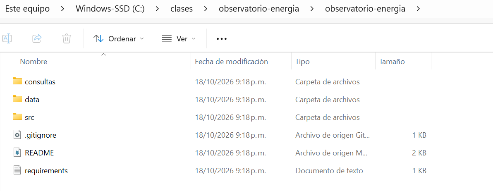

> 📂 **Es normal que la ruta quede doble:** `C:\clases\observatorio-energia\observatorio-energia`. Windows crea una carpeta con el nombre del `.zip` y adentro deja la carpeta descargada. No hay que corregir nada: lo importante es identificar **la carpeta que contiene `consultas`, `data` y `src`**. Esa es la raíz del proyecto.

6. En VS Code: **File → Open Folder...** → seleccionar **la carpeta que contiene `consultas`, `data` y `src`** (la de la imagen) → **Seleccionar carpeta**.
7. Si VS Code pregunta *"Do you trust the authors of the files in this folder?"* o muestra arriba una franja azul que dice **Restricted Mode**, hacer clic en **Yes, I trust the authors** (o en **Manage → Trust**).

Así debe verse VS Code con el proyecto abierto: en el panel **Explorer** aparece `observatorio-energia` con las carpetas `consultas`, `data` y `src`, y los archivos `.gitignore`, `README.md` y `requirements.txt`. Si ya no se ve la franja azul de *Restricted Mode*, la carpeta quedó como confiable.

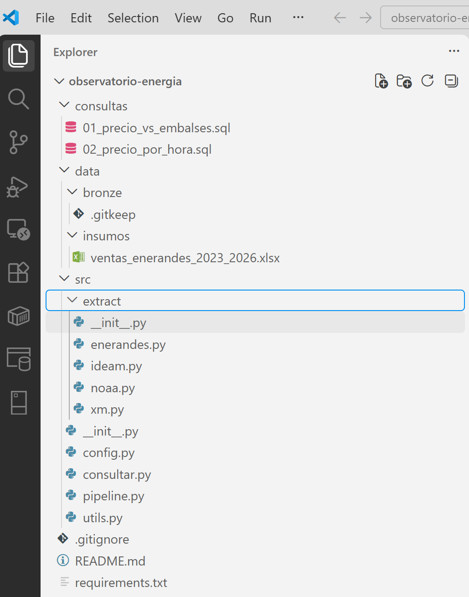

> 🔒 **¿Qué es el modo restringido (Restricted Mode)?** Una protección de VS Code: una carpeta descargada de Internet podría traer configuraciones que ejecutan programas, así que VS Code desactiva algunas funciones hasta que usted indique que confía en ella. Este código es del curso, así que se puede confiar.

> 📁 **¿Por qué en `C:\clases` y no en el Escritorio o Documentos?** Porque esas carpetas suelen estar sincronizadas con **OneDrive**, que bloquea archivos mientras los sube a la nube y puede hacer fallar el pipeline al guardar los datos.

**¿Y el repositorio de GitHub del equipo?** Durante la clase trabajamos en `C:\clases\observatorio-energia`. En la **Parte 7** se explica cómo subir este proyecto al repositorio del equipo.

La estructura debe quedar así:

```
observatorio-energia/
├── requirements.txt          # dependencias
├── .gitignore                # lo que NO se sube a GitHub
├── README.md                 # documentacion del proyecto
├── consultas/                # consultas SQL de BI
│   ├── 01_precio_vs_embalses.sql
│   └── 02_precio_por_hora.sql
├── data/
│   ├── insumos/              # Excel de EnerAndes (viene en el .zip)
│   └── bronze/               # lo genera el pipeline (NO se sube)
└── src/
    ├── __init__.py           # archivo vacio: convierte src en paquete
    ├── config.py             # configuracion central
    ├── utils.py              # reintentos, idempotencia, linaje
    ├── pipeline.py           # punto de entrada unico
    ├── consultar.py          # ejecuta las consultas SQL
    └── extract/
        ├── __init__.py       # archivo vacio
        ├── xm.py
        ├── ideam.py
        ├── noaa.py
        └── enerandes.py
```

> 💡 Los archivos `__init__.py` van **vacíos**. Su función es que Python trate `src` y `src/extract` como **paquetes**, y así poder ejecutar `python -m src.pipeline` desde la raíz.

### 2.2 Dependencias y archivos de Git

**`requirements.txt`**

```text
requests>=2.32
pandas>=2.2
pyarrow>=17.0
openpyxl>=3.1
duckdb>=1.1
```

| Librería | Para qué |
|---|---|
| `requests` | Hablar con APIs HTTP (GET y POST) |
| `pandas` | Manejar tablas en memoria |
| `pyarrow` | Escribir y leer **Parquet**: columnar, comprimido y con tipos. Pesa 5 a 10 veces menos que un CSV. |
| `openpyxl` | Leer archivos Excel |
| `duckdb` | Motor SQL analítico que consulta Parquet **sin base de datos** |

**`.gitignore`**

```text
# Entorno virtual de Python (cada quien crea el suyo)
.venv/

# Datos descargados: se regeneran con el pipeline, no se suben a GitHub
data/bronze/
data/silver/
data/gold/
*.duckdb

# Secretos y configuracion local
.env

# Archivos temporales de Python y del sistema
__pycache__/
*.pyc
.DS_Store
Thumbs.db
```

> 🔒 Los datos **no** se suben a GitHub: se sube **el código que los genera**. Así el repositorio pesa poco y nadie sube por error datos grandes o sensibles.

### 2.3 Entorno virtual e instalación de librerías

En la terminal de VS Code (**Terminal → New Terminal**), **desde la raíz del proyecto**, ejecutar estos tres comandos **uno por uno**:

```powershell
python -m venv .venv
.\.venv\Scripts\Activate.ps1
python -m pip install -r requirements.txt
```

**¿Qué hace cada comando?**

| Comando | Qué hace | Qué se ve |
|---|---|---|
| `python -m venv .venv` | **Crea el entorno virtual**: una carpeta llamada `.venv` con una copia de Python **solo para este proyecto**. `venv` es la herramienta de Python que crea entornos; `.venv` es el nombre de la carpeta. | Nada en la terminal. En el EXPLORER aparece la carpeta **`.venv`**. |
| `.\.venv\Scripts\Activate.ps1` | **Activa el entorno**: desde ese momento, los comandos `python` y `pip` usan el Python de `.venv` y no el del sistema. `Activate.ps1` es un script de PowerShell que viene dentro de `.venv`. | El prompt empieza con **`(.venv)`**. Esa es la señal de que está activo. |
| `python -m pip install -r requirements.txt` | **Instala las librerías** que aparecen en `requirements.txt` dentro del entorno. `pip` es el instalador de librerías de Python; `-r` significa "leer la lista desde este archivo". | Varias líneas de descarga e instalación (ver abajo). Tarda entre 1 y 3 minutos. |

#### ⚠️ Si el segundo comando da el error "la ejecución de scripts está deshabilitada"

Es **el error más común** en Windows. Se ve así, en letras rojas:

```text
.\.venv\Scripts\Activate.ps1 : No se puede cargar el archivo C:\clases\observatorio-energia\.venv\Scripts\Activate.ps1
porque la ejecución de scripts está deshabilitada en este sistema. Para obtener más información, consulta el tema
about_Execution_Policies en https:/go.microsoft.com/fwlink/?LinkID=135170.
```

**¿Por qué pasa?** Windows trae una protección llamada **directiva de ejecución** (*Execution Policy*) que, por defecto, **bloquea todos los scripts de PowerShell**, para evitar que se ejecuten programas maliciosos descargados de Internet. `Activate.ps1` es un script de PowerShell, así que Windows lo bloquea.

**Qué hacer:**

**1.** En la misma terminal, ejecutar:

```powershell
Set-ExecutionPolicy -Scope CurrentUser -ExecutionPolicy RemoteSigned
```

**2.** PowerShell pregunta si desea cambiar la directiva:

```text
¿Desea cambiar la directiva de ejecución?
[S] Sí  [O] Sí a todo  [N] No  [T] No a todo  [U] Suspender  [?] Ayuda (el valor predeterminado es "N"):
```

Escribir **`S`** y presionar **Enter**.

**3.** Volver a ejecutar el comando de activación:

```powershell
.\.venv\Scripts\Activate.ps1
```

Ahora el prompt debe empezar con **`(.venv)`**. Este cambio se hace **una sola vez por computador**: no habrá que repetirlo.

| Parte del comando | Qué significa |
|---|---|
| `Set-ExecutionPolicy` | Cambiar la directiva de ejecución de scripts. |
| `-Scope CurrentUser` | Solo para **su usuario** de Windows. Por eso **no pide permisos de administrador** y no afecta a otros usuarios del computador. |
| `-ExecutionPolicy RemoteSigned` | Permite ejecutar scripts **creados en el propio computador** (como `Activate.ps1`, que lo creó el comando `python -m venv`), pero sigue bloqueando los scripts descargados de Internet que no estén firmados. Es la configuración que recomienda Microsoft para programadores. |

**Plan B: si el computador no deja cambiar la directiva** (algunos computadores de salas o de empresas lo tienen bloqueado y muestran otro error al ejecutar el paso 1), usar este comando, que la cambia **solo para la terminal abierta** y no modifica nada del computador:

```powershell
Set-ExecutionPolicy -Scope Process -ExecutionPolicy Bypass
.\.venv\Scripts\Activate.ps1
```

`-Scope Process` significa "solo para esta ventana de terminal": al cerrarla, todo vuelve a como estaba. Por eso hay que repetirlo **cada vez que se abra una terminal nueva**.


> 🔁 **Cada vez que abran una terminal nueva** deben volver a activar el entorno con `.\.venv\Scripts\Activate.ps1`. Si el prompt no muestra `(.venv)`, las librerías "no existen" para esa terminal.

**Así se ve al terminar:**

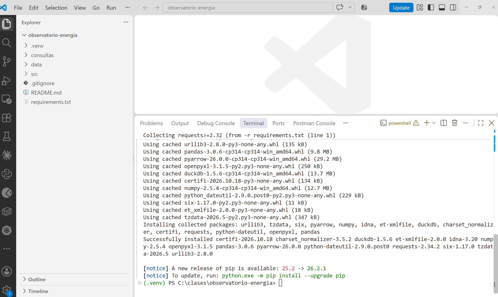

**¿Qué significa cada parte de lo que se ve?**

| Lo que aparece | Qué significa |
|---|---|
| Carpeta **`.venv`** en el EXPLORER | El entorno virtual creado por el primer comando. **No se sube a GitHub** (está en el `.gitignore`): cada persona crea el suyo. |
| `Collecting requests>=2.32 (from -r requirements.txt (line 1))` | pip está **buscando** la librería de la línea 1 de `requirements.txt`. `>=2.32` significa "versión 2.32 o más reciente". |
| `Downloading ...` o `Using cached ...` | **Descargando** la librería de Internet, o **usando una copia guardada** de una descarga anterior. La primera vez se verá `Downloading`; si el computador ya la había descargado antes, `Using cached`. |
| `pandas-3.0.6-cp314-cp314-win_amd64.whl (9.8 MB)` | El archivo que se instala. `.whl` (*wheel*) es el formato de paquete de Python. `3.0.6` es la versión; `cp314` significa que es para Python 3.14; `win_amd64`, para Windows de 64 bits. pip elige solo el archivo que corresponde al computador. |
| Librerías que **no** están en `requirements.txt` (`numpy`, `urllib3`, `certifi`, `tzdata`…) | Son **dependencias de las dependencias**: librerías que nuestras librerías necesitan para funcionar. pip las instala automáticamente (ver la tabla siguiente). |
| `Installing collected packages: ...` | Instalando todo lo que descargó. |
| `Successfully installed ...` | ✅ **Todo quedó instalado.** Muestra cada librería con su versión. |
| `[notice] A new release of pip is available` | **Solo un aviso, no es un error.** Existe una versión más nueva de pip. No hace falta actualizar para la clase. |
| `(.venv) PS C:\clases\observatorio-energia>` | La terminal está lista, con el entorno activo, en la carpeta del proyecto. |
| Ícono ⚠️ junto a `powershell` (arriba a la derecha de la terminal) | VS Code avisa que el entorno de la terminal cambió (porque se activó `.venv`). **Se puede ignorar.** |

**Las librerías instaladas y para qué sirven:**

| Librería | ¿La pedimos? | Para qué sirve |
|---|---|---|
| `requests` | ✅ Sí | Hablar con APIs por Internet (GET y POST) |
| `pandas` | ✅ Sí | Manejar tablas de datos en memoria |
| `pyarrow` | ✅ Sí | Leer y escribir archivos **Parquet** |
| `openpyxl` | ✅ Sí | Leer archivos **Excel** |
| `duckdb` | ✅ Sí | Ejecutar **SQL** directamente sobre archivos Parquet |
| `numpy` | Dependencia de pandas | Cálculos numéricos rápidos (pandas está construido sobre numpy) |
| `python-dateutil`, `six`, `tzdata` | Dependencias de pandas | Manejo de fechas y zonas horarias |
| `urllib3`, `idna`, `charset_normalizer`, `certifi` | Dependencias de requests | Conexiones HTTP, nombres de dominio, codificación de texto y certificados de seguridad (HTTPS) |
| `et-xmlfile` | Dependencia de openpyxl | Leer el formato interno de los archivos Excel (que es XML) |

**Verificación:** para comprobar que las 5 librerías del proyecto se pueden usar:

```powershell
python -c "import requests, pandas, pyarrow, openpyxl, duckdb; print('OK')"
```

Debe responder **`OK`**. El parámetro `-c` le dice a Python que ejecute el código que va entre comillas, sin necesidad de crear un archivo.

```text
(.venv) PS C:\clases\observatorio-energia> python -c "import requests, pandas, pyarrow, openpyxl, duckdb; print('OK')"
OK
```

> 🧹 **Truco:** si la terminal se llena de texto, el comando **`cls`** (*clear screen*) la limpia. Solo borra lo que se ve en pantalla: no cierra la terminal ni desactiva el entorno `(.venv)`.

Versiones con las que se probó: `requests 2.34.2 | pandas 3.0.6 | pyarrow 26.0.0 | duckdb 1.5.6`.

### 2.4 Configuración central: `src/config.py`

Todo lo que puede cambiar (fechas, URLs, rutas) vive en **un solo archivo**. Para pasar de la clase al proyecto real solo se cambia `FECHA_INICIO`.

```python
"""
Configuracion central del pipeline.
Todo lo que puede cambiar (fechas, URLs, rutas) vive AQUI y no regado en el codigo.
Si hay que cambiar una fecha o una URL, se cambia en este archivo y en ningun otro.
"""
# ---------------------------------------------------------------------------
# IMPORTS (traer codigo que ya existe)
# ---------------------------------------------------------------------------
from datetime import date   # datetime: libreria de Python para fechas y horas.
                            # date sirve para escribir una fecha: date(2026, 1, 1)
from pathlib import Path    # pathlib: libreria de Python para manejar rutas de
                            # carpetas y archivos sin preocuparse por / o \

# --- Rango de fechas a extraer --------------------------------------------
# Para la clase usamos 2026 (rapido). Para el proyecto, amplien a 2023-01-01.
FECHA_INICIO = date(2026, 1, 1)     # primer dia que se descarga
FECHA_FIN = date(2026, 9, 30)       # ultimo dia que se descarga

# --- Rutas (relativas a la raiz del proyecto) ------------------------------
# __file__ es la ruta de ESTE archivo (src/config.py).
# .resolve() la vuelve ruta completa; .parent sube una carpeta.
# Dos veces .parent: de src/config.py sube a src/ y luego a la raiz del proyecto.
RAIZ = Path(__file__).resolve().parent.parent
DIR_INSUMOS = RAIZ / "data" / "insumos"     # el operador / une partes de una ruta
DIR_BRONZE = RAIZ / "data" / "bronze"       # aqui se guardan los datos descargados

# --- Fuente 1: API de XM (mercado electrico) -------------------------------
XM_URL = "https://servapibi.xm.com.co/{periodo}"   # periodo: hourly | daily | lists
XM_MAX_DIAS = 30                                    # la API no acepta rangos mas largos
XM_METRICAS = [
    # Lista de tuplas. Cada tupla es una metrica a descargar:
    # (MetricId, Entity, periodo, nombre del archivo en bronce)
    ("PrecBolsNaci", "Sistema", "hourly", "xm_precio_bolsa"),   # precio de bolsa por hora
    ("DemaReal", "Sistema", "hourly", "xm_demanda"),            # demanda real por hora
    ("PorcVoluUtilDiar", "Sistema", "daily", "xm_embalses"),    # % de embalses por dia
]

# --- Fuente 2: IDEAM en datos.gov.co (API Socrata / SoQL) ------------------
IDEAM_URL = "https://www.datos.gov.co/resource/s54a-sgyg.json"   # precipitacion
IDEAM_DEPARTAMENTO = "ANTIOQUIA"
IDEAM_DIAS_VENTANA = 7          # pedir de a una semana evita timeouts del servidor
# El IDEAM es la fuente MAS LENTA (5 a 30 s por semana). Para la clase pedimos
# solo jun-sep 2026. Para el proyecto, usen el mismo rango de las demas fuentes.
IDEAM_FECHA_INICIO = date(2026, 6, 1)

# --- Fuente 3: NOAA, indice de El Nino (archivo de texto) ------------------
NOAA_ONI_URL = "https://www.cpc.ncep.noaa.gov/data/indices/oni.ascii.txt"

# --- Fuente 4: archivo interno de EnerAndes (Excel) ------------------------
ENERANDES_EXCEL = DIR_INSUMOS / "ventas_enerandes_2023_2026.xlsx"

# --- Comportamiento HTTP ---------------------------------------------------
HTTP_TIMEOUT = 120      # segundos que se espera una respuesta antes de rendirse
HTTP_REINTENTOS = 4     # intentos ante fallas de red o del servidor
```

### 2.5 Utilidades: `src/utils.py`

Aquí están las tres ideas "avanzadas" del pipeline, escritas una sola vez y usadas por todos los extractores:

| Idea | Función | Qué resuelve |
|---|---|---|
| **Reintentos con espera exponencial** | `_con_reintentos()` | Si la red o el servidor fallan, espera 2, 4, 8 segundos y reintenta, en lugar de morir al primer error. |
| **Idempotencia** | `ya_existe()` | Si el archivo ya está en bronce, no lo vuelve a descargar (salvo con `--forzar`). |
| **Linaje** | `guardar_bronce()` | Agrega `_fuente`, `_origen` y `_extraido_en` a cada fila. |

```python
"""
Utilidades comunes a todos los extractores:
  - log():            mensajes con hora
  - http_json() / http_texto(): peticiones con REINTENTOS y espera exponencial
  - ya_existe():      idempotencia (no volver a descargar lo que ya esta)
  - guardar_bronce(): guarda en Parquet agregando columnas de LINAJE
"""
# ---------------------------------------------------------------------------
# IMPORTS
# Primero las librerias que trae Python, luego las instaladas con pip,
# y al final los archivos de este mismo proyecto. Es la convencion de Python.
# ---------------------------------------------------------------------------
import time                                            # time.sleep(): esperar segundos
from datetime import datetime, timedelta, timezone     # datetime: fecha y hora actual
                                                       # timedelta: sumar dias a una fecha
                                                       # timezone: zona horaria (UTC)

import pandas as pd     # pandas: tablas (DataFrame). "as pd" = nombre corto
import requests         # requests: hacer peticiones a internet (GET, POST)

from src import config  # la configuracion central de este proyecto (src/config.py)


def log(mensaje: str) -> None:
    """Escribe un mensaje en pantalla con la hora delante: [21:30:32] mensaje."""
    # f"..." es un f-string: lo que va entre { } se reemplaza por su valor.
    # :%H:%M:%S formatea la hora como horas:minutos:segundos.
    # flush=True obliga a mostrarlo de inmediato (sin esperar).
    print(f"[{datetime.now():%H:%M:%S}] {mensaje}", flush=True)


def _con_reintentos(funcion, descripcion: str):
    """Ejecuta funcion(); si falla, espera 2, 4, 8... segundos y reintenta."""
    # El guion bajo al inicio (_con_reintentos) indica que es de uso interno.
    for intento in range(1, config.HTTP_REINTENTOS + 1):       # intento = 1, 2, 3, 4
        try:                                                   # try: intentar...
            return funcion()                                   # si funciona, termina aqui
        except requests.RequestException as error:             # ...si falla la red:
            if intento == config.HTTP_REINTENTOS:              # era el ultimo intento:
                raise RuntimeError(f"Fallo definitivo en {descripcion}: {error}") from error
            espera = 2 ** intento                              # ** = potencia: 2, 4, 8 s
            log(f"   ! intento {intento} fallo ({type(error).__name__}); reintento en {espera} s")
            time.sleep(espera)                                 # espera y vuelve al for


def http_json(metodo: str, url: str, **kwargs):
    """GET o POST que devuelve JSON, con reintentos."""
    # **kwargs recibe parametros extra con nombre (json=..., params=...)
    # y los pasa tal cual a requests.
    def llamar():                                              # funcion dentro de funcion
        r = requests.request(metodo, url, timeout=config.HTTP_TIMEOUT, **kwargs)
        r.raise_for_status()           # convierte 4xx/5xx en excepcion
        return r.json()                # convierte el texto JSON en dict o list de Python
    return _con_reintentos(llamar, f"{metodo} {url}")


def http_texto(url: str) -> str:
    """GET que devuelve texto plano, con reintentos."""
    def llamar():
        r = requests.get(url, timeout=config.HTTP_TIMEOUT)
        r.raise_for_status()
        return r.text                  # el contenido como texto
    return _con_reintentos(llamar, f"GET {url}")


def ventanas(inicio, fin, dias: int):
    """Parte el rango [inicio, fin] en bloques de 'dias' dias."""
    # Ejemplo con dias=30: (1-ene, 30-ene), (31-ene, 1-mar), ... hasta fin.
    a = inicio
    while a <= fin:
        b = min(a + timedelta(days=dias - 1), fin)     # fin del bloque, sin pasarse de fin
        yield a, b                                     # yield: entrega un bloque y sigue
        a = b + timedelta(days=1)                      # el siguiente empieza al otro dia


def ruta_bronce(nombre: str):
    """Ruta del archivo en bronce: data/bronze/<nombre>.parquet"""
    return config.DIR_BRONZE / f"{nombre}.parquet"


def ya_existe(nombre: str, forzar: bool) -> bool:
    """Idempotencia: si el archivo ya esta y no se pide forzar, no se descarga."""
    if ruta_bronce(nombre).exists() and not forzar:
        log(f"   = {nombre}.parquet ya existe; se omite (use --forzar para repetir)")
        return True
    return False


def guardar_bronce(df: pd.DataFrame, nombre: str, fuente: str, origen: str) -> None:
    """Guarda TAL CUAL llego + 3 columnas de linaje. En bronce no se modifica nada."""
    df = df.copy()                                           # copia: no tocar la tabla original
    df["_fuente"] = fuente                                   # de donde vino
    df["_origen"] = origen                                   # URL o archivo exacto
    df["_extraido_en"] = datetime.now(timezone.utc).isoformat(timespec="seconds")   # cuando (UTC)
    config.DIR_BRONZE.mkdir(parents=True, exist_ok=True)     # crea data/bronze si no existe
    df.to_parquet(ruta_bronce(nombre), index=False)          # guarda en Parquet (con pyarrow)
    log(f"   + {nombre}.parquet guardado: {len(df):,} filas x {df.shape[1]} columnas")
```

**Conceptos que aparecen en `utils.py`:**

| Concepto | Qué es |
|---|---|
| **Excepción** | Un error que ocurre mientras el programa corre (por ejemplo, se cae la conexión). Si nadie la "atrapa" con `try / except`, el programa se detiene. |
| **`try / except`** | "Intenta esto; **si falla**, haz esto otro". Aquí lo usamos para reintentar en vez de detenernos. |
| **Timeout** (tiempo límite) | Cuántos segundos esperamos la respuesta de un servidor antes de darnos por vencidos. Sin timeout, el programa podría quedarse esperando para siempre. |
| **Espera exponencial** (*exponential backoff*) | Esperar cada vez más entre reintentos: 2, 4, 8 segundos. Le da tiempo al servidor de recuperarse y evita saturarlo con peticiones seguidas. |
| **UTC** | Tiempo Universal Coordinado: la hora de referencia mundial, sin zonas horarias. Colombia está en UTC−5. Guardar fechas en UTC evita confusiones cuando los datos vienen de distintos países. |

> 💬 **Para explicar `raise_for_status()`:** sin él, un error 500 del servidor pasaría en silencio y guardaríamos basura. Con él, se convierte en una excepción que activa los reintentos.

---

## Parte 3 · API REST de XM (6:30 – 6:55)

### Idea central

- XM publica más de 190 métricas del mercado eléctrico, **sin usuario ni clave**.
- Se consulta con **POST** a `https://servapibi.xm.com.co/{hourly|daily|lists}` y un **cuerpo JSON** que dice qué métrica, qué entidad y qué fechas.
- **Límite: máximo 30 días por consulta.** Para un año hay que pedir **por ventanas**. Es el patrón más común con APIs reales.
- La respuesta es JSON **anidado** (`Items → DailyEntities → Value`), así que hay que **aplanarlo** a filas, sin cambiar los valores.

### Conceptos clave

| Concepto | Qué es |
|---|---|
| **API** (*Application Programming Interface*) | Un **programa** que una organización tiene en su servidor para **entregarles sus datos a otros programas**. Recibe el pedido, busca los datos en su base de datos y los devuelve, siguiendo reglas publicadas. Se llega a ella por una **dirección de internet** (*endpoint*). Ejemplo: el programa le pide a XM "precio de bolsa del 1 al 3 de enero de 2026" y XM responde con esos datos en JSON, sin que el programa tenga que entrar a la base de datos de XM. |
| **REST** | El estilo más común de API en la web: se piden recursos con **direcciones web (URL)** y métodos HTTP. |
| **Endpoint** | Cada URL específica de una API. XM tiene tres: `.../hourly` (datos por hora), `.../daily` (por día) y `.../lists` (catálogos). |
| **HTTP: GET y POST** | Los dos métodos más usados para pedir algo a un servidor. **GET**: los parámetros van en la URL (como el IDEAM). **POST**: los parámetros van en un **cuerpo** aparte, en JSON (como XM). |
| **JSON** | Formato de texto para intercambiar datos, con pares `"clave": valor`, listas `[ ]` y objetos `{ }` que se pueden anidar unos dentro de otros. |
| **Código de estado HTTP** | El número con que el servidor responde: **200** = todo bien; **4xx** = error de quien pregunta (404 no encontrado); **5xx** = error del servidor (500, 503). |
| **JSON anidado y "aplanar"** | La respuesta de XM viene en niveles (`Items → DailyEntities → Value`). **Aplanar** es convertir esos niveles en una tabla de filas y columnas. |
| **Formato ancho y largo** | **Ancho**: una columna por cada hora (`Hour01` … `Hour24`). **Largo**: una sola columna `hora` y una fila por cada hora. Para analizar se prefiere el largo; en bronce se deja como llega. |

**Conceptos del negocio eléctrico** (para entender qué estamos descargando):

| Término | Qué significa |
|---|---|
| **XM** | La empresa que opera el sistema eléctrico colombiano y administra el mercado de energía. Publica los datos del mercado. |
| **kWh** (kilovatio-hora) | La unidad en que se mide y se cobra la energía: un aparato de 1.000 vatios encendido durante una hora consume 1 kWh. |
| **Precio de bolsa** | El precio al que se compra y vende la energía **cada hora** en el mercado mayorista, en COP/kWh. Sube cuando la energía escasea o es cara de producir. |
| **Demanda** | Cuánta energía consume el país en cada hora (en kWh). |
| **Volumen útil de los embalses** | Qué porcentaje de agua aprovechable para generar energía tienen las represas. Colombia genera cerca de dos terceras partes de su energía con agua. |
| **Aportes hídricos** | Cuánta agua llega a los embalses desde los ríos, expresada en energía. |
| **Generación por recurso** | Cuánta energía produjo **cada planta** (hidráulica, térmica, solar, eólica) en cada hora. |

### 3.1 Primer contacto: probar la API desde la terminal

Antes de escribir código en Python, se prueba la API **"a mano"** desde la terminal. Así vemos **qué responde** y **qué forma tiene** el JSON que después vamos a procesar. Es lo que hace cualquier ingeniero de datos antes de programar una extracción.

En la terminal, pegar estas **dos líneas** y presionar **Enter**:

```powershell
$cuerpo = '{"MetricId":"PorcVoluUtilDiar","Entity":"Sistema","StartDate":"2026-09-01","EndDate":"2026-09-03","Filter":[]}'
Invoke-RestMethod -Method Post -Uri "https://servapibi.xm.com.co/daily" -ContentType "application/json" -Body $cuerpo | ConvertTo-Json -Depth 6
```

**Línea 1: preparar la pregunta que le haremos a XM**

| Parte | Qué significa |
|---|---|
| `$cuerpo = '...'` | Crea una **variable** de PowerShell llamada `cuerpo` y le guarda un texto. En PowerShell las variables empiezan con `$`. Las comillas simples `'...'` encierran el texto tal cual. |
| `{ ... }` | El texto es un **JSON**: la "pregunta" que le enviaremos a la API, en el formato que XM exige. |
| `"MetricId":"PorcVoluUtilDiar"` | **Qué dato queremos**: la métrica *Porcentaje de Volumen Útil Diario* de los embalses. Cada métrica de XM tiene un identificador así. |
| `"Entity":"Sistema"` | **De quién**: del **sistema** completo (todo el país), no de un embalse en particular. |
| `"StartDate":"2026-09-01"` | **Desde** qué fecha (formato año-mes-día). |
| `"EndDate":"2026-09-03"` | **Hasta** qué fecha. Aquí pedimos 3 días. |
| `"Filter":[]` | **Filtros** adicionales. `[]` es una lista vacía: sin filtros. |

**Línea 2: enviar la pregunta y mostrar la respuesta**

| Parte | Qué significa |
|---|---|
| `Invoke-RestMethod` | Comando de PowerShell que **llama a una API REST** y convierte su respuesta JSON en un objeto. Es el equivalente de `requests` en Python. |
| `-Method Post` | Usa el método HTTP **POST**: los datos de la pregunta van en un **cuerpo** aparte (el `$cuerpo`), no en la URL. XM exige POST. |
| `-Uri "https://servapibi.xm.com.co/daily"` | **A dónde** se envía la pregunta: el *endpoint* `daily` de XM, que responde datos **diarios**. |
| `-ContentType "application/json"` | Le avisa al servidor que el cuerpo que enviamos está en formato **JSON**. |
| `-Body $cuerpo` | El cuerpo de la petición: la variable que preparamos en la línea 1. |
| `\|` (barra vertical) | Una **tubería** (*pipe*): pasa el resultado del comando de la izquierda al de la derecha. |
| `ConvertTo-Json -Depth 6` | Vuelve a escribir la respuesta como JSON **para poder leerla**. `-Depth 6` indica cuántos niveles anidados mostrar; si es muy bajo, PowerShell recorta los niveles internos. |

**Respuesta real:**

```text
{
    "Metric":  {
                   "Id":  "PorcVoluUtilDiar",
                   "Name":  "Volumen Útil  diario % por Sistema",
                   "StartDate":  "2026-09-01T00:00:00",
                   "EndDate":  "2026-09-03T00:00:00"
               },
    "Items":  [
                  {
                      "Date":  "2026-09-01",
                      "DailyEntities":  [
                                            {
                                                "Id":  "Sistema",
                                                "Value":  "0.79510"
                                            }
                                        ]
                  },
                  {
                      "Date":  "2026-09-02",
                      "DailyEntities":  [
                                            {
                                                "Id":  "Sistema",
                                                "Value":  "0.79935"
                                            }
                                        ]
                  },
                  {
                      "Date":  "2026-09-03",
                      "DailyEntities":  [
                                            {
                                                "Id":  "Sistema",
                                                "Value":  "0.79925"
                                            }
                                        ]
                  }
              ]
}
```

**¿Qué significa cada parte de la respuesta?**

| Campo | Qué es |
|---|---|
| `"Metric"` | **Encabezado**: describe qué se consultó. |
| `"Id": "PorcVoluUtilDiar"` | La métrica que pedimos. |
| `"Name": "Volumen Útil diario % por Sistema"` | El nombre legible de la métrica. |
| `"StartDate"` / `"EndDate"` | El rango de fechas que XM entendió. |
| `"Items": [ ... ]` | La **lista de resultados**: un elemento por cada día. Los corchetes `[ ]` indican una lista. |
| `"Date": "2026-09-01"` | El día al que corresponde ese resultado. |
| `"DailyEntities": [ ... ]` | La lista de **entidades** con dato ese día. Como pedimos `Sistema`, hay una sola. |
| `"Id": "Sistema"` | La entidad: el sistema eléctrico completo. |
| `"Value": "0.79510"` | **El dato**: los embalses estaban al **79,51 %** de su volumen útil (0.79510 × 100). |

> 🔍 **Observen la estructura anidada:** el dato que nos interesa está **tres niveles adentro**: `Items` → `DailyEntities` → `Value`. Para guardarlo como tabla hay que **"aplanarlo"**, y eso es lo que hace la función `aplanar()` de `xm.py` (Parte 3.2).

> 💬 **Para la discusión:** observen que `Value` llega como **texto** (`"0.79510"`, entre comillas), no como número. En bronce lo dejamos así. Además, cuando descargamos este mismo dato el 7 de octubre valía `0.79541`: **XM revisa sus cifras después de publicarlas**. Por eso es clave la columna `_extraido_en`, que registra cuándo se descargó cada dato.

#### ¿De dónde salen el comando y el nombre `PorcVoluUtilDiar`?

El comando no se inventa. Sale de dos fuentes:

1. **La documentación de la API de XM** (`https://github.com/EquipoAnaliticaXM/API_XM`): dice que la dirección base es `https://servapibi.xm.com.co/`, que hay 3 endpoints (`hourly` para datos por hora, `daily` por día y `lists` para listados), que los pedidos se hacen con **POST** y que el pedido lleva los campos `MetricId`, `Entity`, `StartDate`, `EndDate` y `Filter`.
2. **El catálogo de métricas**, que entrega la misma API. De ahí sale el nombre de cada dato.

#### Buscar métricas en el catálogo de XM

Se le pide a la API la lista de todo lo que tiene, con el endpoint `lists` y la métrica especial `ListadoMetricas`:

```powershell
$cuerpo = '{"MetricId":"ListadoMetricas","Entity":"","StartDate":"2026-09-01","EndDate":"2026-09-01","Filter":[]}'
Invoke-RestMethod -Method Post -Uri "https://servapibi.xm.com.co/lists" -ContentType "application/json" -Body $cuerpo | ConvertTo-Json -Depth 6
```

Responde **193 métricas**. Cada una trae estos campos:

| Campo del catálogo | Qué dice | Ejemplo: los embalses |
|---|---|---|
| `MetricId` | El nombre que se pone en `"MetricId"` del pedido. | `PorcVoluUtilDiar` |
| `MetricName` | La descripción en español. | *Volumen Útil diario % por Sistema* |
| `Entity` | De quién se pide: el país (`Sistema`) o el detalle (`Embalse`, `Recurso`, `Rio`…). Va en `"Entity"`. | `Sistema` |
| `Url` | A qué endpoint se envía el pedido. | `https://servapibi.xm.com.co/daily` |
| `MaxDays` | Máximo de días por pedido. | `31` (el programa usa 30, para no quedar en el límite) |
| `MetricUnits` | Unidad del valor. | `%` |

> 💡 La respuesta es larga. Para buscar una métrica, se puede guardar en un archivo y abrirlo en VS Code: cambiar el final del comando por `| ConvertTo-Json -Depth 6 | Out-File catalogo_xm.json` y buscar con **Ctrl+F**.

**Las métricas que pide la Evidencia 1, según el catálogo (respuesta real):**

| `MetricId` | `MetricName` | `Entity` | `Url` |
|---|---|---|---|
| `Gene` | Generación por Recurso | `Recurso` | `.../hourly` |
| `AporEner` | Aportes Energía por Sistema | `Sistema` | `.../daily` |
| `ListadoRecursos` | Listado Recursos con atributos por Sistema | `Sistema` | `.../list` ⚠️ |

> ⚠️ **La documentación también se equivoca.** Para `ListadoRecursos`, el catálogo dice `.../list`, pero esa dirección responde **error 404** (no existe). La que funciona es **`.../lists`**, con *s*. Por eso siempre se **prueba a mano** antes de programar: así se descubren estos errores.

### 3.2 El extractor: `src/extract/xm.py`

```python
"""
Fuente 1 - API REST de XM (operador del mercado electrico colombiano).
  - Metodo POST con un cuerpo JSON
  - Maximo 30 dias por consulta  ->  pedimos por VENTANAS
  - No requiere usuario ni clave
Documentacion: https://github.com/EquipoAnaliticaXM/API_XM
"""
# ---------------------------------------------------------------------------
# IMPORTS (traer codigo que ya existe)
# ---------------------------------------------------------------------------
import pandas as pd     # pandas: libreria de tablas. "as pd" le pone el nombre corto pd.
                        # Aqui se usa para convertir la lista de filas en tabla (DataFrame).

from src import config  # config.py de este proyecto: URL de XM, fechas y lista de metricas.
from src.utils import guardar_bronce, http_json, log, ventanas, ya_existe
# Funciones de utils.py de este proyecto:
#   guardar_bronce: guarda la tabla en Parquet con 3 columnas de linaje
#   http_json:      le envia un pedido a una API y devuelve la respuesta; reintenta si falla
#   log:            escribe un mensaje en pantalla con la hora
#   ventanas:       parte un rango de fechas en bloques de 30 dias
#   ya_existe:      dice si el archivo ya esta en bronce (para no descargarlo otra vez)


# ---------------------------------------------------------------------------
# NOTA sobre "respuesta: dict" o "-> list" en las funciones:
# son ANOTACIONES DE TIPO. Dicen que tipo de dato se espera (dict = diccionario,
# str = texto, bool = verdadero/falso, list = lista) y que devuelve la funcion
# (-> list). Python no las obliga: sirven para que el codigo se entienda mejor.
# ---------------------------------------------------------------------------


def aplanar(respuesta: dict, periodo: str) -> list:
    """Convierte el JSON anidado de XM en filas planas, SIN cambiar los valores."""
    filas = []                                     # lista vacia donde se van guardando las filas
    # .get("Items", []) toma la lista "Items" de la respuesta;
    # si XM no la mando, devuelve una lista vacia [] en vez de fallar.
    for item in respuesta.get("Items", []):        # cada item es un dia
        if periodo == "hourly":                    # datos por hora (precio, demanda)
            for entidad in item["HourlyEntities"]:
                # Cada fila es un diccionario {columna: valor}.
                # ** desempaca el diccionario Values: agrega Hour01 ... Hour24 a la fila.
                filas.append({"Date": item["Date"], "Id": entidad["Id"], **entidad["Values"]})
        else:                                      # datos diarios (embalses)
            for entidad in item["DailyEntities"]:
                filas.append({"Date": item["Date"], "Id": entidad["Id"], "Value": entidad["Value"]})
    return filas                                   # entrega la lista de filas


def extraer_metrica(metrica: str, entidad: str, periodo: str, nombre: str, forzar: bool) -> None:
    """Descarga una metrica de XM en ventanas de 30 dias y la guarda en bronce."""
    if ya_existe(nombre, forzar):                  # si el archivo ya esta en bronce...
        return                                     # ...termina aqui, sin descargar
    url = config.XM_URL.format(periodo=periodo)    # reemplaza {periodo} por hourly o daily
    filas = []                                     # aqui se juntan las filas de todas las ventanas
    for inicio, fin in ventanas(config.FECHA_INICIO, config.FECHA_FIN, config.XM_MAX_DIAS):
        # El pedido, con los mismos 5 campos del comando de prueba de la Parte 3.1.
        # str(inicio) convierte la fecha en texto "2026-01-01", como la pide XM.
        cuerpo = {"MetricId": metrica, "Entity": entidad,
                  "StartDate": str(inicio), "EndDate": str(fin), "Filter": []}
        respuesta = http_json("POST", url, json=cuerpo)          # envia el pedido con POST
        nuevas = aplanar(respuesta, periodo)                     # JSON anidado -> filas
        filas.extend(nuevas)                                     # agrega las filas de esta ventana
        log(f"   {metrica} {inicio} a {fin}: {len(nuevas)} filas")   # len() = cuantas filas
    # pd.DataFrame(filas) convierte la lista de filas en una tabla de pandas,
    # y guardar_bronce() la guarda en data/bronze/<nombre>.parquet
    guardar_bronce(pd.DataFrame(filas), nombre, fuente="XM", origen=f"{url} MetricId={metrica}")


def extraer(forzar: bool = False) -> None:
    """Descarga las 3 metricas de XM definidas en config.XM_METRICAS."""
    # forzar: bool = False -> si no se indica nada, forzar vale False (no repetir descargas).
    log("XM - API REST del mercado electrico")
    # Cada elemento de XM_METRICAS es una tupla de 4 valores;
    # el for la desempaca en 4 variables a la vez.
    for metrica, entidad, periodo, nombre in config.XM_METRICAS:
        extraer_metrica(metrica, entidad, periodo, nombre, forzar)


# ---------------------------------------------------------------------------
# Este bloque solo se ejecuta cuando se corre ESTE archivo directamente:
#     python -m src.extract.xm
# Cuando otro archivo lo importa (como pipeline.py), este bloque NO se ejecuta.
# ---------------------------------------------------------------------------
if __name__ == "__main__":
    import sys      # sys.argv: lista con lo que se escribio en el comando
    extraer(forzar="--forzar" in sys.argv)   # True si el comando trae --forzar
```

**¿Qué hace cada parte de `xm.py`?**

| Parte del código | Qué hace |
|---|---|
| `import pandas as pd` | Trae la librería pandas y la llama `pd` para escribir menos. |
| `from src import config` | Trae la configuración central: fechas, URL y lista de métricas. |
| `from src.utils import ...` | Trae las funciones de apoyo de `utils.py`: guardar en bronce, pedir datos con reintentos, mostrar mensajes, partir el rango de fechas y revisar si el archivo ya existe. |
| `def aplanar(respuesta, periodo)` | Define una **función** que convierte el JSON anidado de XM en una **lista de filas**. Recorre `Items` y, dentro de cada uno, las entidades (`HourlyEntities` para datos por hora o `DailyEntities` para datos diarios). |
| `{"Date": ..., "Id": ..., **entidad["Values"]}` | Arma una fila con la fecha, la entidad y **todos** los valores. Los dos asteriscos `**` "desempacan" el diccionario: copian `Hour01`, `Hour02`… como columnas. |
| `def extraer_metrica(...)` | Descarga **una** métrica completa. |
| `if ya_existe(nombre, forzar): return` | **Idempotencia**: si el archivo ya está en bronce, no se descarga otra vez. |
| `for inicio, fin in ventanas(..., config.XM_MAX_DIAS)` | Parte el rango de fechas en **bloques de 30 días** (el máximo que acepta XM) y recorre cada bloque. |
| `cuerpo = {"MetricId": ..., "StartDate": ..., ...}` | Arma la misma "pregunta" que se probó a mano en la Parte 3.1, pero ahora para cada ventana de fechas. |
| `http_json("POST", url, json=cuerpo)` | Envía la pregunta a XM con **reintentos** automáticos y recibe la respuesta. |
| `filas.extend(nuevas)` | Agrega las filas de esta ventana a la lista general. |
| `log(...)` | Muestra en pantalla cuántas filas llegaron en cada ventana, para seguir el avance. |
| `pd.DataFrame(filas)` | Convierte la lista de filas en una **tabla** de pandas. |
| `guardar_bronce(...)` | Guarda la tabla en `data/bronze/` como Parquet, con las columnas de **linaje**. |
| `def extraer(forzar=False)` | Recorre las 3 métricas configuradas en `config.XM_METRICAS` y descarga cada una. |
| `if __name__ == "__main__":` | Hace que el archivo se pueda ejecutar **por sí solo** con `python -m src.extract.xm`. Si otro archivo lo importa (como `pipeline.py`), ese bloque no se ejecuta. |
| `extraer(forzar="--forzar" in sys.argv)` | `sys.argv` es la lista de palabras escritas después del comando. Si entre ellas está `--forzar`, se descarga todo de nuevo aunque ya exista. |

### 3.3 Ejecutarlo

En la terminal, con el entorno activo (`(.venv)` al inicio del prompt):

```powershell
python -m src.extract.xm
```

| Parte del comando | Qué significa |
|---|---|
| `python` | Ejecutar Python (el del entorno `.venv`, porque está activo). |
| `-m` | Ejecutar un **módulo** de un paquete, en vez de un archivo suelto. |
| `src.extract.xm` | El módulo a ejecutar: el archivo `src/extract/xm.py`. Los puntos reemplazan las barras de las carpetas. |

Tarda **unos 25 segundos**. Salida real completa:

```text
(.venv) PS C:\clases\observatorio-energia> python -m src.extract.xm
[21:30:32] XM - API REST del mercado electrico
[21:30:33]    PrecBolsNaci 2026-01-01 a 2026-01-30: 30 filas
[21:30:34]    PrecBolsNaci 2026-01-31 a 2026-03-01: 30 filas
[21:30:34]    PrecBolsNaci 2026-03-02 a 2026-03-31: 30 filas
[21:30:35]    PrecBolsNaci 2026-04-01 a 2026-04-30: 30 filas
[21:30:36]    PrecBolsNaci 2026-05-01 a 2026-05-30: 30 filas
[21:30:36]    PrecBolsNaci 2026-05-31 a 2026-06-29: 30 filas
[21:30:37]    PrecBolsNaci 2026-06-30 a 2026-07-29: 30 filas
[21:30:38]    PrecBolsNaci 2026-07-30 a 2026-08-28: 30 filas
[21:30:39]    PrecBolsNaci 2026-08-29 a 2026-09-27: 30 filas
[21:30:40]    PrecBolsNaci 2026-09-28 a 2026-09-30: 3 filas
[21:30:40]    + xm_precio_bolsa.parquet guardado: 273 filas x 30 columnas
[21:30:41]    DemaReal 2026-01-01 a 2026-01-30: 30 filas
[21:30:42]    DemaReal 2026-01-31 a 2026-03-01: 30 filas
[21:30:43]    DemaReal 2026-03-02 a 2026-03-31: 30 filas
[21:30:43]    DemaReal 2026-04-01 a 2026-04-30: 30 filas
[21:30:44]    DemaReal 2026-05-01 a 2026-05-30: 30 filas
[21:30:45]    DemaReal 2026-05-31 a 2026-06-29: 30 filas
[21:30:46]    DemaReal 2026-06-30 a 2026-07-29: 30 filas
[21:30:47]    DemaReal 2026-07-30 a 2026-08-28: 30 filas
[21:30:47]    DemaReal 2026-08-29 a 2026-09-27: 30 filas
[21:30:48]    DemaReal 2026-09-28 a 2026-09-30: 3 filas
[21:30:48]    + xm_demanda.parquet guardado: 273 filas x 30 columnas
[21:30:49]    PorcVoluUtilDiar 2026-01-01 a 2026-01-30: 30 filas
[21:30:50]    PorcVoluUtilDiar 2026-01-31 a 2026-03-01: 30 filas
[21:30:51]    PorcVoluUtilDiar 2026-03-02 a 2026-03-31: 30 filas
[21:30:52]    PorcVoluUtilDiar 2026-04-01 a 2026-04-30: 30 filas
[21:30:53]    PorcVoluUtilDiar 2026-05-01 a 2026-05-30: 30 filas
[21:30:53]    PorcVoluUtilDiar 2026-05-31 a 2026-06-29: 30 filas
[21:30:54]    PorcVoluUtilDiar 2026-06-30 a 2026-07-29: 30 filas
[21:30:55]    PorcVoluUtilDiar 2026-07-30 a 2026-08-28: 30 filas
[21:30:56]    PorcVoluUtilDiar 2026-08-29 a 2026-09-27: 30 filas
[21:30:56]    PorcVoluUtilDiar 2026-09-28 a 2026-09-30: 3 filas
[21:30:56]    + xm_embalses.parquet guardado: 273 filas x 6 columnas
```

**¿Qué significa cada parte de la salida?**

| Lo que aparece | Qué significa |
|---|---|
| `[21:30:32]` | La **hora** en que se escribió cada mensaje (horas:minutos:segundos). La pone la función `log()` y sirve para ver cuánto tarda cada paso. |
| `XM - API REST del mercado electrico` | Inicio de la extracción de XM. |
| `PrecBolsNaci` | La métrica que se está descargando: **Prec**io de **Bols**a **Naci**onal. Le siguen `DemaReal` (**Dema**nda **Real**) y `PorcVoluUtilDiar` (**Porc**entaje de **Volu**men **Útil Diar**io de los embalses). |
| `2026-01-01 a 2026-01-30` | La **ventana de fechas** de esa petición: 30 días, el máximo que acepta la API de XM. |
| `: 30 filas` | XM devolvió **una fila por día**: 30 días = 30 filas. |
| Las **10 líneas** de cada métrica | El rango del 1 de enero al 30 de septiembre son **273 días**. Partidos en ventanas de 30 días dan **10 peticiones**: 9 de 30 días y una última de 3. |
| `2026-09-28 a 2026-09-30: 3 filas` | La **última ventana** es más corta: solo quedaban 3 días (28, 29 y 30 de septiembre). |
| `+ xm_precio_bolsa.parquet guardado` | El archivo se guardó en la carpeta `data/bronze/`. El signo `+` indica "archivo nuevo". |
| `273 filas` | Las 10 ventanas juntas: 9 × 30 + 3 = **273 días**, uno por fila. |
| `x 30 columnas` (precio y demanda) | Son datos **por hora**: cada fila trae `Date` (fecha), `Id` (entidad), `code` (código) y **24 columnas**, `Hour01` a `Hour24`, una por hora del día (formato **ancho**). A eso se suman las **3 columnas de linaje** (`_fuente`, `_origen` y `_extraido_en`): 3 + 24 + 3 = **30**. |
| `x 6 columnas` (embalses) | Son datos **diarios**: un solo valor por día. `Date`, `Id` y `Value`, más las 3 de linaje = **6**. |

> 🔍 **Comparen con la Parte 3.1:** allí pedimos **3 días a mano**. Ahora el programa pidió **273 días de 3 métricas** (30 peticiones) en unos 25 segundos, sin intervención. Eso es **automatizar la extracción**.

> 📁 **Para comprobarlo:** en el EXPLORER de VS Code, abran la carpeta `data/bronze/`. Deben aparecer los 3 archivos `.parquet`.

**Prueben la idempotencia:** ejecuten **otra vez** el mismo comando:

```text
(.venv) PS C:\clases\observatorio-energia> python -m src.extract.xm
[21:32:31] XM - API REST del mercado electrico
[21:32:31]    = xm_precio_bolsa.parquet ya existe; se omite (use --forzar para repetir)
[21:32:31]    = xm_demanda.parquet ya existe; se omite (use --forzar para repetir)
[21:32:31]    = xm_embalses.parquet ya existe; se omite (use --forzar para repetir)
```

| Lo que aparece | Qué significa |
|---|---|
| Todo ocurre en el mismo segundo (`21:32:31`) | No se hizo **ninguna** petición a la API: terminó al instante. |
| `= ... ya existe; se omite` | El signo `=` indica "sin cambios". Como el archivo ya está en `data/bronze/`, no se vuelve a descargar. Esto es la **idempotencia**: ejecutar dos veces da el mismo resultado, sin duplicar datos ni gastar tiempo. |
| `(use --forzar para repetir)` | Si de verdad se quiere descargar todo otra vez (por ejemplo, porque XM corrigió datos), se agrega `--forzar` al comando: `python -m src.extract.xm --forzar`. |

> 💡 **¿Para qué sirve la idempotencia en la vida real?** Si el pipeline se cae a la mitad (por ejemplo, se va el Internet en el IDEAM), al volver a ejecutarlo **no repite lo que ya descargó**: continúa con lo que faltaba. En la semana 5, cuando el pipeline se ejecute solo todos los días con GitHub Actions, esto evita descargar y duplicar los mismos datos.

### 3.4 Ver los datos descargados

Para mirar lo que quedó guardado en bronce, sin abrir ningún programa adicional:

```powershell
python -c "import pandas as pd; df = pd.read_parquet('data/bronze/xm_precio_bolsa.parquet'); print(df[['Date','Id','Hour01','Hour19','_fuente','_extraido_en']].head(3))"
```

| Parte del comando | Qué hace |
|---|---|
| `python -c "..."` | Ejecuta el código que va entre comillas, sin crear un archivo. |
| `import pandas as pd` | Trae la librería pandas con el nombre corto `pd`. |
| `df = pd.read_parquet('data/bronze/xm_precio_bolsa.parquet')` | Lee el archivo Parquet del precio de bolsa y lo guarda en una tabla llamada `df` (*DataFrame*, el nombre que pandas le da a una tabla). |
| `df[['Date','Id','Hour01','Hour19','_fuente','_extraido_en']]` | Elige solo esas 6 columnas de las 30 que tiene, para que quepan en la pantalla. |
| `.head(3)` | Toma solo las **3 primeras filas**. |
| `print(...)` | Muestra el resultado en la terminal. |
| `;` | Separa instrucciones de Python escritas en una sola línea. |

**Resultado real:**

```text
         Date       Id     Hour01     Hour19 _fuente               _extraido_en
0  2026-01-01  Sistema  327.90985  332.90985      XM  2026-10-19T02:30:40+00:00
1  2026-01-02  Sistema  329.20101  352.17901      XM  2026-10-19T02:30:40+00:00
2  2026-01-03  Sistema  342.48147  354.48147      XM  2026-10-19T02:30:40+00:00
```

| Columna | Qué significa |
|---|---|
| `0`, `1`, `2` (a la izquierda, sin nombre) | El **índice**: el número de fila que pandas asigna. Empieza en 0. |
| `Date` | El día al que corresponde el precio. |
| `Id` | La entidad: `Sistema`, es decir, el precio de todo el país. |
| `Hour01` | El precio de bolsa en la **primera hora del día, de 00:00 a 01:00**, en pesos por kWh. El 1 de enero de 2026 fue de 327,91 COP/kWh. |
| `Hour19` | El precio en la hora **19 del día, de 6:00 a 7:00 pm**, que es la hora de mayor demanda (la gente llega a casa y prende luces y electrodomésticos). |
| `_fuente` | **Linaje**: de dónde vino el dato (`XM`). |
| `_extraido_en` | **Linaje**: cuándo se descargó, en hora **UTC**. |

> ⏰ **¿Por qué `_extraido_en` dice `02:30` si se descargó a las 9:30 pm?** Porque está en **UTC**, la hora universal. Colombia está 5 horas atrás (UTC−5): las 21:30 del 18 de octubre en Colombia son las **02:30 del 19 de octubre** en UTC. El `+00:00` del final indica que es hora UTC. Se guarda así para que no haya confusiones cuando los datos vienen de fuentes de distintos países.

> 💬 **Para la discusión:** los precios (`327.90985`) se ven como números, pero en bronce están guardados como **texto**, tal como los entregó la API. Convertirlos a número es tarea de la **capa plata** (semana 3).

---

## Parte 4 · Datos abiertos del IDEAM (6:55 – 7:20)

### Idea central

- datos.gov.co usa la plataforma **Socrata**, que expone cada dataset como una API con su propio lenguaje de consulta, **SoQL** (parecido a SQL).
- El dataset de precipitación tiene **millones** de observaciones (una cada pocos minutos desde 2005). Descargarlo completo es inviable.
- **Idea clave de ingeniería:** **filtrar (`$where`) y agregar (`$select` + `$group`) en el servidor**, para que viaje solo un resumen diario por estación.
- **Paginación** (`$limit` y `$offset`): la API devuelve como máximo `$limit` filas por petición; si hay más, se pide la siguiente página.

| SoQL | Equivale en SQL a | En nuestra consulta |
|---|---|---|
| `$select` | `SELECT` | estación, día, `sum(valorobservado)`, `count(*)` |
| `$where` | `WHERE` | Antioquia y rango de fechas |
| `$group` | `GROUP BY` | estación y día |
| `$order` | `ORDER BY` | fecha y estación |
| `$limit` / `$offset` | `LIMIT` / `OFFSET` | paginación de 50.000 en 50.000 |

### Conceptos clave

| Concepto | Qué es |
|---|---|
| **Datos abiertos** | Datos que el Estado publica para que cualquiera los use libremente. En Colombia se publican en **datos.gov.co**, por mandato de la Ley 1712 de 2014 (Transparencia). |
| **Socrata** | La plataforma tecnológica sobre la que funciona datos.gov.co. Convierte cada dataset en una API con la misma forma de consulta. |
| **Agregar** | Resumir muchas filas en una sola con una operación (suma, promedio, conteo). Aquí: sumar todas las mediciones de lluvia de un día en una estación. |
| **Filtrar y agregar en el servidor** | Pedirle a la API que haga el resumen **antes de enviarlo**. Es como pedir al banco el **saldo** en vez de descargar todos los movimientos para sumarlos usted. |
| **Paginación** | Una API no devuelve millones de filas de una vez: las entrega por **páginas**. `$limit` dice cuántas filas por página y `$offset` cuántas saltar. Página 1: `offset=0`; página 2: `offset=50000`; etc. |
| **Rezago de publicación** | El tiempo que pasa entre que ocurre un dato y que la fuente lo publica. El IDEAM tarda unos 2,5 meses; XM, uno o dos días. |

### 4.1 Primer contacto: la API en el navegador (y con código)

La API del IDEAM se consulta con el método **GET**: toda la pregunta va escrita en la dirección web. Por eso se puede probar **pegando la URL en el navegador**, sin programar nada. (La de XM usa POST y por eso en la Parte 3.1 la probamos desde PowerShell.)

**Opción A · En el navegador.** Peguen esta URL en la barra de direcciones y presionen Enter:

```text
https://www.datos.gov.co/resource/s54a-sgyg.json?$limit=2
```

| Parte de la URL | Qué significa |
|---|---|
| `https://www.datos.gov.co` | El portal de datos abiertos del Estado colombiano. |
| `/resource/` | Indica que se pide el **contenido** de un dataset a través de la API (no la página web del dataset). |
| `s54a-sgyg` | El **identificador** del dataset: precipitación del IDEAM. Cada dataset de datos.gov.co tiene un código de 4 + 4 caracteres. |
| `.json` | El formato de la respuesta: JSON. |
| `?` | Separa la dirección de los **parámetros** de la consulta. |
| `$limit=2` | Parámetro SoQL: devolver **solo 2 filas**. Sin él, la API devuelve 1.000 por defecto. |

**Resultado real:**

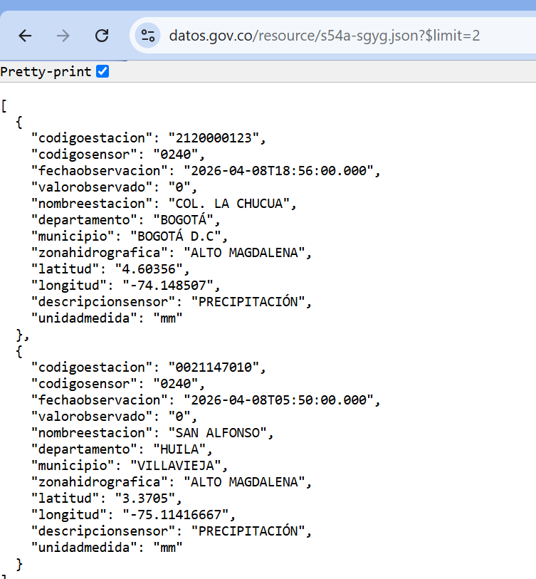

| Lo que aparece | Qué significa |
|---|---|
| `Pretty-print` ☑ | Opción del navegador (Chrome) para mostrar el JSON ordenado con sangrías. No es parte de los datos. |
| `[ ... ]` | Corchetes: una **lista**. Aquí trae 2 elementos, porque pedimos `$limit=2`. |
| `{ ... }` | Llaves: un **objeto**, es decir, **una observación** (una fila de la tabla). |
| `codigoestacion` | Código único de la estación meteorológica (ej. `2120000123`). |
| `codigosensor` | Código del sensor. `0240` = sensor de **precipitación**. |
| `fechaobservacion` | Fecha y hora de la medición (`2026-04-08T18:56:00.000` = 8 de abril de 2026 a las 6:56 pm). La `T` separa la fecha de la hora. |
| `valorobservado` | Lo que midió el sensor: `"0"` = **0 mm de lluvia** en ese intervalo. |
| `nombreestacion` | Nombre de la estación (`COL. LA CHUCUA`, `SAN ALFONSO`). |
| `departamento`, `municipio` | Ubicación (`BOGOTÁ`, `HUILA` / `VILLAVIEJA`). Con `departamento` filtraremos Antioquia. |
| `zonahidrografica` | Cuenca a la que pertenece (`ALTO MAGDALENA`). Importa para energía: la lluvia en una cuenca llena los embalses de esa cuenca. |
| `latitud`, `longitud` | Coordenadas de la estación (sirven para hacer mapas). |
| `descripcionsensor` | Qué mide el sensor: `PRECIPITACIÓN`. |
| `unidadmedida` | Unidad del valor: `mm` (milímetros de lluvia; 1 mm = 1 litro de agua por metro cuadrado). |

> 💬 **Para observar:**
> - **Todos los valores vienen entre comillas**, incluso los números (`"0"`, `"4.60356"`): la API los entrega como **texto**. En bronce se guardan así; en plata se convierten a número.
> - Las 2 filas son de **estaciones y departamentos distintos** y no están en orden: la API devuelve lo primero que encuentra. Para pedir algo útil hay que **filtrar** (`$where`) y **ordenar** (`$order`).
> - Cada fila es **una medición de pocos minutos** en una sola estación. Por eso el dataset tiene millones de filas y conviene **agregar** (sumar por día) en el servidor.

**Opción B · Con código.** La misma consulta se puede hacer desde la terminal de VS Code (con PowerShell):

```powershell
Invoke-RestMethod 'https://www.datos.gov.co/resource/s54a-sgyg.json?$limit=2'
```

| Parte del comando | Qué significa |
|---|---|
| `Invoke-RestMethod` | Comando de PowerShell que llama a una API y convierte el JSON en una tabla legible. Sin `-Method`, usa **GET**, como el navegador. |
| `'...'` (comillas **simples**) | Obligatorias aquí: con comillas dobles, PowerShell confundiría `$limit` con una variable suya y la borraría de la URL. |

**Resultado real:**

```text
(.venv) PS C:\clases\observatorio-energia> Invoke-RestMethod 'https://www.datos.gov.co/resource/s54a-sgyg.json?$limit=2'


codigoestacion    : 2120000123
codigosensor      : 0240
fechaobservacion  : 2026-04-08T18:56:00.000
valorobservado    : 0
nombreestacion    : COL. LA CHUCUA
departamento      : BOGOTÁ
municipio         : BOGOTÁ D.C
zonahidrografica  : ALTO MAGDALENA
latitud           : 4.60356
longitud          : -74.148507
descripcionsensor : PRECIPITACIÓN
unidadmedida      : mm

codigoestacion    : 0021147010
codigosensor      : 0240
fechaobservacion  : 2026-04-08T05:50:00.000
valorobservado    : 0
nombreestacion    : SAN ALFONSO
departamento      : HUILA
municipio         : VILLAVIEJA
zonahidrografica  : ALTO MAGDALENA
latitud           : 3.3705
longitud          : -75.11416667
descripcionsensor : PRECIPITACIÓN
unidadmedida      : mm
```

| Lo que aparece | Qué significa |
|---|---|
| Dos **bloques** separados por una línea en blanco | Cada bloque es **una observación** (una fila). Son 2 porque pedimos `$limit=2`. Equivalen a los dos `{ ... }` del navegador. |
| `campo : valor` | PowerShell convirtió el JSON en **objetos** y los muestra en formato de lista: a la izquierda el nombre del campo, a la derecha su valor. Ya no hay llaves, corchetes ni comillas. |
| Los mismos campos y valores que en el navegador | Es **la misma API y la misma respuesta**; solo cambia quién la pide y cómo se muestra. Los campos se explicaron en la tabla de la Opción A. |

> 🔍 **Navegador vs. código:** el navegador sirve para **explorar** una API rápidamente. El código sirve para **automatizar**: se puede repetir, agregar filtros, pedir miles de páginas y guardar el resultado sin intervención. Eso es lo que hace `ideam.py`.

Y en Python es lo que hace el extractor (Parte 4.2) con la librería `requests`: arma la misma URL con sus parámetros, la pide y recibe la lista de filas.

Y esta otra URL ya **filtra y agrega en el servidor** (lluvia diaria por estación en Antioquia, una semana):

```text
https://www.datos.gov.co/resource/s54a-sgyg.json?$select=nombreestacion,date_trunc_ymd(fechaobservacion) as fecha,sum(valorobservado) as mm&$where=departamento='ANTIOQUIA' AND fechaobservacion between '2026-07-01T00:00:00' and '2026-07-07T23:59:59'&$group=nombreestacion,fecha&$limit=5
```

> ⚠️ **Esta URL va en el NAVEGADOR, no en la terminal.** Si se pega en la terminal de VS Code, PowerShell la trata como un comando y responde en rojo:
>
> ```text
> Falta un argumento en la lista de parámetros.
> No se permite usar el carácter de Y comercial (&). El operador & está reservado para un uso futuro...
> + CategoryInfo          : ParserError: (:) [], ParentContainsErrorRecordException
> ```
>
> **Por qué pasa:** para PowerShell, `$select` y `$where` son **variables** suyas, los paréntesis y las comas tienen significado especial, y el `&` es un **operador reservado**. No entiende la línea como una dirección web (`ParserError` = error al leer el comando).
>
> **Qué hacer:** nada se dañó. Copien la URL y péguenla en la **barra de direcciones del navegador** (Chrome, Edge…), luego presionen Enter.

#### ¿Cómo se llega a esa URL? Se arma por partes, a partir de una pregunta

Nadie se la sabe de memoria: se **construye**. El método es siempre el mismo:

**1. Escribir la pregunta en español.**
> *"¿Cuánto llovió cada día en cada estación de Antioquia durante la primera semana de julio de 2026?"*

**2. Conocer los nombres de los campos.** Salen de la consulta anterior (`$limit=2`): `nombreestacion`, `fechaobservacion`, `valorobservado`, `departamento`… También aparecen en la página del dataset en datos.gov.co (sección *Columnas de esta tabla* y botón **Acciones → API**).

**3. Traducir cada parte de la pregunta a un parámetro SoQL.** La documentación oficial del lenguaje está en `dev.socrata.com` (SoQL).

| Parte de la pregunta | Parámetro SoQL | Qué se escribe |
|---|---|---|
| "en cada estación… cada día… cuánto llovió" → **qué columnas quiero** | `$select` (= `SELECT`) | `nombreestacion,date_trunc_ymd(fechaobservacion) as fecha,sum(valorobservado) as mm` |
| "de Antioquia… primera semana de julio" → **qué filas quiero** | `$where` (= `WHERE`) | `departamento='ANTIOQUIA' AND fechaobservacion between '2026-07-01T00:00:00' and '2026-07-07T23:59:59'` |
| "**cada** estación, **cada** día" → **cómo agrupo** para sumar | `$group` (= `GROUP BY`) | `nombreestacion,fecha` |
| "muéstreme solo unas pocas" → **cuántas filas** | `$limit` (= `LIMIT`) | `5` |

**4. Unir las piezas:** dirección del dataset + `?` + parámetros separados por `&`.

```text
https://www.datos.gov.co/resource/s54a-sgyg.json
   ?$select=nombreestacion,date_trunc_ymd(fechaobservacion) as fecha,sum(valorobservado) as mm
   &$where=departamento='ANTIOQUIA' AND fechaobservacion between '2026-07-01T00:00:00' and '2026-07-07T23:59:59'
   &$group=nombreestacion,fecha
   &$limit=5
```

(Aquí está partida en líneas solo para leerla; en el navegador va **en una sola línea**.)

**Qué significa cada elemento:**

| Elemento | Qué significa |
|---|---|
| `?` | Empieza la lista de parámetros. |
| `&` | Separa un parámetro del siguiente. |
| `nombreestacion` | Traer el nombre de la estación. |
| `date_trunc_ymd(fechaobservacion)` | Función que **recorta** la fecha y hora al **día** (*ymd* = *year, month, day*): `2026-07-02T14:35` y `2026-07-02T21:10` quedan ambas como `2026-07-02T00:00`. Así todas las mediciones del mismo día quedan juntas. |
| `as fecha` | **Alias**: le pone un nombre corto a la columna calculada. |
| `sum(valorobservado)` | **Suma** todas las mediciones de lluvia del grupo = lluvia total del día. |
| `as mm` | Alias de la suma: la columna se llamará `mm`. |
| `departamento='ANTIOQUIA'` | Solo filas de Antioquia. Los textos van entre **comillas simples** y en mayúsculas, tal como están en los datos. |
| `AND` | Ambas condiciones deben cumplirse. |
| `fechaobservacion between '...' and '...'` | Solo mediciones entre el 1 de julio a las 00:00:00 y el 7 de julio a las 23:59:59. |
| `$group=nombreestacion,fecha` | Forma un grupo por cada combinación **estación + día**, y en cada grupo aplica el `sum`. |
| `$limit=5` | Solo 5 filas, para mirar. El extractor quitará este límite y usará paginación. |

> 🔤 **Lo que muestra la barra del navegador:** al presionar Enter, la URL cambia a `...nombreestacion,date_trunc_ymd(fechaobservacion)%20as%20fecha...departamento=%27ANTIOQUIA%27%20AND...`. Es la misma URL **codificada**: las direcciones web no admiten espacios ni comillas, así que el navegador los reemplaza por códigos: `%20` = espacio, `%27` = comilla simple `'`. En Python, la librería `requests` hace esta codificación automáticamente.

**Resultado real:**

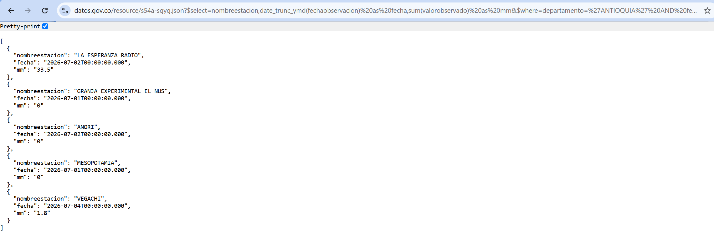

| Lo que aparece | Qué significa |
|---|---|
| 5 objetos `{ ... }` | 5 filas, por el `$limit=5`. Cada una es **una estación en un día**, ya no una medición de minutos. |
| Solo 3 campos | Exactamente los que pedimos en `$select`, con los nombres de los alias: `nombreestacion`, `fecha` y `mm`. Los demás campos (latitud, sensor…) no viajaron. |
| `"nombreestacion": "LA ESPERANZA RADIO"` | Estaciones de Antioquia: La Esperanza Radio, Granja Experimental El Nus, Anorí, Mesopotamia, Vegachí. El filtro `$where` funcionó. |
| `"fecha": "2026-07-02T00:00:00.000"` | El día, con la hora en ceros: es el efecto de `date_trunc_ymd`. |
| `"mm": "33.5"` | Lluvia **total del día** en esa estación: 33,5 mm el 2 de julio en La Esperanza Radio (un aguacero fuerte). La API sumó por nosotros todas las mediciones de ese día. |
| `"mm": "0"` | Ese día no llovió en esa estación. |
| Fechas en desorden (02, 01, 02, 01, 04) | No pedimos `$order`, así que la API devuelve los grupos en cualquier orden. El extractor agrega `$order=fecha, codigoestacion`. |

> 💡 **La idea de ingeniería:** una estación puede reportar cada pocos minutos (cientos de mediciones al día). Con `$group` + `sum` el **servidor** hizo la suma y nos envió **una sola fila por estación y día**. Menos datos por la red, descarga más rápida, mismo resultado.

### 4.2 El extractor: `src/extract/ideam.py`

```python
"""
Fuente 2 - IDEAM en datos.gov.co (plataforma Socrata, lenguaje de consulta SoQL).
  - El dataset tiene MILLONES de observaciones (una cada pocos minutos desde 2005)
  - Por eso FILTRAMOS ($where) y AGREGAMOS ($select + $group) EN EL SERVIDOR:
    viaja un resumen diario por estacion, no millones de filas
  - Ademas paginamos con $limit / $offset por si una ventana trae muchas filas
Documentacion SoQL: https://dev.socrata.com/docs/queries/
"""
# ---------------------------------------------------------------------------
# IMPORTS (traer codigo que ya existe)
# ---------------------------------------------------------------------------
import pandas as pd     # pandas: libreria de tablas. "as pd" le pone el nombre corto pd.
                        # Aqui se usa para convertir la lista de filas en tabla (DataFrame).

from src import config  # config.py de este proyecto: URL del IDEAM, departamento, fechas, ventana.
from src.utils import guardar_bronce, http_json, log, ventanas, ya_existe
# Funciones de utils.py de este proyecto:
#   guardar_bronce: guarda la tabla en Parquet con 3 columnas de linaje
#   http_json:      le envia un pedido a una API y devuelve la respuesta; reintenta si falla
#   log:            escribe un mensaje en pantalla con la hora
#   ventanas:       parte un rango de fechas en bloques (aqui, de 7 dias)
#   ya_existe:      dice si el archivo ya esta en bronce (para no descargarlo otra vez)

# ---------------------------------------------------------------------------
# CONSTANTES: valores fijos de este extractor (en MAYUSCULAS por convencion)
# ---------------------------------------------------------------------------
NOMBRE = "ideam_precipitacion_diaria"     # nombre del archivo en bronce
CAMPOS = "codigoestacion, nombreestacion, municipio, latitud, longitud"   # columnas que se piden
PAGINA = 50000                            # filas maximas por pedido ($limit)

# ---------------------------------------------------------------------------
# NOTA sobre "offset: int" o "-> dict" en las funciones:
# son ANOTACIONES DE TIPO. Dicen que tipo de dato se espera (int = numero entero,
# bool = verdadero/falso, dict = diccionario) y que devuelve la funcion.
# Python no las obliga: sirven para que el codigo se entienda mejor.
# ---------------------------------------------------------------------------


def consulta_soql(inicio, fin, offset: int) -> dict:
    """Arma los parametros SoQL: filtrar Antioquia y fechas, y sumar la lluvia por dia."""
    # Devuelve un diccionario {parametro: valor}. Son los mismos parametros que se
    # escribieron a mano en la URL del navegador en la Parte 4.1.
    return {
        "$select": f"{CAMPOS}, date_trunc_ymd(fechaobservacion) AS fecha, "      # el dia
                   f"sum(valorobservado) AS precipitacion_mm, count(*) AS n_obs",  # suma y conteo
        "$where": f"departamento = '{config.IDEAM_DEPARTAMENTO}' AND "           # solo Antioquia
                  f"fechaobservacion BETWEEN '{inicio}T00:00:00' AND '{fin}T23:59:59'",   # esa semana
        "$group": f"{CAMPOS}, fecha",             # un grupo por estacion y dia
        "$order": "fecha, codigoestacion",        # ordenado por fecha y estacion
        "$limit": PAGINA,                         # filas por pagina
        "$offset": offset,                        # filas que se saltan (para pedir la pagina siguiente)
    }


def extraer(forzar: bool = False) -> None:
    """Descarga la lluvia diaria por estacion, semana por semana, y la guarda en bronce."""
    # forzar: bool = False -> si no se indica nada, forzar vale False (no repetir descargas).
    log("IDEAM - datos abiertos (SoQL)")
    if ya_existe(NOMBRE, forzar):                 # si el archivo ya esta en bronce...
        return                                    # ...termina aqui, sin descargar
    filas = []                                    # aqui se juntan las filas de todas las semanas
    for inicio, fin in ventanas(config.IDEAM_FECHA_INICIO, config.FECHA_FIN, config.IDEAM_DIAS_VENTANA):
        offset = 0                                # empezar por la primera pagina
        while True:                               # paginacion: repetir hasta la ultima pagina
            # GET con los parametros SoQL; requests los pone en la URL despues de ?
            # La respuesta es una lista de filas (cada fila es un diccionario).
            lote = http_json("GET", config.IDEAM_URL, params=consulta_soql(inicio, fin, offset))
            filas.extend(lote)                    # agrega las filas de esta pagina
            if len(lote) < PAGINA:                # llegaron menos filas que el limite: era la ultima
                break                             # break: sale del while
            offset += PAGINA                      # pedir la siguiente pagina
        log(f"   semana {inicio} a {fin}: {len(lote)} filas")
    # pd.DataFrame(filas) convierte la lista de filas en una tabla de pandas,
    # y guardar_bronce() la guarda en data/bronze/<NOMBRE>.parquet
    guardar_bronce(pd.DataFrame(filas), NOMBRE, fuente="IDEAM", origen=config.IDEAM_URL)


# ---------------------------------------------------------------------------
# Este bloque solo se ejecuta cuando se corre ESTE archivo directamente:
#     python -m src.extract.ideam
# Cuando otro archivo lo importa (como pipeline.py), este bloque NO se ejecuta.
# ---------------------------------------------------------------------------
if __name__ == "__main__":
    import sys      # sys.argv: lista con lo que se escribio en el comando
    extraer(forzar="--forzar" in sys.argv)   # True si el comando trae --forzar
```

### 4.3 Ejecutarlo

En la terminal, con el entorno activo (`(.venv)` al inicio del prompt):

```powershell
python -m src.extract.ideam
```

| Parte del comando | Qué significa |
|---|---|
| `python -m` | Ejecutar un módulo del proyecto (igual que con XM). |
| `src.extract.ideam` | El archivo `src/extract/ideam.py`. |

Tarda **entre 1,5 y 3 minutos**. Salida real completa:

```text
(.venv) PS C:\clases\observatorio-energia> python -m src.extract.ideam
[21:44:17] IDEAM - datos abiertos (SoQL)
[21:44:20]    semana 2026-06-01 a 2026-06-07: 374 filas
[21:44:24]    semana 2026-06-08 a 2026-06-14: 389 filas
[21:44:27]    semana 2026-06-15 a 2026-06-21: 384 filas
[21:44:33]    semana 2026-06-22 a 2026-06-28: 385 filas
[21:44:38]    semana 2026-06-29 a 2026-07-05: 328 filas
[21:44:44]    semana 2026-07-06 a 2026-07-12: 311 filas
[21:44:51]    semana 2026-07-13 a 2026-07-19: 360 filas
[21:45:00]    semana 2026-07-20 a 2026-07-26: 253 filas
[21:45:01]    semana 2026-07-27 a 2026-08-02: 0 filas
[21:45:02]    semana 2026-08-03 a 2026-08-09: 0 filas
[21:45:04]    semana 2026-08-10 a 2026-08-16: 0 filas
[21:45:06]    semana 2026-08-17 a 2026-08-23: 0 filas
[21:45:21]    semana 2026-08-24 a 2026-08-30: 0 filas
[21:45:30]    semana 2026-08-31 a 2026-09-06: 0 filas
[21:45:37]    semana 2026-09-07 a 2026-09-13: 0 filas
[21:45:46]    semana 2026-09-14 a 2026-09-20: 0 filas
[21:45:50]    semana 2026-09-21 a 2026-09-27: 0 filas
[21:45:53]    semana 2026-09-28 a 2026-09-30: 0 filas
[21:45:53]    + ideam_precipitacion_diaria.parquet guardado: 2,784 filas x 11 columnas
```

**¿Qué significa cada parte de la salida?**

| Lo que aparece | Qué significa |
|---|---|
| `[21:44:17]` | Hora de cada mensaje. Del inicio (21:44:17) al final (21:45:53) pasaron **1 minuto y 36 segundos**. |
| `IDEAM - datos abiertos (SoQL)` | Inicio de la extracción del IDEAM. |
| `semana 2026-06-01 a 2026-06-07` | La **ventana** de esa petición: 7 días (`IDEAM_DIAS_VENTANA = 7` en `config.py`). Empieza el 1 de junio porque así lo dice `IDEAM_FECHA_INICIO`. Son **18 ventanas** hasta el 30 de septiembre; la última, de solo 3 días. |
| `: 374 filas` | Filas que devolvió el servidor para esa semana. Cada fila es **una estación en un día** (ya agregada), no una medición. 374 ÷ 7 días ≈ **53 estaciones** de Antioquia reportando por día. |
| Entre 3 y 15 segundos por semana | Es lo que tarda el **servidor** en filtrar y sumar millones de mediciones antes de responder. Varía según la carga de datos.gov.co. |
| `: 0 filas` desde el 27 de julio | No hay datos publicados todavía para esas fechas (ver hallazgo 1, abajo). No es un error. |
| `+ ideam_precipitacion_diaria.parquet guardado` | El archivo nuevo quedó en `data/bronze/`. |
| `2,784 filas` | La suma de las 8 semanas con datos: 374 + 389 + 384 + 385 + 328 + 311 + 360 + 253 = **2.784**. (La coma es el separador de miles en inglés.) |
| `x 11 columnas` | Los 5 campos pedidos (`codigoestacion`, `nombreestacion`, `municipio`, `latitud`, `longitud`) + `fecha` + `precipitacion_mm` (la suma de lluvia del día) + `n_obs` (cuántas mediciones se sumaron) = **8**, más las **3 de linaje** (`_fuente`, `_origen`, `_extraido_en`) = **11**. |

> 💬 **Dos hallazgos para discutir:**
> 1. **Desde finales de julio llegan 0 filas.** No es un error del código: el IDEAM publica con un **rezago de unos 2,5 meses** (su último dato es del 24 de julio de 2026). XM, en cambio, ya tenía septiembre completo. En un proyecto de integración las fuentes **no están sincronizadas**, y eso se documenta.
> 2. **Es la fuente más lenta**, porque el servidor agrega millones de filas en cada petición. Por eso en `config.py` el IDEAM empieza el 1 de junio y no el 1 de enero: si se pidieran los 9 meses completos tardaría unos 7 minutos.

> 🔍 **Comparen con la Parte 4.1:** en el navegador pedimos **5 filas de una semana**. El programa pidió **18 semanas** con paginación y guardó **2.784 resúmenes diarios**, sin intervención.

> 📁 En el EXPLORER de VS Code, la carpeta `data/bronze/` ahora debe tener **4 archivos** `.parquet`: los 3 de XM y el del IDEAM.

---

## Parte 5 · Archivos planos: NOAA y Excel (7:20 – 7:35)

### Idea central

- **NOAA – ONI:** un archivo de texto con columnas separadas por espacios. Indica si hay **El Niño** (anomalía ≥ +0,5) o **La Niña** (≤ −0,5).
- **Excel de EnerAndes:** el típico archivo interno de empresa, con una hoja por año, **encabezados distintos en cada hoja**, títulos encima de la tabla y una fila `TOTAL` al final.
- **Regla de bronce aplicada a archivos:** se leen **como texto** (`dtype=str`) y **sin interpretar encabezados** (`header=None`), y se guardan tal cual, una hoja por archivo.

### Conceptos clave

| Concepto | Qué es |
|---|---|
| **El Niño y La Niña** | Fenómenos climáticos del océano Pacífico. **El Niño** calienta el agua del océano y en Colombia trae **sequía**; **La Niña** la enfría y trae **lluvias**. |
| **ONI** (*Oceanic Niño Index*) | El índice oficial de NOAA (agencia de EE. UU.) que mide El Niño: cuántos grados está el océano por encima o por debajo de lo normal. Se calcula por **trimestres móviles**: `JAS` = julio-agosto-septiembre. |
| **Archivo separado por espacios** | Un archivo de texto donde las columnas se separan con espacios en lugar de comas. `sep=r"\s+"` le dice a pandas: "uno o más espacios separan las columnas". |
| **`dtype=str`** | Leer **todas** las columnas como texto, sin que pandas intente adivinar si son números o fechas. En bronce no queremos que nada cambie el dato original. |
| **`header=None`** | No tomar ninguna fila como encabezado: leer el archivo exactamente como está. Sirve porque en el Excel el encabezado real no está en la primera fila. |
| **NaN** (*Not a Number*) | Así representa pandas una **celda vacía** o un valor que no existe. |

### 5.0 Mirar el archivo crudo antes de programar

NOAA no tiene API: publica un **archivo de texto plano** (`.txt`). Antes de escribir código para leer un archivo, un ingeniero de datos **lo abre y lo mira**: qué separa las columnas, si tiene encabezado, cuántas filas, dónde empieza y dónde termina.

Peguen esta dirección en el **navegador**:

```text
https://www.cpc.ncep.noaa.gov/data/indices/oni.ascii.txt
```

| Parte de la URL | Qué significa |
|---|---|
| `cpc.ncep.noaa.gov` | El *Climate Prediction Center* (Centro de Predicción Climática) de NOAA, la agencia del clima de EE. UU. |
| `/data/indices/` | Carpeta pública donde publican los índices climáticos. |
| `oni.ascii.txt` | El archivo del índice ONI en **texto ASCII** (texto simple, sin formato). |

**Resultado real (inicio del archivo):**

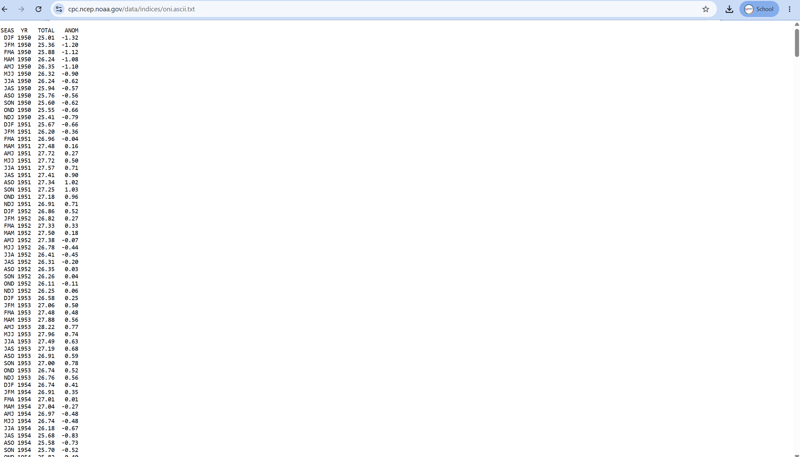

```text
SEAS  YR   TOTAL   ANOM
  DJF 1950  25.01  -1.32
  JFM 1950  25.36  -1.20
  FMA 1950  25.88  -1.12
  ...
```

**Final del archivo (los datos más recientes):**

```text
  ...
  DJF 2026  26.15  -0.39
  JFM 2026  26.57  -0.21
  FMA 2026  27.34   0.11
  MAM 2026  28.09   0.46
  AMJ 2026  28.74   0.95
  MJJ 2026  29.02   1.39
  JJA 2026  29.09   1.80
  JAS 2026  29.12   2.16
```

| Columna | Qué significa | Ejemplo |
|---|---|---|
| `SEAS` (*season*, temporada) | El **trimestre móvil**: las iniciales en inglés de 3 meses seguidos. Cada fila avanza un mes. | `DJF` = diciembre-enero-febrero; `JAS` = julio-agosto-septiembre. |
| `YR` (*year*) | El año del trimestre. | `2026` |
| `TOTAL` | **Temperatura promedio** del agua en la superficie del Pacífico central, en °C, durante ese trimestre. | `29.12` °C |
| `ANOM` (anomalía) | **Cuántos grados está por encima (+) o por debajo (−) de lo normal**. Este es el **ONI**. | `2.16` = 2,16 °C más caliente que lo normal. |

**Cómo se lee `ANOM`:**

| Valor de `ANOM` | Significa | Efecto típico en Colombia |
|---|---|---|
| ≥ **+0,5** | **El Niño** | Menos lluvia, embalses bajos, **precio de la energía alto**. |
| entre −0,5 y +0,5 | Neutral | Condiciones normales. |
| ≤ **−0,5** | **La Niña** | Más lluvia, embalses llenos, precio bajo. |
| ≥ +1,5 | El Niño **fuerte** | Riesgo de racionamiento (como en 1992 y 2016). |

**Qué observamos al mirar el archivo (y cómo lo usa el código):**

| Observación | Decisión en el código (`noaa.py`) |
|---|---|
| Las columnas se separan con **uno o varios espacios** (no con comas). | `sep=r"\s+"` = "uno o más espacios". |
| La **primera fila es el encabezado** (`SEAS YR TOTAL ANOM`). | Se deja que pandas la use como nombres de columna (no hace falta `header=None`). |
| Hay **espacios al inicio** de cada fila de datos. | `\s+` también los ignora. |
| Son **920 filas** de datos: de 1950 a 2025 (76 años × 12 trimestres = 912) más 8 de 2026. | Es pequeño: se descarga completo, sin ventanas ni paginación. |
| El último dato es **JAS 2026**. `ASO 2026` (agosto-septiembre-octubre) todavía no existe porque octubre no ha terminado. | El archivo **crece** cada mes: volver a extraerlo con `--forzar` trae el dato nuevo. |
| Los valores son texto con punto decimal (`-1.32`). | `dtype=str`: en bronce se guardan como texto, tal cual. |

> 🌡️ **Para la discusión:** el ONI pasó de **−0,39** (DJF 2026) a **+2,16** (JAS 2026): en 6 meses se formó un **El Niño fuerte**, comparable con los de 1997 (2,37) y 2015 (2,59). Coincide con lo que vimos en XM: el precio de bolsa subió de unos 212 a 942 COP/kWh entre enero y agosto. **Integrar fuentes** es justamente poder conectar estas dos historias con datos.

### 5.1 `src/extract/noaa.py`

```python
"""
Fuente 3 - NOAA: indice ONI de El Nino (archivo de texto separado por espacios).
  Columnas: SEAS (trimestre movil, ej. JAS), YR (anio), TOTAL (temp. del mar), ANOM (anomalia)
  ANOM >= +0.5  -> El Nino      ANOM <= -0.5 -> La Nina
"""
# ---------------------------------------------------------------------------
# IMPORTS (traer codigo que ya existe)
# ---------------------------------------------------------------------------
import io               # io: libreria de Python para manejar entradas y salidas.
                        # io.StringIO hace que un texto en memoria se lea como si fuera un archivo.

import pandas as pd     # pandas: libreria de tablas. "as pd" le pone el nombre corto pd.
                        # Aqui se usa read_csv para leer el texto como tabla.

from src import config  # config.py de este proyecto: la URL del archivo de NOAA.
from src.utils import guardar_bronce, http_texto, log, ya_existe
# Funciones de utils.py de este proyecto:
#   guardar_bronce: guarda la tabla en Parquet con 3 columnas de linaje
#   http_texto:     descarga un archivo de texto de internet; reintenta si falla
#   log:            escribe un mensaje en pantalla con la hora
#   ya_existe:      dice si el archivo ya esta en bronce (para no descargarlo otra vez)

NOMBRE = "noaa_oni"     # CONSTANTE: nombre del archivo en bronce


def extraer(forzar: bool = False) -> None:
    """Descarga el archivo del indice ONI y lo guarda en bronce."""
    # forzar: bool = False -> ANOTACION DE TIPO (forzar es verdadero/falso) con valor
    # por defecto False: si no se indica nada, no se repiten descargas.
    # -> None: la funcion no devuelve nada, solo hace el trabajo.
    log("NOAA - indice ONI (El Nino)")
    if ya_existe(NOMBRE, forzar):               # si el archivo ya esta en bronce...
        return                                  # ...termina aqui, sin descargar
    texto = http_texto(config.NOAA_ONI_URL)     # descarga el .txt completo como un texto
    # read_csv lee "archivos" con columnas. Como el texto esta en memoria y no en el
    # disco, io.StringIO(texto) lo presenta como si fuera un archivo.
    # sep=r"\s+": uno o mas espacios separan las columnas
    # dtype=str: en bronce guardamos el texto tal cual, sin convertir tipos
    df = pd.read_csv(io.StringIO(texto), sep=r"\s+", dtype=str)
    guardar_bronce(df, NOMBRE, fuente="NOAA", origen=config.NOAA_ONI_URL)   # data/bronze/noaa_oni.parquet


# ---------------------------------------------------------------------------
# Este bloque solo se ejecuta cuando se corre ESTE archivo directamente:
#     python -m src.extract.noaa
# Cuando otro archivo lo importa (como pipeline.py), este bloque NO se ejecuta.
# ---------------------------------------------------------------------------
if __name__ == "__main__":
    import sys      # sys.argv: lista con lo que se escribio en el comando
    extraer(forzar="--forzar" in sys.argv)   # True si el comando trae --forzar
```

### 5.2 `src/extract/enerandes.py`

```python
"""
Fuente 4 - Archivo interno de EnerAndes (Excel con una hoja por anio).
  Cada hoja tiene encabezados DISTINTOS y algunas traen un titulo encima.
  Regla de bronce: NO se modifica. Guardamos cada hoja tal cual, como texto,
  incluidas las filas de titulo y la fila TOTAL. Limpiar es trabajo de la capa plata.
"""
# ---------------------------------------------------------------------------
# IMPORTS (traer codigo que ya existe)
# ---------------------------------------------------------------------------
import pandas as pd     # pandas: libreria de tablas. "as pd" le pone el nombre corto pd.
                        # Aqui se usa read_excel para leer el Excel (usa openpyxl por debajo).

from src import config  # config.py de este proyecto: la ruta del Excel (data/insumos/...).
from src.utils import guardar_bronce, log, ya_existe
# Funciones de utils.py de este proyecto:
#   guardar_bronce: guarda la tabla en Parquet con 3 columnas de linaje
#   log:            escribe un mensaje en pantalla con la hora
#   ya_existe:      dice si el archivo ya esta en bronce (para no repetir el trabajo)


def extraer(forzar: bool = False) -> None:
    """Lee las 4 hojas del Excel de EnerAndes y guarda cada una en bronce."""
    # forzar: bool = False -> ANOTACION DE TIPO (forzar es verdadero/falso) con valor
    # por defecto False: si no se indica nada, no se repite el trabajo.
    # -> None: la funcion no devuelve nada, solo hace el trabajo.
    log("EnerAndes - Excel interno")
    archivo = config.ENERANDES_EXCEL               # ruta completa del Excel
    if not archivo.exists():                       # .exists(): el archivo esta en el disco?
        # raise detiene el programa con un error y un mensaje claro de que hacer
        raise FileNotFoundError(f"No se encontro {archivo}. Copielo en data/insumos/.")

    # sheet_name=None -> lee TODAS las hojas y devuelve un diccionario {nombre_hoja: tabla}
    # header=None     -> no interpreta ninguna fila como encabezado (tal cual)
    # dtype=str       -> todo como texto, sin convertir
    hojas = pd.read_excel(archivo, sheet_name=None, header=None, dtype=str)
    for nombre_hoja, df in hojas.items():          # .items(): recorre el diccionario, una vuelta por hoja
        # .lower() pasa a minusculas y .replace(" ", "_") cambia espacios por guion bajo:
        # "Ventas 2024" -> "enerandes_ventas_2024"
        nombre = "enerandes_" + nombre_hoja.lower().replace(" ", "_")
        if ya_existe(nombre, forzar):
            continue                               # continue: salta a la siguiente hoja
        # Como no hay encabezado, pandas nombra las columnas 0, 1, 2...
        # Parquet exige nombres de texto: se cambian por col_0, col_1, col_2...
        # df.shape[1] = numero de columnas de la hoja.
        df.columns = [f"col_{i}" for i in range(df.shape[1])]
        guardar_bronce(df, nombre, fuente="EnerAndes", origen=f"{archivo.name}#{nombre_hoja}")


# ---------------------------------------------------------------------------
# Este bloque solo se ejecuta cuando se corre ESTE archivo directamente:
#     python -m src.extract.enerandes
# Cuando otro archivo lo importa (como pipeline.py), este bloque NO se ejecuta.
# ---------------------------------------------------------------------------
if __name__ == "__main__":
    import sys      # sys.argv: lista con lo que se escribio en el comando
    extraer(forzar="--forzar" in sys.argv)   # True si el comando trae --forzar
```

### 5.3 Ejecutar el extractor de NOAA

En la terminal, con el entorno activo:

```powershell
python -m src.extract.noaa
```

| Parte del comando | Qué significa |
|---|---|
| `python -m` | Ejecutar un módulo del proyecto. |
| `src.extract.noaa` | El archivo `src/extract/noaa.py`. |

Tarda **1 o 2 segundos**. Salida real:

```text
(.venv) PS C:\clases\observatorio-energia> python -m src.extract.noaa
[21:50:11] NOAA - indice ONI (El Nino)
[21:50:12]    + noaa_oni.parquet guardado: 920 filas x 7 columnas
```

| Lo que aparece | Qué significa |
|---|---|
| `NOAA - indice ONI (El Nino)` | Inicio de la extracción de NOAA. |
| `[21:50:11]` → `[21:50:12]` | Tardó **un segundo**: es un solo archivo pequeño, sin ventanas ni paginación. Compárenlo con los 25 segundos de XM y el minuto y medio del IDEAM. |
| `+ noaa_oni.parquet guardado` | Archivo nuevo en `data/bronze/`. |
| `920 filas` | Las mismas 920 filas que vimos en el navegador (Parte 5.0): 1950–2025 (912) + 8 trimestres de 2026. La fila del encabezado no cuenta: pandas la usó como nombres de columna. **Nada se perdió en el camino.** |
| `x 7 columnas` | Las 4 del archivo (`SEAS`, `YR`, `TOTAL`, `ANOM`) + las 3 de linaje (`_fuente`, `_origen`, `_extraido_en`) = **7**. |

> ✅ **Verificación de extracción:** comparar lo que tiene la fuente (920 filas, 4 columnas) con lo que quedó en bronce (920 filas, 4 + 3 columnas) es la prueba más básica de que la extracción fue **completa y fiel**. En la EA1 se pide hacer este tipo de verificación.

> 📁 `data/bronze/` debe tener ahora **5 archivos** `.parquet`.

### 5.4 Ejecutar el extractor del Excel de EnerAndes

```powershell
python -m src.extract.enerandes
```

| Parte del comando | Qué significa |
|---|---|
| `src.extract.enerandes` | El archivo `src/extract/enerandes.py`. No descarga nada de internet: lee el Excel que ya está en `data/insumos/ventas_enerandes_2023_2026.xlsx`. |

Tarda **1 segundo**. Salida real:

```text
(.venv) PS C:\clases\observatorio-energia> python -m src.extract.enerandes
[21:51:21] EnerAndes - Excel interno
[21:51:22]    + enerandes_ventas_2023.parquet guardado: 1,114 filas x 10 columnas
[21:51:22]    + enerandes_ventas_2024.parquet guardado: 1,114 filas x 11 columnas
[21:51:22]    + enerandes_ventas_2025.parquet guardado: 1,117 filas x 10 columnas
[21:51:22]    + enerandes_ventas_2026.parquet guardado: 839 filas x 10 columnas
```

| Lo que aparece | Qué significa |
|---|---|
| `EnerAndes - Excel interno` | Inicio de la extracción del archivo interno de la empresa. |
| **4 líneas** `+ ... guardado` | El Excel tiene **4 hojas** (`Ventas 2023` … `Ventas 2026`) y se guardó **un parquet por hoja**. El nombre sale de la hoja: `Ventas 2023` → `enerandes_ventas_2023`. |
| `1,114 filas` (2023 y 2024) | **1 fila de encabezado + 1.112 filas de datos + 1 fila `TOTAL`**. Como usamos `header=None`, el encabezado y el total se guardan **como filas** más. |
| `1,117 filas` (2025) | Esta hoja trae **3 filas extra encima**: un título (`EnerAndes S.A.S. E.S.P. - Reporte de ventas 2025…`), una línea `Fuente: sistema comercial…` y una fila vacía. Luego el encabezado, 1.112 datos y el `TOTAL`: 3 + 1 + 1.112 + 1 = **1.117**. |
| `839 filas` (2026) | Mismo formato que 2025 (título, fuente, fila vacía, encabezado y `TOTAL`), pero con solo **834 filas de datos**, porque el año 2026 va hasta septiembre. |
| `x 10 columnas` (2023, 2025, 2026) | 7 columnas de datos (fecha, municipio, segmento, tipo de compra, energía, valor, clientes) + 3 de linaje = **10**. |
| `x 11 columnas` (2024) | La hoja 2024 tiene **una columna más**: `UNIDAD`, porque ese año la energía se registró unas veces en **kWh** y otras en **MWh**. 8 + 3 = **11**. |

**Cada hoja tiene encabezados distintos para los mismos datos:**

| Dato | Hoja 2023 | Hoja 2024 | Hoja 2025 | Hoja 2026 |
|---|---|---|---|---|
| Fecha | `Fecha` (`2023-04`) | `PERIODO` (`jun-24`, `09/2024`, `2024-07`) | `mes` (`06/2025`) | `Fecha corte` (`01/03/2026`) |
| Municipio | `Municipio` | `MUNICIPIO` | `municipio` | `Ciudad` |
| Energía | `Energia_kWh` | `ENERGIA` + `UNIDAD` | `consumo (kWh)` | `kWh` |

> 💬 **Así son los archivos internos reales:** cada año los hizo una persona distinta, con su propio formato. En bronce **no se modifica nada**: se guarda todo, incluidos títulos, encabezados como filas y la fila `TOTAL`. Si se modificara al leer, se perdería el original de cómo llegó el archivo. Unificar nombres, fechas y unidades es trabajo de la **capa plata** (semana 3).

> 📁 `data/bronze/` debe tener ahora **9 archivos** `.parquet`: 3 de XM, 1 del IDEAM, 1 de NOAA y 4 de EnerAndes.

### 5.5 Ver una hoja "sucia" en bronce

Se mira cómo quedó guardada la hoja 2025: sus **6 primeras filas** y sus **2 últimas**.

```powershell
python -c "import pandas as pd; df = pd.read_parquet('data/bronze/enerandes_ventas_2025.parquet'); print(df.iloc[:6, :7]); print(df.iloc[-2:, :7])"
```

| Parte del comando | Qué hace |
|---|---|
| `pd.read_parquet('data/bronze/enerandes_ventas_2025.parquet')` | Lee el parquet de la hoja 2025 y lo guarda en la tabla `df`. |
| `.iloc[ filas , columnas ]` | Selecciona filas y columnas **por posición** (número), no por nombre. |
| `df.iloc[:6, :7]` | `:6` = filas de la 0 a la 5 (las **6 primeras**); `:7` = columnas de la 0 a la 6 (las **7 de datos**, sin las de linaje). |
| `df.iloc[-2:, :7]` | `-2:` = las **2 últimas** filas (los números negativos cuentan desde el final). |
| `print(...); print(...)` | Muestra las dos selecciones, una debajo de la otra. |

**Resultado real:**

```text
                                               col_0      col_1  ...       col_5     col_6
0  EnerAndes S.A.S. E.S.P. - Reporte de ventas 20...        NaN  ...         NaN       NaN
1            Fuente: sistema comercial. Uso interno.        NaN  ...         NaN       NaN
2                                                NaN        NaN  ...         NaN       NaN
3                                                mes  municipio  ...   facturado  usuarios
4                                            06/2025   Apartadó  ...   143967156        87
5                                            08/2025   Rionegro  ...  1312367913      7708

[6 rows x 7 columns]
        col_0     col_1       col_2     col_3   col_4      col_5 col_6
1115  07/2025  Rionegro  Industrial  Contrato  901154  873937410    21
1116    TOTAL       NaN         NaN       NaN     NaN        NaN   NaN
```

| Lo que aparece | Qué significa |
|---|---|
| `col_0` … `col_6` | Nombres genéricos de columna. Como leímos con `header=None`, pandas no usó ninguna fila como encabezado, y el extractor les puso `col_0`, `col_1`… (Parquet exige que las columnas tengan nombre de texto). |
| `...` (en el centro) | La terminal es **angosta** y pandas **ocultó** las columnas del medio (`col_2` a `col_4`) para que la tabla quepa. Los datos están completos en el archivo; solo no se muestran. Por lo mismo, el título termina en `20...`. |
| Fila `0` | El **título** del reporte, pegado en la primera celda. No es un dato. |
| Fila `1` | Una nota (`Fuente: sistema comercial. Uso interno.`). Tampoco es un dato. |
| Fila `2` | Una fila **vacía**: todo `NaN`. |
| `NaN` | *Not a Number*: celda **vacía** en el Excel. |
| Fila `3` | El **encabezado real** (`mes`, `municipio`, …, `facturado`, `usuarios`). Está en la fila 3, no en la 0. |
| Filas `4` y `5` | Los primeros **datos** reales: junio de 2025 en Apartadó (facturado $143.967.156, 87 usuarios); agosto en Rionegro. |
| `[6 rows x 7 columns]` | pandas avisa el tamaño de lo que mostró, porque ocultó columnas. |
| Filas `1115` y `1116` | Las 2 últimas de las 1.117 (se numeran desde 0, así que la última es la 1.116). |
| Fila `1115` | El último dato real: julio de 2025, Rionegro, Industrial, Contrato, 901.154 kWh, $873.937.410, 21 usuarios. |
| Fila `1116` | La fila `TOTAL` del Excel. **No es un dato** y sus valores están vacíos (`NaN`). |

> 🖥️ **Para ver todas las columnas** sin los `...`: amplíen el panel de la terminal arrastrando su borde superior, o maximícenlo, y vuelvan a ejecutar el comando (flecha ↑ y Enter).

> 💬 **Pregunta para el grupo:** "¿Cuántos problemas de calidad ven en estas 8 filas?" Algunas respuestas:
> - el título y la fuente están **encima** del encabezado, que realmente está en la fila 3;
> - en la columna `col_3` (tipo de compra) aparecen `CONTRATOS` y `Contrato`: el **mismo valor escrito distinto** (se ve con la terminal ancha);
> - la fila `TOTAL` **no es un dato**, y su suma no se leyó (`NaN`) porque era una fórmula;
> - las fechas son **texto** con formato `MM/AAAA`.
>
> Todo eso se arregla en la **capa plata** (semana 3), no hoy.

---

## Parte 6 · Orquestar y consultar (7:35 – 7:45)

### Conceptos clave

| Concepto | Qué es |
|---|---|
| **Orquestar** | Coordinar varios procesos para que se ejecuten **en orden** desde un único punto, como el director de una orquesta. `pipeline.py` llama a los cuatro extractores uno tras otro. |
| **Punto de entrada** | El archivo que se ejecuta para poner en marcha todo el sistema. Aquí: `python -m src.pipeline`. |
| **DuckDB** | Un motor de base de datos **analítico** (OLAP) que corre dentro de Python, sin instalar servidor. Puede ejecutar SQL **directamente sobre archivos** Parquet o CSV. |
| **OLTP y OLAP** | **OLTP**: bases de datos para operar el día a día (registrar una venta, una a una). **OLAP**: bases de datos para **analizar** grandes volúmenes (sumar todas las ventas del año). DuckDB es OLAP. |


### 6.1 Un solo punto de entrada: `src/pipeline.py`

```python
"""
Punto de entrada unico del pipeline de extraccion (capa BRONCE).

Uso:
    python -m src.pipeline              # descarga lo que falte
    python -m src.pipeline --forzar     # vuelve a descargar todo
"""
# ---------------------------------------------------------------------------
# IMPORTS
# ---------------------------------------------------------------------------
import sys      # sys.argv: lista con lo que se escribio en el comando (ej. --forzar)
import time     # time.time(): segundos actuales, para medir cuanto tarda

import pandas as pd     # pandas: para abrir cada Parquet y contar filas y columnas

from src import config                              # configuracion central
from src.extract import enerandes, ideam, noaa, xm  # los 4 extractores (src/extract/*.py)
from src.utils import log                           # mensajes con hora


def resumen() -> None:
    """Muestra una tabla con los archivos de la capa bronce."""
    log("Resumen de la capa bronce:")
    # :<34 alinea a la izquierda en 34 espacios; :>10 a la derecha en 10.
    print(f"   {'archivo':<34}{'filas':>10}{'columnas':>10}{'KB':>8}")
    for archivo in sorted(config.DIR_BRONZE.glob("*.parquet")):    # cada .parquet, en orden
        df = pd.read_parquet(archivo)
        # len(df) = filas; df.shape[1] = columnas; st_size // 1024 = tamano en KB
        print(f"   {archivo.name:<34}{len(df):>10,}{df.shape[1]:>10}{archivo.stat().st_size // 1024:>8}")


def main() -> None:
    forzar = "--forzar" in sys.argv       # True si el comando trae --forzar
    inicio = time.time()                  # hora de inicio, para medir
    log(f"Pipeline bronce | rango {config.FECHA_INICIO} a {config.FECHA_FIN} | forzar={forzar}")
    for extractor in (xm, ideam, noaa, enerandes):   # los 4 extractores, EN ORDEN
        extractor.extraer(forzar)                    # todos tienen la funcion extraer()
    resumen()
    log(f"Listo en {time.time() - inicio:.0f} s")    # :.0f = sin decimales


# Este bloque solo se ejecuta cuando se corre el archivo directamente
# (python -m src.pipeline), no cuando otro archivo lo importa.
if __name__ == "__main__":
    main()
```

**¿Qué hace cada parte del código?**

| Parte | Qué hace |
|---|---|
| `from src.extract import enerandes, ideam, noaa, xm` | Trae los 4 extractores que ya ejecutamos uno por uno. |
| `forzar = "--forzar" in sys.argv` | Revisa si el comando trae `--forzar` (`True` o `False`). |
| `inicio = time.time()` | Anota la hora de inicio para medir cuánto tarda. |
| `for extractor in (xm, ideam, noaa, enerandes):` | Recorre los 4 extractores **en ese orden**. |
| `extractor.extraer(forzar)` | Ejecuta cada uno. Todos tienen una función con el mismo nombre, `extraer`; por eso el ciclo funciona igual para los 4. |
| `resumen()` | Al final, abre cada `.parquet` de `data/bronze/` y muestra una tabla con filas, columnas y tamaño. |
| `config.DIR_BRONZE.glob("*.parquet")` | Busca todos los archivos que terminan en `.parquet` en la carpeta bronce. |
| `sorted(...)` | Los ordena alfabéticamente. |
| `f"{archivo.name:<34}{len(df):>10,}"` | Formato de texto: `<34` = alinear a la izquierda en 34 espacios; `>10` = a la derecha en 10; `,` = separador de miles. Así queda una tabla alineada. |
| `archivo.stat().st_size // 1024` | Tamaño del archivo en bytes, dividido entre 1.024 = **kilobytes (KB)**. |

**Ejecutarlo:**

```powershell
python -m src.pipeline
```

Como ya ejecutamos los 4 extractores, los 9 archivos existen. Salida real:

```text
(.venv) PS C:\clases\observatorio-energia> python -m src.pipeline
[21:53:57] Pipeline bronce | rango 2026-01-01 a 2026-09-30 | forzar=False
[21:53:57] XM - API REST del mercado electrico
[21:53:57]    = xm_precio_bolsa.parquet ya existe; se omite (use --forzar para repetir)
[21:53:57]    = xm_demanda.parquet ya existe; se omite (use --forzar para repetir)
[21:53:57]    = xm_embalses.parquet ya existe; se omite (use --forzar para repetir)
[21:53:57] IDEAM - datos abiertos (SoQL)
[21:53:57]    = ideam_precipitacion_diaria.parquet ya existe; se omite (use --forzar para repetir)
[21:53:57] NOAA - indice ONI (El Nino)
[21:53:57]    = noaa_oni.parquet ya existe; se omite (use --forzar para repetir)
[21:53:57] EnerAndes - Excel interno
[21:53:57]    = enerandes_ventas_2023.parquet ya existe; se omite (use --forzar para repetir)
[21:53:57]    = enerandes_ventas_2024.parquet ya existe; se omite (use --forzar para repetir)
[21:53:57]    = enerandes_ventas_2025.parquet ya existe; se omite (use --forzar para repetir)
[21:53:57]    = enerandes_ventas_2026.parquet ya existe; se omite (use --forzar para repetir)
[21:53:57] Resumen de la capa bronce:
   archivo                                filas  columnas      KB
   enerandes_ventas_2023.parquet          1,114        10      32
   enerandes_ventas_2024.parquet          1,114        11      34
   enerandes_ventas_2025.parquet          1,117        10      33
   enerandes_ventas_2026.parquet            839        10      26
   ideam_precipitacion_diaria.parquet     2,784        11      18
   noaa_oni.parquet                         920         7       9
   xm_demanda.parquet                       273        30      92
   xm_embalses.parquet                      273         6       7
   xm_precio_bolsa.parquet                  273        30      85
[21:53:57] Listo en 1 s
```

**¿Qué significa cada parte de la salida?**

| Lo que aparece | Qué significa |
|---|---|
| `Pipeline bronce \| rango 2026-01-01 a 2026-09-30 \| forzar=False` | Encabezado de la corrida: el rango de fechas configurado en `config.py` y si se pidió `--forzar` (`False` = no). |
| `XM - …`, `IDEAM - …`, `NOAA - …`, `EnerAndes - …` | Cada extractor arranca **en orden**: eso es **orquestar**. |
| `= ... ya existe; se omite` | El signo `=` indica "ya estaba". Ningún extractor volvió a descargar: **idempotencia**. Ejecutar el pipeline 1 o 100 veces deja la capa bronce igual. |
| `(use --forzar para repetir)` | Cómo obligarlo a descargar de nuevo. |
| `Resumen de la capa bronce:` | La tabla que arma la función `resumen()`. |
| `archivo` | Cada uno de los **9 archivos** de bronce, en orden alfabético. |
| `filas`, `columnas` | Coinciden con lo que reportó cada extractor por separado (273 × 30 de XM, 2.784 × 11 del IDEAM, 920 × 7 de NOAA, etc.). |
| `KB` | Tamaño en disco. Todo bronce ocupa **unos 336 KB**: Parquet comprime muy bien. El precio de bolsa (273 días × 24 horas) ocupa solo 85 KB. |
| `Listo en 1 s` | Tardó 1 segundo porque no descargó nada. |

> ⏱️ **Corrida desde cero.** Si `data/bronze/` está vacía (por ejemplo, un compañero que acaba de clonar el repositorio), el mismo comando descarga todo en **unos 3 minutos**: 25 s de XM, 1,5 a 3 min del IDEAM y 2 s de NOAA y EnerAndes. Termina con la misma tabla de resumen. Eso es **reproducibilidad**: un solo comando regenera la capa bronce completa en cualquier computador.

> 🔁 **Para volver a descargar todo:** `python -m src.pipeline --forzar`. Úsenlo, por ejemplo, el próximo mes, cuando NOAA publique el trimestre ASO 2026 y el IDEAM publique agosto.

### 6.2 SQL sobre Parquet con DuckDB (la conexión con BI)

DuckDB consulta los Parquet **directamente**, sin cargarlos a ninguna base de datos. Es el "Excel con SQL" del ingeniero de datos.

**Elementos de SQL que usan las consultas:**

| Elemento | Qué hace |
|---|---|
| `read_parquet('archivo')` | Lee un archivo Parquet como si fuera una tabla. |
| `WITH nombre AS (...)` | Una **CTE** (*Common Table Expression*): una tabla temporal con nombre, para dividir una consulta larga en pasos legibles. |
| `UNPIVOT ... ON COLUMNS('^Hour')` | Convierte el formato **ancho** (`Hour01` … `Hour24`) en formato **largo** (una fila por hora). `'^Hour'` significa "las columnas cuyo nombre empieza por *Hour*". |
| `TRY_CAST(valor AS DOUBLE)` | Intenta convertir texto a número decimal; si no puede (por ejemplo, un valor vacío), devuelve `NULL` en vez de detener la consulta. |
| `strftime(fecha, '%Y-%m')` | Formatea una fecha como texto. `'%Y-%m'` produce `2026-07` (año-mes). |
| `AVG`, `MAX`, `ROUND` | Promedio, máximo y redondeo. |
| `GROUP BY` | Agrupa las filas (por ejemplo, por mes) para aplicar `AVG` o `MAX` a cada grupo. |
| `JOIN ... USING (mes)` | Une dos tablas por la columna que tienen en común. |

**`consultas/01_precio_vs_embalses.sql`**

```sql
-- Precio de bolsa promedio mensual frente al nivel de los embalses.
-- Se consulta DIRECTO sobre los Parquet de bronce: no hay base de datos.
-- En bronce los valores vienen como TEXTO, por eso usamos TRY_CAST
-- (si un valor viene vacio, devuelve NULL en vez de fallar).

WITH precio_hora AS (
    -- XM entrega el precio en formato ANCHO (Hour01 ... Hour24).
    -- UNPIVOT lo pasa a formato LARGO: una fila por fecha y hora.
    UNPIVOT read_parquet('data/bronze/xm_precio_bolsa.parquet')
    ON COLUMNS('^Hour')
    INTO NAME hora VALUE precio
),
precio_mes AS (
    SELECT strftime(CAST("Date" AS DATE), '%Y-%m')          AS mes,
           ROUND(AVG(TRY_CAST(precio AS DOUBLE)), 0)        AS precio_bolsa_cop_kwh
    FROM precio_hora
    GROUP BY mes
),
embalses_mes AS (
    SELECT strftime(CAST("Date" AS DATE), '%Y-%m')          AS mes,
           ROUND(AVG(TRY_CAST("Value" AS DOUBLE)) * 100, 1) AS embalses_pct
    FROM read_parquet('data/bronze/xm_embalses.parquet')
    GROUP BY mes
)
SELECT p.mes, p.precio_bolsa_cop_kwh, e.embalses_pct
FROM precio_mes p
JOIN embalses_mes e USING (mes)
ORDER BY p.mes;
```

**`consultas/02_precio_por_hora.sql`**

```sql
-- Perfil horario del precio de bolsa: ¿cual es la hora mas cara del dia?
-- Hour01 corresponde a la franja 00:00-01:00, por eso restamos 1.

WITH precio_hora AS (
    UNPIVOT read_parquet('data/bronze/xm_precio_bolsa.parquet')
    ON COLUMNS('^Hour')
    INTO NAME hora VALUE precio
)
SELECT CAST(substr(hora, 5) AS INTEGER) - 1          AS hora_inicio,
       ROUND(AVG(TRY_CAST(precio AS DOUBLE)), 0)     AS precio_promedio_cop_kwh,
       ROUND(MAX(TRY_CAST(precio AS DOUBLE)), 0)     AS precio_maximo_cop_kwh
FROM precio_hora
GROUP BY hora_inicio
ORDER BY precio_promedio_cop_kwh DESC
LIMIT 5;
```

**`src/consultar.py`**

```python
"""
Ejecuta las consultas SQL de la carpeta consultas/ con DuckDB, directo sobre Parquet.

Uso:
    python -m src.consultar
"""
# ---------------------------------------------------------------------------
# IMPORTS
# ---------------------------------------------------------------------------
import os       # os: funciones del sistema operativo; os.chdir() cambia de carpeta

import duckdb   # duckdb: motor SQL que lee archivos Parquet sin base de datos

from src import config       # configuracion central (para saber la carpeta raiz)
from src.utils import log    # mensajes con hora


def main() -> None:
    os.chdir(config.RAIZ)               # las rutas de los .sql son relativas a la raiz
    con = duckdb.connect()              # base de datos en memoria: no crea archivos
    for archivo in sorted((config.RAIZ / "consultas").glob("*.sql")):   # cada .sql, en orden
        log(f"Consulta: {archivo.name}")
        sql = archivo.read_text(encoding="utf-8")          # el texto de la consulta
        print(con.sql(sql).df().to_string(index=False))    # ejecutar, pasar a tabla y mostrar
        print()                                            # linea en blanco


if __name__ == "__main__":
    main()
```

**¿Qué hace cada parte de `consultar.py`?**

| Parte | Qué hace |
|---|---|
| `os.chdir(config.RAIZ)` | Se ubica en la carpeta raíz del proyecto, para que las rutas `data/bronze/...` de los `.sql` funcionen desde donde se ejecute. |
| `duckdb.connect()` | Abre DuckDB **en memoria**: no crea ningún archivo de base de datos. |
| `(config.RAIZ / "consultas").glob("*.sql")` | Busca todos los archivos `.sql` de la carpeta `consultas/`. Para agregar una consulta nueva basta con crear otro `.sql` allí. |
| `sorted(...)` | Los ejecuta en orden: `01_...` antes que `02_...`. |
| `archivo.read_text(encoding="utf-8")` | Lee el texto SQL del archivo. |
| `con.sql(sql)` | DuckDB ejecuta la consulta. |
| `.df()` | Convierte el resultado en una tabla de pandas. |
| `.to_string(index=False)` | La convierte en texto para mostrarla, **sin** la columna del índice (0, 1, 2…). |

**Ejecutarlo:**

```powershell
python -m src.consultar
```

Tarda menos de un segundo. Salida real:

```text
(.venv) PS C:\clases\observatorio-energia> python -m src.consultar
[21:55:22] Consulta: 01_precio_vs_embalses.sql
    mes  precio_bolsa_cop_kwh  embalses_pct
2026-01                 212.0          78.9
2026-02                 124.0          75.0
2026-03                 220.0          67.5
2026-04                 269.0          62.8
2026-05                 505.0          65.6
2026-06                 546.0          73.3
2026-07                 790.0          79.0
2026-08                 942.0          78.8
2026-09                 677.0          78.4

[21:55:22] Consulta: 02_precio_por_hora.sql
 hora_inicio  precio_promedio_cop_kwh  precio_maximo_cop_kwh
          19                    691.0                 1603.0
          18                    657.0                 1847.0
          20                    612.0                 1303.0
          21                    573.0                 1271.0
          17                    538.0                 1185.0
```

**Consulta 1 · Precio de bolsa vs. embalses, por mes**

| Columna | Qué significa | De dónde sale |
|---|---|---|
| `mes` | Año-mes (`2026-01` = enero de 2026). | `strftime(..., '%Y-%m')` sobre la columna `Date`. |
| `precio_bolsa_cop_kwh` | **Precio promedio del mes** en pesos por kWh: el promedio de las 24 horas de todos los días del mes. | `AVG(TRY_CAST(precio AS DOUBLE))` sobre `xm_precio_bolsa`, después del `UNPIVOT`. |
| `embalses_pct` | **Nivel promedio de los embalses** del país en el mes, en porcentaje de su volumen útil. | `AVG(Value) * 100` sobre `xm_embalses` (XM entrega `0.789`; × 100 = `78.9` %). |
| 9 filas | Enero a septiembre de 2026. | El `JOIN ... USING (mes)` une las dos tablas por el mes. |

**Cómo se lee:** en enero la energía en bolsa costaba **212 COP/kWh**. En agosto llegó a **942**, es decir, **4,4 veces más**. En septiembre bajó a 677. Los embalses tocaron su punto más bajo en abril (62,8 %) y volvieron a subir a cerca de 79 % en julio.

**Consulta 2 · Las 5 horas más caras del día**

| Columna | Qué significa | De dónde sale |
|---|---|---|
| `hora_inicio` | Hora en que **empieza** la franja: `19` = de **7:00 a 8:00 pm**. | `Hour20` → `substr(hora, 5)` = `20` → menos 1 = `19`. (`Hour01` es la franja 00:00–01:00.) |
| `precio_promedio_cop_kwh` | Precio promedio de esa hora en los 273 días. | `AVG(...)` agrupado por hora. |
| `precio_maximo_cop_kwh` | El precio **más alto** que tuvo esa hora en algún día del año. | `MAX(...)`. |
| Solo 5 filas, de mayor a menor | Es un "top 5". | `ORDER BY precio_promedio_cop_kwh DESC LIMIT 5` (`DESC` = descendente). |

**Cómo se lee:** las 5 horas más caras son **seguidas, de 5 a 10 pm**. Es el **pico de demanda**: la gente llega a casa y prende luces, estufas y televisores al mismo tiempo. La más cara en promedio es la de 7 a 8 pm (691). El **máximo del año** fue de **1.847 COP/kWh**, en la franja de 6 a 7 pm.

> 🔍 **Lo importante técnicamente:** estas consultas leyeron los Parquet **de bronce directamente**, sin base de datos y sin limpiar nada. Por eso usan `TRY_CAST`: los valores están guardados como texto y hay que convertirlos a número al consultarlos.

> 💬 **Discusión de negocio (5 minutos), con mentalidad de BI:**
> 1. En abril los embalses estaban en su punto más bajo (62,8 %) y el precio fue de 269. En **julio y agosto los embalses estaban altos (79 %) y aun así el precio se disparó a 790 y 942**. ¿Por qué? **Pista:** el índice ONI de NOAA pasó de +0,95 (abril-junio) a +2,16 (julio-septiembre). El mercado **anticipa la sequía de El Niño**: por eso hay que **integrar** las fuentes; ninguna sola lo explica.
> 2. La hora más cara en promedio es de **7 a 8 pm** (hora 19), y el pico máximo del año fue de **1.847 COP/kWh** a las 6 pm. ¿Qué le recomendarían a EnerAndes?
>
> Estas son exactamente las **preguntas de negocio 1 y 2 del reto**.

---

## Parte 7 · Trabajo en equipo y Evidencia 1 (7:45 – 8:00)

### Conceptos clave de Git y GitHub

| Concepto | Qué es |
|---|---|
| **Git** | El programa que registra cada cambio del código: quién lo hizo, cuándo y qué cambió. Funciona en su computador. |
| **GitHub** | El sitio web donde se guarda una copia del repositorio en la nube y el equipo colabora. |
| **Commit** | Una "foto" de los cambios con un mensaje que explica qué se hizo. Cada commit queda a nombre de su autor (ver Parte 0.4). |
| **Rama** (*branch*) | Una línea de trabajo paralela. Cada integrante trabaja en su rama sin dañar el código principal (`main`). |
| **Push** | Subir sus commits de su computador a GitHub. |
| **Pull Request (PR)** | Una **solicitud** para unir los cambios de una rama a `main`. Permite que un compañero **revise** el código antes de aceptarlo. |
| **Merge** | Unir los cambios de una rama a otra, por ejemplo al aprobar un PR. |
| **Rama protegida** | Una rama, normalmente `main`, que no acepta cambios directos: solo por Pull Request aprobado. |
| **Tag** (etiqueta) | Un nombre fijo para un momento del historial, por ejemplo `ea1` = "así estaba el código al entregar la Evidencia 1". |
| **Issue** | Una tarea, pregunta o error registrado en GitHub, asignable a una persona. |
| **GitHub Projects** | Un tablero tipo Kanban (*Por hacer · En progreso · Hecho*) donde se organizan los issues del equipo. |


### 7.1 Convertir la carpeta en un repositorio

La carpeta que descargaron de Drive todavía **no es un repositorio**: Git no está registrando sus cambios. Primero hay que crearlo.

| Concepto | Qué es |
|---|---|
| **Repositorio** | Una carpeta cuyo historial de cambios controla Git. |
| **`.git`** | Carpeta **oculta** que crea Git dentro del proyecto. Ahí guarda todo el historial. No se toca a mano. |
| **Archivo sin seguimiento** (*untracked*) | Un archivo que está en la carpeta pero que Git todavía no registra. |

En la terminal, desde `C:\clases\observatorio-energia`, ejecuten uno por uno:

```powershell
git init
git status
```

| Comando | Qué hace |
|---|---|
| `git init` | **Inicia** un repositorio en la carpeta actual: crea la carpeta oculta `.git`. Se hace **una sola vez** por proyecto. |
| `git status` | Muestra el **estado** del repositorio: en qué rama está y qué archivos han cambiado o no tienen seguimiento. Se usa todo el tiempo y no modifica nada. |

**Resultado real:**

```text
(.venv) PS C:\clases\observatorio-energia> git init
Initialized empty Git repository in C:/clases/observatorio-energia/.git/
(.venv) PS C:\clases\observatorio-energia> git status
On branch main

No commits yet

Untracked files:
  (use "git add <file>..." to include in what will be committed)
        .gitignore
        README.md
        consultas/
        data/
        requirements.txt
        src/

nothing added to commit but untracked files present (use "git add" to track)
```

| Lo que aparece | Qué significa |
|---|---|
| `Initialized empty Git repository in C:/clases/observatorio-energia/.git/` | "Se inició un repositorio **vacío**" y se creó la carpeta `.git`. Vacío = todavía sin ningún commit. |
| `On branch main` | Están en la rama **`main`**, la rama principal. |
| `No commits yet` | Todavía no hay ninguna "foto" guardada en el historial. |
| `Untracked files:` | Archivos y carpetas que Git **ve pero aún no registra**. |
| `(use "git add <file>..." ...)` | Pista de Git: con `git add` se incluyen en el próximo commit. |
| `.gitignore`, `README.md`, `consultas/`, `data/`, `requirements.txt`, `src/` | Lo que **sí** se subirá al repositorio. Las carpetas se muestran con `/` al final, sin listar su contenido. |
| `nothing added to commit but untracked files present` | "No hay nada preparado para el commit, pero hay archivos sin seguimiento". |

> ✅ **El `.gitignore` funcionó:** **no aparecen** `.venv/` (el entorno virtual, cientos de MB que cada uno crea en su computador) ni `__pycache__/`. `data/` sí aparece porque contiene `data/insumos/` (el Excel), pero `data/bronze/` está ignorada: los datos descargados **no se suben**, se regeneran con `python -m src.pipeline`.

> ⚠️ **Si dice `On branch master` en lugar de `main`:** es una versión de Git configurada con el nombre antiguo de la rama principal. Ejecuten `git branch -m main` para renombrarla. Para que no vuelva a pasar en futuros proyectos: `git config --global init.defaultBranch main`.

#### Preparar los archivos: `git add`

| Concepto | Qué es |
|---|---|
| **Área de preparación** (*staging area*) | Una "sala de espera" donde se ponen los archivos que entrarán en el **próximo commit**. Es como meter los objetos en la caja antes de tomar la foto. |

```powershell
git add .
git status
```

| Comando | Qué hace |
|---|---|
| `git add .` | Pasa al área de preparación **todo** lo de la carpeta (`.` = "aquí"), **excepto** lo que dice el `.gitignore`. |
| `git status` | Ahora lista **cada archivo** que entrará en el commit. |

**Resultado real:**

```text
(.venv) PS C:\clases\observatorio-energia> git add .
warning: in the working copy of '.gitignore', LF will be replaced by CRLF the next time Git touches it
warning: in the working copy of 'README.md', LF will be replaced by CRLF the next time Git touches it
warning: in the working copy of 'consultas/01_precio_vs_embalses.sql', LF will be replaced by CRLF the next time Git touches it
...
warning: in the working copy of 'src/utils.py', LF will be replaced by CRLF the next time Git touches it
(.venv) PS C:\clases\observatorio-energia> git status
On branch main

No commits yet

Changes to be committed:
  (use "git rm --cached <file>..." to unstage)
        new file:   .gitignore
        new file:   README.md
        new file:   consultas/01_precio_vs_embalses.sql
        new file:   consultas/02_precio_por_hora.sql
        new file:   data/insumos/ventas_enerandes_2023_2026.xlsx
        new file:   requirements.txt
        new file:   src/__init__.py
        new file:   src/config.py
        new file:   src/consultar.py
        new file:   src/extract/__init__.py
        new file:   src/extract/enerandes.py
        new file:   src/extract/ideam.py
        new file:   src/extract/noaa.py
        new file:   src/extract/xm.py
        new file:   src/pipeline.py
        new file:   src/utils.py
```

| Lo que aparece | Qué significa |
|---|---|
| `warning: ... LF will be replaced by CRLF ...` | **Advertencia, no error. Se puede ignorar.** Windows y Linux marcan el fin de cada línea de texto de forma distinta: Linux con **LF** (un carácter) y Windows con **CRLF** (dos caracteres). Estos archivos se escribieron con LF, y Git avisa que en Windows los dejará con CRLF. El código funciona igual. |
| `Changes to be committed:` | Lo que **ya está en el área de preparación** y entrará en el próximo commit. |
| `(use "git rm --cached <file>..." to unstage)` | Pista: cómo **sacar** un archivo del área de preparación si se agregó por error (sin borrarlo del disco). |
| `new file:` | Archivo **nuevo** para Git: nunca había estado en el historial. |
| **16 archivos** | El código (`src/`), las consultas, el Excel de insumo, `requirements.txt`, `README.md` y `.gitignore`. Es todo lo necesario para que cualquiera **reproduzca** el proyecto. |

> ✅ **Revisión obligatoria antes de cada commit:** en la lista **no hay** ningún `.parquet`, nada de `.venv/` ni de `__pycache__/`. Si apareciera algo de eso, el `.gitignore` está mal: corríjanlo y quítenlo con `git rm --cached <archivo>`.

> 💡 **¿Y la carpeta `data/bronze/`?** No se sube, ni siquiera vacía. No hace falta: `guardar_bronce()` la crea sola (`mkdir`) la primera vez que alguien ejecuta el pipeline.

#### El primer commit

```powershell
git commit -m "chore: codigo base de la clase"
git log --oneline
```

| Parte del comando | Qué hace |
|---|---|
| `git commit` | Toma la "foto" de todo lo que está en el área de preparación y la guarda en el historial. |
| `-m "..."` | El **mensaje** del commit: qué se hizo. Es obligatorio. |
| `chore:` | Prefijo de la convención **Conventional Commits**, que indica el **tipo** de cambio: `feat:` funcionalidad nueva, `fix:` corrección de un error, `docs:` documentación, `test:` pruebas, `chore:` tareas de mantenimiento o configuración. Hace el historial fácil de leer. |
| `git log --oneline` | Muestra el **historial** de commits, uno por línea. |

**Resultado real:**

```text
(.venv) PS C:\clases\observatorio-energia> git commit -m "chore: codigo base de la clase"
[main (root-commit) 9ad20a4] chore: codigo base de la clase
 16 files changed, 459 insertions(+)
 create mode 100644 .gitignore
 create mode 100644 README.md
 create mode 100644 consultas/01_precio_vs_embalses.sql
 ...
 create mode 100644 src/utils.py
(.venv) PS C:\clases\observatorio-energia> git log --oneline
9ad20a4 (HEAD -> main) chore: codigo base de la clase
```

| Lo que aparece | Qué significa |
|---|---|
| `main` | El commit quedó en la rama `main`. |
| `(root-commit)` | Es el **commit raíz**: el primero del repositorio, sin ningún commit anterior. |
| `9ad20a4` | El **identificador** (*hash*) del commit: un código único calculado a partir de su contenido. Se muestran los 7 primeros caracteres. **A cada uno le saldrá uno distinto**, porque incluye el autor y la hora. |
| `16 files changed` | Los 16 archivos que estaban preparados. |
| `459 insertions(+)` | **Líneas** de texto agregadas en total (el Excel no cuenta líneas porque es un archivo binario). |
| `create mode 100644 <archivo>` | Se creó ese archivo en el historial. `100644` es el **tipo de archivo** para Git: archivo normal, que no es ejecutable. |
| `9ad20a4 (HEAD -> main) chore: ...` | La línea del historial: hash, mensaje y una marca. **`HEAD`** = "donde estoy parado ahora"; `-> main` = en la rama `main`. |

> ⚠️ **Si sale `Author identity unknown` / `Please tell me who you are`:** falta configurar la identidad de Git. Ejecuten los dos comandos de la **Parte 0.4** (`git config --global user.name "..."` y `git config --global user.email "..."`) con **su nombre y el correo de su cuenta de GitHub**, y repitan el `git commit`.

#### Crear el repositorio en GitHub

Hasta ahora el repositorio existe **solo en su computador**. Para que el equipo colabore hace falta una copia en la nube, en **GitHub**.

| Concepto | Qué es |
|---|---|
| **Repositorio local** | El que está en su computador (la carpeta con `.git`). |
| **Repositorio remoto** (*remote*) | La copia en GitHub. Todo el equipo sube y baja cambios de ahí. |
| **`origin`** | El nombre que por costumbre se le da al remoto principal. Es un **apodo** para no escribir la URL completa cada vez. |

> 👥 **Lo hace UNA sola persona del equipo** (quien será el dueño del repositorio). Los demás lo reciben como colaboradores (ver más abajo).

En el navegador:

1. Entrar a **github.com** con su cuenta.
2. Arriba a la derecha, clic en **+** → **New repository**.
3. **Repository name:** `observatorio-energia`.
4. Marcar **Public**.
5. **NO marcar** *Add a README*, *.gitignore* ni *license*: el proyecto ya los tiene. Si GitHub los crea, el repositorio de la nube y el local empiezan con historias distintas y el `push` falla.
6. Clic en **Create repository**.

**Resultado real:**

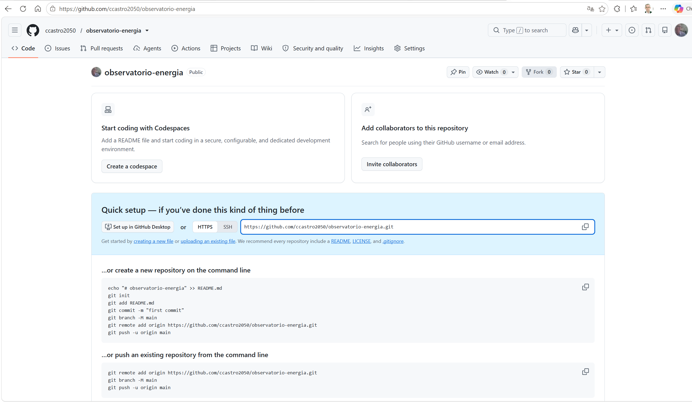

| Lo que aparece | Qué significa |
|---|---|
| `ccastro2050 / observatorio-energia` | **Usuario dueño / nombre del repositorio.** A cada uno le saldrá su propio usuario. |
| `Public` | Cualquiera puede **ver** el código; solo los colaboradores pueden **modificarlo**. |
| Pestañas `Code`, `Issues`, `Pull requests`, `Projects`, `Insights`, `Settings` | Las secciones del repositorio. En esta materia se usan **Pull requests** (revisión de código), **Projects** (tablero de tareas) e **Insights** (contribución de cada integrante). |
| **Add collaborators → Invite collaborators** | Para invitar a los compañeros del equipo y al docente. |
| **Quick setup** + URL `https://github.com/<usuario>/observatorio-energia.git` | La **dirección del remoto**. Es la que se usa en el siguiente paso. El botón de la derecha la copia. |
| `HTTPS` / `SSH` | Dos formas de conectarse. Usaremos **HTTPS**, que no requiere configurar llaves. |
| **…or create a new repository on the command line** | Instrucciones para quien **no** tiene un repositorio local. **No es nuestro caso**: ya hicimos `git init` y el commit. |
| **…or push an existing repository from the command line** | ✅ **Nuestro caso:** ya tenemos un repositorio local con un commit. Son los 3 comandos que vamos a ejecutar. |

#### Subir el repositorio a GitHub: `push`

Copien los 3 comandos del bloque **"…or push an existing repository from the command line"** de **su** pantalla (traen **su** usuario) y péguenlos en la terminal de VS Code:

```powershell
git remote add origin https://github.com/<su-usuario>/observatorio-energia.git
git branch -M main
git push -u origin main
```

| Comando | Qué hace |
|---|---|
| `git remote add origin <URL>` | Registra el repositorio de GitHub como **remoto** con el apodo `origin`. No sube nada todavía; solo guarda la dirección. |
| `git branch -M main` | Renombra la rama actual a `main` (`-M` = a la fuerza). Si ya se llamaba `main`, no cambia nada; está ahí por si la rama se llamaba `master`. |
| `git push` | **Sube** los commits locales al remoto. |
| `-u` | Deja **enlazada** la rama local `main` con la de GitHub. Así, la próxima vez basta escribir `git push`, sin más. |
| `origin main` | A cuál remoto (`origin`) y cuál rama (`main`). |

> 🔐 **La primera vez** que se sube algo desde un computador, Git abre una **ventana del navegador para iniciar sesión en GitHub** (*Git Credential Manager*). Clic en **Sign in with your browser** → **Authorize**. Queda guardado y no se vuelve a pedir. Si el computador ya tenía la sesión guardada, no aparece la ventana.

**Resultado real:**

```text
(.venv) PS C:\clases\observatorio-energia> git remote add origin https://github.com/ccastro2050/observatorio-energia.git
(.venv) PS C:\clases\observatorio-energia> git branch -M main
(.venv) PS C:\clases\observatorio-energia> git push -u origin main
Enumerating objects: 22, done.
Counting objects: 100% (22/22), done.
Delta compression using up to 22 threads
Compressing objects: 100% (20/20), done.
Writing objects: 100% (22/22), 185.27 KiB | 16.84 MiB/s, done.
Total 22 (delta 0), reused 0 (delta 0), pack-reused 0 (from 0)
To https://github.com/ccastro2050/observatorio-energia.git
 * [new branch]      main -> main
branch 'main' set up to track 'origin/main'.
```

| Lo que aparece | Qué significa |
|---|---|
| Los dos primeros comandos no muestran nada | Es normal: en la terminal, **sin mensaje = sin error**. |
| `Enumerating objects: 22` | Git cuenta los **objetos** a subir. Para Git, un objeto es un **archivo**, una **carpeta** o un **commit**. Aquí: 15 archivos distintos (los dos `__init__.py` están vacíos y son idénticos, así que se guardan una sola vez) + 6 carpetas + 1 commit = **22**. |
| `Delta compression` / `Compressing objects` | Git **comprime** los objetos antes de enviarlos, para que viajen menos datos. |
| `Writing objects: 100% (22/22), 185.27 KiB` | Se enviaron los 22 objetos: **185 KB** en total, la mayor parte es el Excel. Sin `.venv` ni `data/bronze/`, el repositorio es liviano. |
| `To https://github.com/.../observatorio-energia.git` | El destino: su repositorio en GitHub. |
| `* [new branch]      main -> main` | En GitHub se creó la rama `main`, copia de la `main` local. |
| `branch 'main' set up to track 'origin/main'` | El efecto de `-u`: la rama local quedó **enlazada** con la remota. |

#### Comprobar en GitHub

Recarguen la página del repositorio en GitHub (**F5**). Ya no aparece el *Quick setup*: ahora se ve el proyecto.

**Resultado real:**

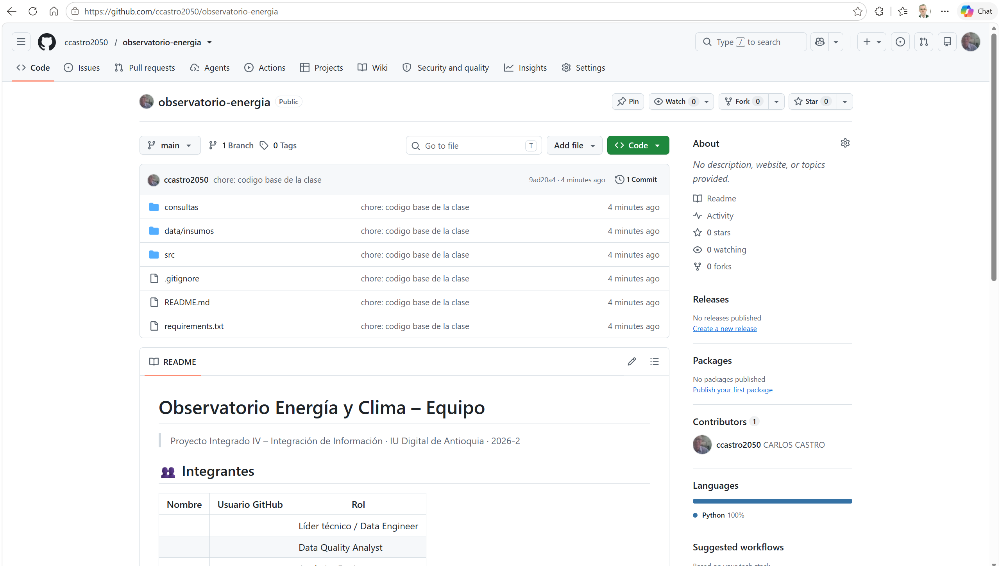

| Lo que aparece | Qué significa |
|---|---|
| `main` · `1 Branch` · `0 Tags` | Hay una sola rama (`main`) y todavía ninguna etiqueta. El tag `ea1` se crea al entregar la Evidencia 1. |
| `ccastro2050  chore: codigo base de la clase` | El **último commit**: autor y mensaje. |
| `9ad20a4 · 4 minutes ago` | El **mismo hash** que mostró `git log --oneline` en el computador: la copia en GitHub es idéntica a la local. |
| `1 Commit` | Clic aquí muestra el historial completo de commits. |
| `consultas`, `data/insumos`, `src` | Las carpetas subidas. GitHub muestra `data/insumos` en una sola línea porque `data` solo contiene esa subcarpeta: **`data/bronze` no se subió** (el `.gitignore` funcionó). |
| `.gitignore`, `README.md`, `requirements.txt` | Los archivos de la raíz. |
| Texto gris a la derecha de cada carpeta | El último commit que modificó esa carpeta o archivo. |
| **README** (abajo) | GitHub muestra automáticamente el `README.md` como portada. Es la plantilla que el equipo debe completar: integrantes, usuarios de GitHub y roles. |
| **Contributors 1** | Quién ha hecho commits: por ahora, solo el dueño. Cuando cada integrante haga sus commits aparecerá aquí. Es lo que se revisa para la nota individual. |
| **Languages: Python 100%** | GitHub detectó el lenguaje del código. |

#### Invitar a los compañeros como colaboradores

| Concepto | Qué es |
|---|---|
| **Colaborador** | Persona con permiso para **subir cambios** (push) al repositorio. En un repositorio público, cualquiera puede **ver** el código, pero solo los colaboradores pueden **modificarlo**. |
| **Invitación** | El dueño invita y el invitado debe **aceptar**. Hasta que acepte, no tiene permiso. |

**Lo hace el dueño del repositorio:**

1. En la página del repositorio, clic en **Settings** (pestaña del engranaje).
2. Menú de la izquierda → **Collaborators**. Si GitHub pide la contraseña o un código de confirmación, ingresarlo.
3. Clic en **Add people**.
4. Escribir el **usuario de GitHub** (o el correo) del compañero, elegirlo de la lista y clic en **Add … to this repository**.
5. Repetir con cada integrante y con el **docente** (`ccastro2050`).

**Resultado real** (después de invitar a una cuenta de prueba):

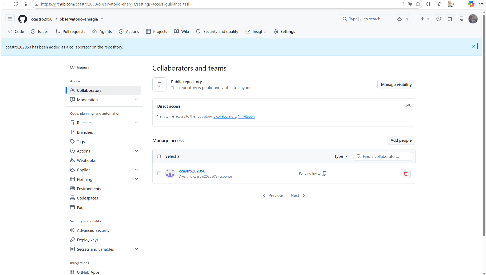

| Lo que aparece | Qué significa |
|---|---|
| `... has been added as a collaborator on the repository.` | Confirmación de que la invitación se **envió** (todavía no está aceptada). |
| `Public repository · This repository is public and visible to anyone` | Recordatorio de que el repositorio es público. **Manage visibility** permite cambiarlo; no lo cambien. |
| `Direct access · 1 entity has access ... 0 collaborators. 1 invitation.` | Hay **1 invitación pendiente** y **0 colaboradores** aceptados. |
| **Manage access** | La lista de personas invitadas o con acceso. |
| `Awaiting ...'s response` / `Pending Invite` | El invitado **aún no ha aceptado**. |
| Ícono de copiar junto a *Pending Invite* | Copia el **enlace de la invitación**, para enviárselo al compañero por WhatsApp o correo. |
| Basurero rojo | Cancela la invitación o quita al colaborador. |

**Lo hace cada invitado:**

1. Abrir el correo de GitHub *"… invited you to collaborate on …/observatorio-energia"* y clic en **View invitation**. También sirve entrar a `https://github.com/<usuario-del-dueño>/observatorio-energia/invitations`.
2. Clic en **Accept invitation**.

Cuando acepte, en la página del dueño su nombre deja de decir *Pending Invite*, y el contador cambia a `1 collaborators`.

> ⚠️ **La invitación vence a los 7 días.** Si vence, el dueño debe invitar de nuevo con **Add people**.

#### Los demás integrantes: clonar el repositorio

El repositorio lo **crea una sola persona** (el dueño), con los pasos anteriores. Los demás integrantes **no** descargan el proyecto de Drive ni repiten `git init`: hacen una copia del repositorio del equipo en su computador. A eso se le llama **clonar**.

| Concepto | Qué es |
|---|---|
| **Clonar** (`git clone`) | Descargar a su computador una copia del repositorio que está en GitHub, **con todo su historial** y ya conectada a GitHub (`origin`). |

**Qué hace cada integrante (después de aceptar la invitación):**

1. En GitHub, en la página del repositorio del equipo, clic en el botón verde **Code** → copiar la dirección **HTTPS**.
2. En la terminal, ubicarse en `C:\clases` y ejecutar:

```powershell
cd C:\clases
git clone https://github.com/<usuario-del-dueño>/observatorio-energia.git
cd observatorio-energia
git log --oneline
```

| Comando | Qué hace |
|---|---|
| `git clone <dirección>` | Crea la carpeta `observatorio-energia` con todos los archivos y el historial del repositorio. |
| `cd observatorio-energia` | Entra a la carpeta clonada. |
| `git log --oneline` | Muestra el historial: los mismos commits que hay en GitHub. |

**Resultado real** (clonando el repositorio de prueba de la clase):

```text
Cloning into 'observatorio-energia'...
64e0580 Merge pull request #1 from ccastro2050/docs/readme-integrantes
ebc06ec docs: agregar integrante al README
9ad20a4 chore: codigo base de la clase
```

| Lo que aparece | Qué significa |
|---|---|
| `Cloning into 'observatorio-energia'...` | Se está creando la carpeta con la copia. |
| Los 3 commits | El historial completo llegó con la copia: se ve quién hizo qué desde el comienzo. |

3. Abrir la carpeta en VS Code y crear su **propio** entorno virtual (Parte 2.3): `python -m venv .venv`, activarlo y `pip install -r requirements.txt`. El `.venv` no viene en el repositorio porque está en `.gitignore`.
4. Ejecutar `python -m src.pipeline`. La carpeta `data/bronze/` tampoco viene en el repositorio: el pipeline la crea y descarga los datos (unos 3 minutos).

| ❌ No se hace | ✅ Sí se hace |
|---|---|
| Que cada integrante descargue el proyecto de Drive y haga su propio `git init`: quedarían 4 repositorios distintos. | Uno crea el repositorio; los demás lo **clonan**. |
| Copiar la carpeta `.venv` de un compañero. | Cada uno crea su `.venv` e instala con `requirements.txt`. |

> ⚠️ **Si sale `error: remote origin already exists`:** el remoto ya se había agregado (por ejemplo, al repetir el comando). Continúen con `git push -u origin main`. Si la URL estaba mal escrita: `git remote set-url origin <URL correcta>`.
>
> ⚠️ **Si sale `! [rejected] main -> main (fetch first)`:** el repositorio de GitHub se creó **con** README, .gitignore o licencia, y ya tiene un commit que el local no tiene. Lo más simple: borrar ese repositorio en GitHub (*Settings → Delete this repository*), crearlo de nuevo **sin marcar nada** y repetir el `push`.

### 7.2 Flujo de trabajo con ramas

Nadie trabaja directamente en `main`. Cada cambio se hace en una **rama**, se sube a GitHub y se une a `main` mediante un **Pull Request** que revisa un compañero. Para practicar el flujo completo haremos un cambio real que todo equipo necesita: **llenar la tabla de integrantes del `README.md`**.

```text
main ──●─────────────────────●──  (merge: el cambio entra a main)
        \                   /
         ●── commit ── push ── Pull Request ── revisión
     docs/readme-integrantes
```

#### Paso 1 · Crear la rama

```powershell
git switch -c docs/readme-integrantes
git branch
```

| Parte del comando | Qué hace |
|---|---|
| `git switch` | Cambiarse de rama. |
| `-c` | *Create*: **crea** la rama antes de cambiarse a ella. |
| `docs/readme-integrantes` | Nombre de la rama. Por convención: **tipo/descripción-corta**, en minúsculas y con guiones. Tipos comunes: `feature/` (funcionalidad nueva), `fix/` (corrección), `docs/` (documentación). |
| `git branch` | Lista las ramas locales y marca con `*` aquella en la que se está. |

> 🔄 **¿Y `git checkout -b`?** Hace **exactamente lo mismo** que `git switch -c`. `checkout` es el comando clásico, pero servía para demasiadas cosas: cambiar de rama, crear ramas y también **descartar cambios de archivos** (que se pierden). Por eso, desde 2019 (Git 2.23), Git lo separó en dos comandos más claros:
>
> | Clásico | Nuevo | Qué hace |
> |---|---|---|
> | `git checkout rama` | `git switch rama` | Cambiarse de rama |
> | `git checkout -b rama` | `git switch -c rama` | Crear una rama y cambiarse a ella |
> | `git checkout -- archivo` | `git restore archivo` | Descartar los cambios de un archivo |
>
> `checkout` sigue funcionando y aparece en muchos tutoriales. En esta guía usamos `switch` porque es más claro y no pone en riesgo los archivos.

**Resultado real:**

```text
(.venv) PS C:\clases\observatorio-energia> git switch -c docs/readme-integrantes
Switched to a new branch 'docs/readme-integrantes'
(.venv) PS C:\clases\observatorio-energia> git branch
* docs/readme-integrantes
  main
```

| Lo que aparece | Qué significa |
|---|---|
| `Switched to a new branch 'docs/readme-integrantes'` | Se creó la rama y ahora se está **en ella**. Todo commit que se haga quedará aquí, no en `main`. |
| `* docs/readme-integrantes` | El `*` marca la **rama actual**. |
| `main` | La rama principal sigue existiendo, **intacta**. |

> 💡 **La rama nueva arranca como una copia de `main`:** tiene los mismos archivos y el mismo commit. Desde aquí, los cambios se separan. En la barra inferior de VS Code (esquina izquierda) también aparece el nombre de la rama actual.

#### Paso 2 · Hacer un cambio en la rama

1. En el **EXPLORER** de VS Code (primer ícono de la barra izquierda, las dos hojas), clic en **`README.md`**. Se abre en texto plano, con `|` y `#`.
2. En la tabla **Integrantes**, llenar la primera fila con su nombre y su usuario de GitHub:
   ```text
   | Carlos Arturo Castro | ccastro2050 | Líder técnico / Data Engineer |
   ```
3. Guardar con **Ctrl+S**. Si en **File** está marcado **Auto Save**, se guarda solo.
4. En la terminal:

```powershell
git status
git diff
```

| Comando | Qué muestra |
|---|---|
| `git status` | **Qué archivos** cambiaron. |
| `git diff` | **Qué líneas** cambiaron dentro de esos archivos. Solo muestra cambios que todavía no se han preparado con `git add`. |

**Resultado real de `git diff`:**

```text
(.venv) PS C:\clases\observatorio-energia> git diff
warning: in the working copy of 'README.md', LF will be replaced by CRLF the next time Git touches it
diff --git a/README.md b/README.md
index 446c459..17dd1a9 100644
--- a/README.md
+++ b/README.md
@@ -6,7 +6,7 @@
 
 | Nombre | Usuario GitHub | Rol |
 |---|---|---|
-| | | Líder técnico / Data Engineer |
+| Carlos Arturo Castro | ccastro2050 | Líder técnico / Data Engineer |
 | | | Data Quality Analyst |
 | | | Analytics Engineer |
 | | | BI Analyst / Storyteller |
```

| Lo que aparece | Qué significa |
|---|---|
| `warning: ... LF will be replaced by CRLF` | La misma advertencia de fin de línea que vimos con `git add`. Se puede ignorar. |
| `diff --git a/README.md b/README.md` | Se compara el archivo: **`a/`** = la versión del último commit (antes); **`b/`** = la versión actual (después). |
| `index 446c459..17dd1a9` | Identificadores internos del contenido antes y después. |
| `--- a/README.md` / `+++ b/README.md` | Leyenda: las líneas con `-` vienen del archivo **antes**; las líneas con `+`, del archivo **después**. |
| `@@ -6,7 +6,7 @@` | Ubicación del cambio: desde la **línea 6**, se muestran **7 líneas** antes y 7 después. |
| Líneas que empiezan con un espacio | **Contexto**: líneas que no cambiaron. Se muestran para ubicarse. |
| `-\| \| \| Líder técnico ...` (**rojo** en la terminal) | La línea **eliminada**: la fila vacía. |
| `+\| Carlos Arturo Castro \| ccastro2050 \| ...` (**verde**) | La línea **agregada**: la fila con los datos. |

> 💡 Git no guarda "la fila se editó": guarda **una línea quitada y una agregada**. Así funcionan todas las comparaciones de código, también en los Pull Requests de GitHub.

> ⚠️ **Si `git status` dice `nothing to commit, working tree clean` y `git diff` no muestra nada:** Git no ve ningún cambio en el archivo. Revisen:
>
> | Causa | Cómo se ve | Qué hacer |
> |---|---|---|
> | No hay ningún archivo abierto | El área de edición solo muestra el logo de VS Code. | Abrir `README.md` con un clic en el EXPLORER y hacer el cambio. |
> | El archivo no se guardó | La pestaña muestra un círculo **●** en vez de la **X**. | **Ctrl+S**, o activar **File → Auto Save**. |
> | Está abierta la **vista previa** | La pestaña dice **Preview README.md** y no deja escribir. | Cerrarla y abrir el archivo desde el EXPLORER. |
> | Se editó **otro** README | Al pasar el mouse sobre la pestaña, la ruta no es `C:\clases\observatorio-energia\README.md`. | Abrir el README desde el EXPLORER de este proyecto. |

#### Paso 3 · Commit y push de la rama

Es el mismo `add` + `commit` de antes, pero ahora **dentro de la rama**. El `push` sube la rama a GitHub como una rama **nueva**; `main` no se toca.

```powershell
git add README.md
git commit -m "docs: agregar integrante al README"
git push -u origin docs/readme-integrantes
```

| Parte del comando | Qué hace |
|---|---|
| `git add README.md` | Prepara **solo** ese archivo (en vez de `.`, que prepara todo). |
| `"docs: ..."` | Prefijo `docs:` de Conventional Commits: el cambio es de **documentación**. |
| `git push -u origin docs/readme-integrantes` | Sube la rama a GitHub con el **mismo nombre**. `-u` la deja enlazada: la próxima vez basta `git push`. |

**Resultado real:**

```text
(.venv) PS C:\clases\observatorio-energia> git add README.md
warning: in the working copy of 'README.md', LF will be replaced by CRLF the next time Git touches it
(.venv) PS C:\clases\observatorio-energia> git commit -m "docs: agregar integrante al README"
[docs/readme-integrantes ebc06ec] docs: agregar integrante al README
 1 file changed, 1 insertion(+), 1 deletion(-)
(.venv) PS C:\clases\observatorio-energia> git push -u origin docs/readme-integrantes
Enumerating objects: 5, done.
Counting objects: 100% (5/5), done.
Delta compression using up to 22 threads
Compressing objects: 100% (3/3), done.
Writing objects: 100% (3/3), 348 bytes | 348.00 KiB/s, done.
Total 3 (delta 2), reused 0 (delta 0), pack-reused 0 (from 0)
remote: Resolving deltas: 100% (2/2), completed with 2 local objects.
remote:
remote: Create a pull request for 'docs/readme-integrantes' on GitHub by visiting:
remote:      https://github.com/ccastro2050/observatorio-energia/pull/new/docs/readme-integrantes
remote:
To https://github.com/ccastro2050/observatorio-energia.git
 * [new branch]      docs/readme-integrantes -> docs/readme-integrantes
branch 'docs/readme-integrantes' set up to track 'origin/docs/readme-integrantes'.
```

| Lo que aparece | Qué significa |
|---|---|
| `[docs/readme-integrantes ebc06ec]` | El commit quedó **en la rama** `docs/readme-integrantes`, no en `main`, con el hash `ebc06ec`. |
| `1 file changed, 1 insertion(+), 1 deletion(-)` | 1 archivo, 1 línea agregada y 1 quitada: es la fila editada que vimos en `git diff`. |
| `Writing objects: 100% (3/3), 348 bytes` | Solo viajaron **3 objetos** (el commit, la carpeta raíz y el README nuevo), **348 bytes**. Git sube únicamente lo que cambió, no todo el proyecto otra vez. |
| `delta` / `Resolving deltas` | Git envía el README como una **diferencia** (*delta*) respecto a la versión que GitHub ya tenía, no completo. |
| `remote:` | Mensajes que escribe **GitHub** (el remoto), no Git local. |
| `Create a pull request for '...' on GitHub by visiting: https://...` | GitHub detectó una rama nueva y da el **enlace directo** para abrir el Pull Request. Con **Ctrl + clic** sobre el enlace se abre en el navegador. |
| `* [new branch]  docs/readme-integrantes -> docs/readme-integrantes` | En GitHub se creó la rama nueva, copia de la local. |
| `set up to track 'origin/docs/readme-integrantes'` | El efecto de `-u`: rama local y remota enlazadas. |

#### Paso 4 · Ver la rama en GitHub

Recarguen la página del repositorio en GitHub (**F5**).

**Resultado real:**

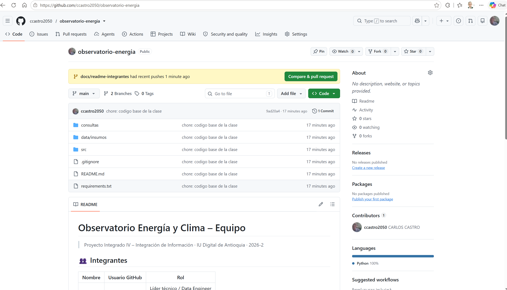

| Lo que aparece | Qué significa |
|---|---|
| Franja amarilla: `docs/readme-integrantes had recent pushes 1 minute ago` | GitHub detectó que se subió una rama nueva y ofrece abrir el Pull Request. |
| Botón verde **Compare & pull request** | Abre el formulario del PR. Hace lo mismo que el enlace que mostró la terminal. |
| `main` · **`2 Branches`** | Ahora hay dos ramas en GitHub: `main` y `docs/readme-integrantes`. |
| `1 Commit` y `chore: codigo base de la clase` | La página muestra la rama **`main`**, que sigue con **un solo commit**. |
| En el README, la tabla de **Integrantes sigue vacía** | **`main` no ha cambiado.** El nombre agregado solo existe en la rama. Llegará a `main` cuando se apruebe el Pull Request. |

#### Pull Request y merge: ¿son lo mismo?

**No.** Están relacionados, pero son dos cosas distintas:

| | **Pull Request (PR)** | **Merge** |
|---|---|---|
| Qué es | Una **solicitud**: "quiero unir mi rama a `main`, revísenla". | La **acción** de unir los cambios de una rama a otra. |
| Dónde ocurre | Solo en GitHub (o GitLab, Bitbucket). Git no tiene PR. | Es una operación de **Git** (`git merge`). GitHub la ejecuta con un botón. |
| Qué incluye | Título, descripción, el `diff` de los cambios, comentarios, revisión y aprobación de compañeros. | Solo el resultado: los commits de la rama quedan en `main`. |
| Cuándo | **Primero**: se abre el PR y se discute. | **Al final**: es el botón **Merge pull request** dentro del PR, cuando ya está aprobado. |
| Puede terminar sin merge | Sí: un PR se puede **cerrar sin unir** si el cambio no sirve. | — |

**Analogía:** el PR es **presentar un documento para aprobación**, con espacio para comentarios y correcciones. El merge es **firmarlo y archivarlo** en la carpeta oficial (`main`).

#### Paso 5 · Abrir el Pull Request

1. Clic en el botón verde **Compare & pull request**.
2. Revisar que arriba diga **base: `main`** ← **compare: `docs/readme-integrantes`**.
3. El título ya viene con el mensaje del commit. En la descripción, escribir qué se hizo y por qué, por ejemplo: *"Agrego mi nombre y usuario a la tabla de integrantes."*
4. Clic en **Create pull request**.

**Resultado real** (antes de crear el PR):

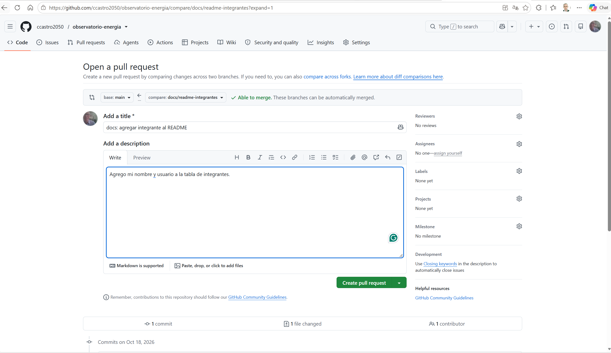

| Lo que aparece | Qué significa |
|---|---|
| `Open a pull request` | El formulario para crear el PR. |
| `base: main` | La rama **destino**: adonde llegarán los cambios. |
| `←` | La flecha indica la dirección: los cambios van **de** la rama de la derecha **hacia** la de la izquierda. |
| `compare: docs/readme-integrantes` | La rama **origen**: la que trae los cambios. |
| ✓ `Able to merge. These branches can be automatically merged.` | **No hay conflictos**: GitHub puede unir las ramas sin intervención. Si dos personas cambiaran **la misma línea** del mismo archivo en ramas distintas, aquí diría *Can't automatically merge* y habría que resolver el **conflicto** a mano. |
| `Add a title *` | Título del PR (obligatorio, `*`). GitHub lo llena con el mensaje del commit. |
| `Add a description` · `Write` / `Preview` | Descripción en formato Markdown. `Preview` muestra cómo se verá. Una buena descripción dice **qué** cambia y **por qué**. |
| **Reviewers** | Para pedir la **revisión** de un compañero. Solo aparecen los colaboradores que **ya aceptaron** la invitación. |
| **Assignees** | Responsable del PR (normalmente, quien lo abre: *assign yourself*). |
| **Labels**, **Projects**, **Milestone** | Etiquetas (`documentación`, `bug`…), tablero del proyecto y meta o entrega a la que pertenece. Opcionales. |
| **Development** · *Closing keywords* | Si la descripción incluye `Closes #3`, al hacer merge se cierra automáticamente el *issue* número 3. |
| Botón verde **Create pull request** | Crea el PR. **Todavía no une nada**: solo abre la solicitud. |
| `1 commit` · `1 file changed` · `1 contributor` | Resumen de lo que trae la rama. Más abajo en la página se ve el `diff`, igual al de `git diff`. |

#### Paso 6 · El Pull Request creado

Al hacer clic en **Create pull request**, GitHub crea el PR y abre su página.

**Resultado real:**

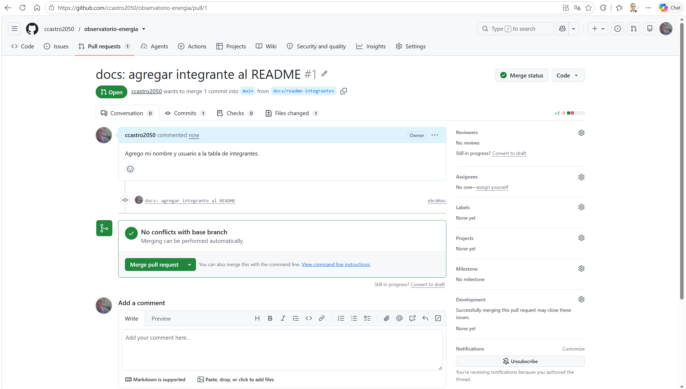

| Lo que aparece | Qué significa |
|---|---|
| `docs: agregar integrante al README #1` | Título del PR y su **número** (`#1`). Los PR y los issues se numeran en orden; `#1` sirve para mencionarlo en comentarios o commits. |
| URL `.../observatorio-energia/pull/1` | La dirección del PR. Es el **enlace que se entrega como evidencia**. |
| Etiqueta verde **Open** | El PR está **abierto**: esperando revisión. Después del merge cambiará a **Merged** (morado). |
| `ccastro2050 wants to merge 1 commit into main from docs/readme-integrantes` | Quién lo pide, cuántos commits trae y de qué rama a cuál. |
| Pestaña **Conversation** | Descripción, comentarios y revisiones: la **discusión** del cambio. |
| Pestaña **Commits 1** | Los commits que trae la rama (`ebc06ec`, el mismo hash del computador). |
| Pestaña **Checks 0** | Pruebas automáticas (GitHub Actions). Este proyecto aún no tiene; más adelante pueden ejecutar `pytest` automáticamente en cada PR. |
| Pestaña **Files changed 1** | El `diff` en colores: rojo la línea quitada y verde la agregada. **Aquí revisa el compañero**: puede comentar una línea específica. |
| `+1 -1` y cuadritos verde/rojo | Tamaño del cambio: 1 línea agregada y 1 quitada. |
| `Owner` | Quien comentó es el **dueño** del repositorio. |
| ✓ `No conflicts with base branch · Merging can be performed automatically.` | Se puede unir a `main` sin conflictos. |
| Botón **Merge pull request** | Ejecuta el **merge**. Lo ideal es usarlo **después** de que un compañero apruebe en *Reviewers*. |
| `Convert to draft` | Marca el PR como **borrador**: "aún no está listo para revisar". |
| **Add a comment** | Para conversar sobre el cambio: preguntas, sugerencias, aprobación. |

> 👀 **Cómo se revisa en equipo:** en **Reviewers** (engranaje) se elige a un compañero. Ese compañero entra a **Files changed**, revisa y hace clic en **Review changes**. Allí elige **Approve** (aprobar), **Request changes** (pedir cambios) o **Comment**. Con la aprobación, quien abrió el PR hace el merge. Quien es dueño del PR **no puede aprobarse a sí mismo**.

#### Paso 7 · Hacer el merge

En el equipo, el merge se hace **después** de que un compañero apruebe. En clase lo hacemos directamente para ver el resultado.

1. Clic en **Merge pull request**.
2. Aparece un formulario para el **commit de merge**. Dejarlo como viene y hacer clic en **Confirm merge**.

**Resultado real (formulario de confirmación):**

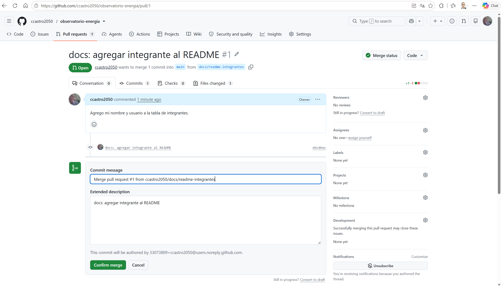

| Lo que aparece | Qué significa |
|---|---|
| `Commit message: Merge pull request #1 from ccastro2050/docs/readme-integrantes` | El merge crea un **commit nuevo** en `main`, el **commit de merge**, que registra "aquí se unió el PR #1". El mensaje se puede dejar como viene. |
| `Extended description: docs: agregar integrante al README` | Descripción del commit de merge; GitHub pone el título del PR. |
| `This commit will be authored by ...@users.noreply.github.com` | El autor del commit de merge. GitHub usa un correo **privado** (*noreply*) para no publicar el correo real. |
| **Confirm merge** / **Cancel** | Confirmar o volver atrás. Hasta este clic, nada ha cambiado en `main`. |

**Resultado real (después de confirmar):**

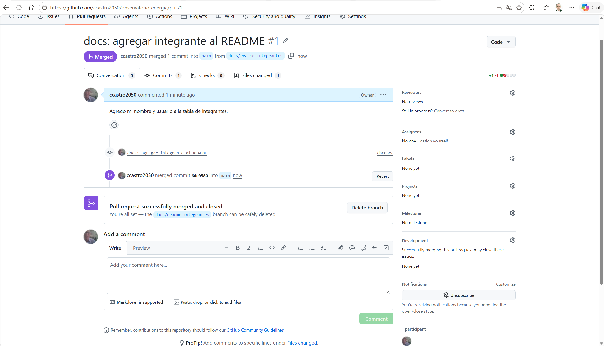

| Lo que aparece | Qué significa |
|---|---|
| Etiqueta morada **Merged** | El PR se **unió** a `main` y quedó cerrado. |
| `ccastro2050 merged 1 commit into main from docs/readme-integrantes` | Registro de quién hizo el merge, cuántos commits entraron y de qué rama. |
| `ccastro2050 merged commit 64e0580 into main` | El **commit de merge** que se creó en `main`, con su hash. |
| Botón **Revert** | Crea un PR que **deshace** este merge, si resultara que el cambio estaba mal. El historial no se borra: se agrega un cambio que lo revierte. |
| `Pull request successfully merged and closed` | Confirmación: el PR terminó su ciclo. |
| `You're all set — the docs/readme-integrantes branch can be safely deleted.` | La rama ya cumplió su función: sus cambios están en `main`. |
| Botón **Delete branch** | Borra la rama **en GitHub** para no acumular ramas viejas. **Háganlo**: los commits no se pierden, ya están en `main`. |
| `1 participant` | Quiénes participaron en el PR. En el equipo, aquí aparecerán también los revisores. |

#### Paso 8 · Traer los cambios al computador: `pull`

El merge ocurrió **en GitHub**. El `main` del computador todavía no tiene el commit de merge.

| Concepto | Qué es |
|---|---|
| **`git pull`** | **Baja** los commits nuevos del remoto y los une a la rama local. Es lo contrario de `push`. |
| **Fast-forward** (avance rápido) | Tipo de unión en el que la rama local no tenía cambios propios: Git solo **mueve el puntero** de la rama hacia adelante, hasta el último commit. No hay nada que mezclar. |

```powershell
git switch main
git pull
git log --oneline
```

| Comando | Qué hace |
|---|---|
| `git switch main` | Volver a la rama `main` (sin `-c`, porque ya existe). |
| `git pull` | Traer de GitHub los cambios de `main`. |
| `git log --oneline` | Ver el historial actualizado. |

**Resultado real:**

```text
(.venv) PS C:\clases\observatorio-energia> git switch main
Switched to branch 'main'
Your branch is up to date with 'origin/main'.
(.venv) PS C:\clases\observatorio-energia> git pull
remote: Enumerating objects: 1, done.
remote: Counting objects: 100% (1/1), done.
remote: Total 1 (delta 0), reused 0 (delta 0), pack-reused 0 (from 0)
Unpacking objects: 100% (1/1), 925 bytes | 132.00 KiB/s, done.
From https://github.com/ccastro2050/observatorio-energia
   9ad20a4..64e0580  main       -> origin/main
Updating 9ad20a4..64e0580
Fast-forward
 README.md | 2 +-
 1 file changed, 1 insertion(+), 1 deletion(-)
(.venv) PS C:\clases\observatorio-energia> git log --oneline
64e0580 (HEAD -> main, origin/main, origin/HEAD) Merge pull request #1 from ccastro2050/docs/readme-integrantes
ebc06ec (origin/docs/readme-integrantes, docs/readme-integrantes) docs: agregar integrante al README
9ad20a4 chore: codigo base de la clase
```

| Lo que aparece | Qué significa |
|---|---|
| `Switched to branch 'main'` | Se volvió a `main`. En el EXPLORER, el README vuelve a mostrar la tabla **vacía**: es la versión de `main` antes del pull. |
| `Your branch is up to date with 'origin/main'.` | **Cuidado, puede confundir:** compara con lo **último que el computador sabía** de GitHub, no con GitHub en este instante. Todavía no se había consultado, por eso dice "al día". |
| `remote: ... Total 1` · `Unpacking objects: 100% (1/1), 925 bytes` | Bajó **un solo objeto**: el commit de merge. El README nuevo ya estaba en el computador (vino del commit de la rama). |
| `9ad20a4..64e0580  main -> origin/main` | En GitHub, `main` avanzó del commit `9ad20a4` al `64e0580`. |
| `Updating 9ad20a4..64e0580` · `Fast-forward` | La rama `main` local **avanzó** hasta el mismo commit, sin mezclar nada. |
| `README.md \| 2 +-` · `1 insertion(+), 1 deletion(-)` | El archivo que cambió: la fila de integrantes. En el EXPLORER, el README ya muestra el nombre. |
| **Historial**, de abajo hacia arriba | El más **antiguo** está **abajo**: |
| `9ad20a4 chore: codigo base de la clase` | 1. El commit inicial. |
| `ebc06ec (... docs/readme-integrantes) docs: agregar integrante...` | 2. El commit de la rama. |
| `64e0580 (HEAD -> main, origin/main, origin/HEAD) Merge pull request #1...` | 3. El **commit de merge**: el más reciente. |
| `HEAD -> main` | Usted está en `main`, en el último commit. |
| `origin/main` | El `main` de GitHub está en el **mismo** commit: local y remoto **sincronizados**. |
| `origin/HEAD` | La rama principal por defecto del remoto (`main`). |
| `docs/readme-integrantes` / `origin/docs/readme-integrantes` | La rama local y la **referencia** que el computador guarda de la rama remota. Siguen ahí aunque ya se unieron (ver limpieza abajo). |

> 🧹 **Limpieza de ramas ya unidas.** Borrar la rama en GitHub (**Delete branch**) no la borra del computador, y `git pull` no limpia las referencias viejas. Para dejar todo ordenado:
>
> ```powershell
> git branch -d docs/readme-integrantes
> git fetch --prune
> ```
>
> | Comando | Qué hace |
> |---|---|
> | `git branch -d <rama>` | Borra la rama **local**. `-d` solo la borra si ya está unida a `main`; si no lo está, Git se niega y avisa (así no se pierde trabajo). |
> | `git fetch --prune` | Consulta GitHub y **elimina las referencias** `origin/...` de ramas que ya no existen allá (*prune* = podar). |
>
> **Resultado real:**
>
> ```text
> (.venv) PS C:\clases\observatorio-energia> git branch -d docs/readme-integrantes
> Deleted branch docs/readme-integrantes (was ebc06ec).
> (.venv) PS C:\clases\observatorio-energia> git fetch --prune
> (.venv) PS C:\clases\observatorio-energia> git log --oneline
> 64e0580 (HEAD -> main, origin/main, origin/HEAD) Merge pull request #1 from ccastro2050/docs/readme-integrantes
> ebc06ec (origin/docs/readme-integrantes) docs: agregar integrante al README
> 9ad20a4 chore: codigo base de la clase
> ```
>
> | Lo que aparece | Qué significa |
> |---|---|
> | `Deleted branch docs/readme-integrantes (was ebc06ec)` | Se borró la rama **local**; apuntaba al commit `ebc06ec`. El commit **no se borra**: sigue en el historial de `main`. |
> | `git fetch --prune` sin mensajes | No encontró nada que podar. |
> | `ebc06ec (origin/docs/readme-integrantes)` | La referencia a la rama **remota** sigue ahí, porque la rama **todavía existe en GitHub**: no se hizo clic en **Delete branch**. |
>
> **Qué hacer:** en la página del PR (`.../pull/1`), clic en **Delete branch**:
>
> 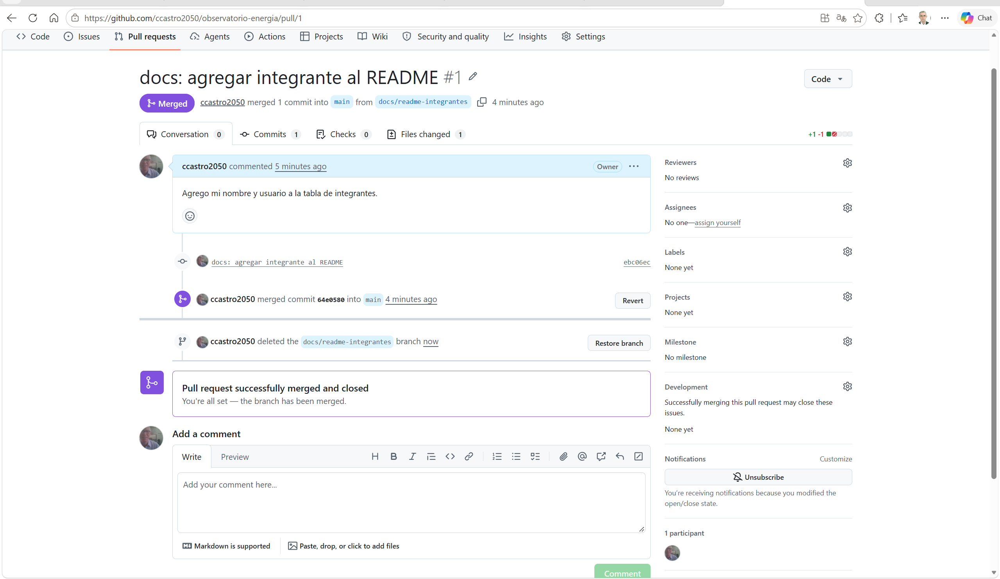
>
> | Lo que aparece | Qué significa |
> |---|---|
> | `ccastro2050 deleted the docs/readme-integrantes branch now` | Queda **registrado** en el PR quién borró la rama y cuándo. |
> | Botón **Restore branch** | Permite **recuperar** la rama si se borró por error. |
> | `You're all set — the branch has been merged.` | El ciclo del PR terminó. |
>
> Y volver a ejecutar:
>
> ```text
> (.venv) PS C:\clases\observatorio-energia> git fetch --prune
> From https://github.com/ccastro2050/observatorio-energia
>  - [deleted]         (none)     -> origin/docs/readme-integrantes
> (.venv) PS C:\clases\observatorio-energia> git log --oneline
> 64e0580 (HEAD -> main, origin/main, origin/HEAD) Merge pull request #1 from ccastro2050/docs/readme-integrantes
> ebc06ec docs: agregar integrante al README
> 9ad20a4 chore: codigo base de la clase
> ```
>
> | Lo que aparece | Qué significa |
> |---|---|
> | `- [deleted]  (none) -> origin/docs/readme-integrantes` | El `-` y `[deleted]` indican que se **eliminó** la referencia local a la rama remota, porque en GitHub ya no existe. |
> | `ebc06ec docs: agregar integrante al README` (sin etiquetas) | El commit **sigue en el historial**: lo que se borró fue la **rama** (el nombre que apuntaba a él), no el trabajo. |
> | `64e0580 (HEAD -> main, origin/main, origin/HEAD)` | Todo limpio: una sola rama, `main`, igual en el computador y en GitHub. |

> 🔁 **Regla de oro del equipo:** antes de crear una rama nueva, siempre `git switch main` + `git pull`. Así cada rama parte del `main` más reciente, con el trabajo ya unido de los compañeros, y se evitan conflictos.

> 🔁 **El ciclo completo de un cambio:** rama → cambio → commit → push → Pull Request → revisión → **merge** → borrar la rama → `pull` en `main`. En la Evidencia 1, cada integrante repite este ciclo con su parte del trabajo.

> 🔴 **Para la nota:** un merge directo, sin PR, no deja evidencia de revisión. La Evidencia 1 pide que cada integrante tenga **al menos un PR propio**, con su revisión, visible en la pestaña *Pull requests*.

**Para la Evidencia 1**, cada integrante trabaja **su parte** en **su propia rama**, con el mismo flujo:

| Integrante | Rama (ejemplo) | Trabajo de la EA1 |
|---|---|---|
| 1 | `feature/xm-ampliado` | `src/extract/xm.py`: 2 años y las métricas nuevas |
| 2 | `feature/ideam-ampliado` | `src/extract/ideam.py`: 1 año de precipitación y la temperatura |
| 3 | `feature/fuente-propia` | La fuente propia del equipo |
| 4 | `feature/perfilamiento-pruebas` | Perfilamiento, pruebas con `pytest` y README |

> 🔴 **Recuerden:** cada integrante debe tener **commits y por lo menos un PR propio**. La nota individual se revisa en *Insights → Contributors*.

### 7.3 Lo que se hizo hoy frente a lo que se evalúa en la Evidencia 1

> 📌 **El código de esta clase es la BASE del proyecto, y es de todos.** La Evidencia 1 (vence el domingo 25 de octubre) evalúa lo que cada equipo **agrega, amplía y entiende** a partir de él. El enunciado completo y la rúbrica están en Canvas.

| Hecho en clase (base) | Lo que el equipo debe agregar para la EA1 |
|---|---|
| XM: precio, demanda y embalses de 2026 | **2 años** (desde 2024) y 3 métricas más: `Gene` por recurso, `AporEner` y `ListadoRecursos` (endpoint `lists`, que el código de la clase **no** resuelve) |
| IDEAM: precipitación de junio a septiembre de 2026 | Precipitación de **1 año** (desde 2025) y **temperatura** del aire (dataset `sbwg-7ju4`) |
| NOAA y EnerAndes | Se mantienen igual |
| — | Una **fuente propia** integrada y justificada |
| — | Muestra en `data/sample/`, README completo, **perfilamiento** con 5 o más hallazgos |
| — | **3 o más pruebas** con `pytest` |
| — | Cada integrante: 3 o más commits, 1 o más PR propio, bitácora y **video individual** de máximo 5 minutos |
| — | Tag `ea1`: `git tag ea1` y luego `git push origin ea1` |

### 7.4 Para el miércoles 21 (sincrónica, 6:00 – 7:00 pm)

Traer el pipeline funcionando con los datos del equipo. Veremos el **perfilamiento**: nulos, duplicados, tipos y rangos de cada archivo de bronce.

---

## Si algo falla

| Síntoma | Causa | Solución |
|---|---|---|
| `Activate.ps1 no se puede cargar... la ejecución de scripts está deshabilitada` | Directiva de ejecución de PowerShell | Ver el procedimiento completo en la **Parte 2.3**: `Set-ExecutionPolicy -Scope CurrentUser -ExecutionPolicy RemoteSigned`, responder `S` y volver a activar |
| `ModuleNotFoundError: No module named 'src'` | Se ejecutó desde la carpeta equivocada, o como `python src/pipeline.py` | Ejecutar **desde la raíz** del proyecto y **con `-m`**: `python -m src.pipeline` |
| `ModuleNotFoundError: No module named 'pandas'` (u otra librería) | El entorno virtual no está activo | `.\.venv\Scripts\Activate.ps1` (debe aparecer `(.venv)` en el prompt) |
| `! intento 1 fallo (ReadTimeout); reintento en 2 s` | El servidor del IDEAM está lento | **Es normal**: el código reintenta solo. Si falla 4 veces, ejecutar de nuevo; gracias a la idempotencia continúa donde iba. |
| `FileNotFoundError: No se encontro ...ventas_enerandes_2023_2026.xlsx` | Falta el Excel | Viene dentro del `.zip` del código base; si falta, descargarlo de la carpeta de insumos de Drive y copiarlo en `data/insumos/` |
| `PermissionError` al guardar un `.parquet` | El archivo está abierto en otro programa, o OneDrive lo está sincronizando | Cerrar el programa; idealmente, tener el proyecto **fuera de OneDrive** |
| Las semanas del IDEAM después de julio traen `0 filas` | Rezago de publicación del IDEAM | **No es un error**: documentarlo como hallazgo |
| `UnicodeEncodeError` al imprimir | Consola de Windows sin UTF-8 | Los mensajes del código no llevan tildes; si se agregan, ejecutar antes `$env:PYTHONUTF8=1` |

---

## Glosario (orden alfabético)

| Término | Definición breve | Parte de la clase |
|---|---|---|
| **Agregar** | Resumir muchas filas en una con una operación: suma, promedio, conteo. | 4 |
| **API** | Programa en el servidor de una organización que les entrega sus datos a otros programas; se accede por una dirección de internet. | 3 |
| **Aplanar** | Convertir un JSON anidado en una tabla de filas y columnas. | 3 |
| **Arquitectura medallion** | Organización de los datos en tres capas: bronce, plata y oro. | 1 |
| **Bronce (capa)** | Datos crudos, tal como llegan de la fuente, con su linaje. Equivale al *staging*. | 1 |
| **Clonar** | Descargar una copia de un repositorio de GitHub con su historial. | 7 |
| **Código de estado HTTP** | Número de respuesta del servidor: 200 bien, 4xx error de quien pide, 5xx error del servidor. | 3 |
| **Commit** | Registro de un cambio en Git, con autor, fecha y mensaje. | 7 |
| **CTE** (`WITH`) | Tabla temporal con nombre dentro de una consulta SQL. | 6 |
| **Datos abiertos** | Datos públicos que el Estado publica para uso libre. | 4 |
| **Dependencia** | Librería externa que el proyecto necesita. | 2 |
| **DuckDB** | Motor SQL analítico que consulta archivos Parquet sin servidor. | 6 |
| **ELT / ETL** | Formas de ordenar Extraer, Transformar y Cargar. ELT carga primero el dato crudo. | 1 |
| **El Niño / La Niña** | Calentamiento / enfriamiento del Pacífico; en Colombia, sequía / lluvias. | 5 |
| **Endpoint** | Cada URL específica de una API. | 3 |
| **Entorno virtual** | Instalación aislada de Python para un solo proyecto. | 2 |
| **Espera exponencial** | Reintentar esperando cada vez más: 2, 4, 8 segundos. | 2 |
| **Excepción** | Error que ocurre mientras el programa corre. | 2 |
| **Formato ancho / largo** | Ancho: una columna por variable (por hora). Largo: una fila por cada valor. | 3 y 6 |
| **GET / POST** | Métodos HTTP: GET envía los parámetros en la URL; POST, en un cuerpo aparte. | 3 |
| **Idempotente** | Que ejecutarlo una o muchas veces produce el mismo resultado. | 1 |
| **Integración de información** | Reunir datos de fuentes heterogéneas para analizarlos juntos. | 1 |
| **JSON** | Formato de texto con pares clave-valor, listas y objetos anidados. | 3 |
| **kWh** | Kilovatio-hora: unidad de energía en que se mide el consumo. | 3 |
| **Linaje** | Registro de dónde vino un dato y cuándo se obtuvo. | 1 |
| **Merge** | Unir los cambios de una rama a otra. | 7 |
| **NaN** | Valor vacío o inexistente en pandas. | 5 |
| **OLTP / OLAP** | Bases de datos para operar (una transacción a la vez) / para analizar volúmenes grandes. | 6 |
| **ONI** | Índice de NOAA que mide El Niño por trimestres móviles. | 5 |
| **Orquestar** | Coordinar varios procesos para ejecutarlos en orden desde un punto. | 6 |
| **Paginación** | Entrega de resultados de una API por partes (`$limit`, `$offset`). | 4 |
| **Paquete / módulo** | Módulo: un archivo `.py`. Paquete: una carpeta de módulos con `__init__.py`. | 2 |
| **Parquet** | Formato de archivo columnar, comprimido y con tipos, para análisis. | 2 |
| **Perfilamiento** | Diagnóstico de los datos: filas, tipos, nulos, duplicados y rangos. | 7 |
| **Pipeline** | Secuencia automática de pasos por la que pasan los datos. | 1 |
| **Precio de bolsa** | Precio horario de la energía en el mercado mayorista (COP/kWh). | 3 |
| **Pull Request** | Solicitud para unir una rama a `main`, con revisión de un compañero. | 7 |
| **Rama** | Línea de trabajo paralela en Git. | 7 |
| **Rezago de publicación** | Tiempo entre que ocurre un dato y que la fuente lo publica. | 4 |
| **Reproducible** | Que otro obtiene el mismo resultado con el mismo código. | 1 |
| **REST** | Estilo de API que usa URLs y métodos HTTP. | 3 |
| **Socrata / SoQL** | Plataforma de datos.gov.co / su lenguaje de consulta, parecido a SQL. | 4 |
| **Staging** | Nombre clásico en BI de la zona de datos crudos: equivale a bronce. | 1 |
| **Tag** | Nombre fijo para un momento del historial de Git (por ejemplo `ea1`). | 7 |
| **Timeout** | Tiempo máximo de espera de una respuesta. | 2 |
| **`TRY_CAST`** | Conversión de tipo en SQL que devuelve NULL si falla. | 6 |
| **`UNPIVOT`** | Instrucción SQL que pasa de formato ancho a largo. | 6 |
| **UTC** | Hora universal de referencia, sin zona horaria (Colombia = UTC−5). | 2 |
| **Volumen útil** | Porcentaje de agua aprovechable que tienen los embalses. | 3 |
