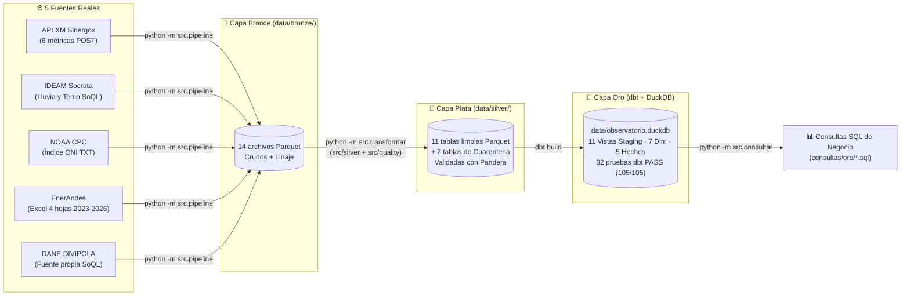

# Mapa del Proyecto y Reporte de Avance (EA1 + EA2)

> **Proyecto Integrado IV – Observatorio Energía y Clima Colombia (2026-2)**
> **Integrante:** César Puentes (`CesarPuentes`) · IU Digital de Antioquia

---

## Arquitectura Medallion del Pipeline (Bronce → Plata → Oro)

---

## Parte II – Evidencia de Aprendizaje 2 (EA2): Calidad de Datos (Capa Plata) y Modelo Dimensional (Capa Oro)

### 1. Limpieza Completa hacia la Capa Plata (`observatorio-energia/src/silver/`)
- **[`src/silver/enerandes.py`](observatorio-energia/src/silver/enerandes.py):**
  - Extiende el módulo visto en clase para unificar las 4 hojas del Excel (`2023`, `2024`, `2025`, `2026`) en `data/silver/enerandes_ventas.parquet` (**4,007 filas limpias**), manteniendo compatibilidad con un único `DataFrame` o lista de `DataFrames`.
  - Elimina las **14 filas parásitas** (títulos decorativos en 2025 y 2026, encabezados desplazados y filas `TOTAL`).
  - Convierte los **4 formatos de fecha** (`2024-03`, `mar-24` / `apr-24`, `03/2024` y `01/03/2026` como `DD/MM/AAAA`: marzo de 2026, no 3 de enero) al formato `YYYY-MM` en la columna `periodo` y deriva `fecha` (`YYYY-MM-01`).
  - Convierte las **347 filas en `MWh`** de la hoja 2024 a `kWh` (`× 1,000`).
  - Estandariza las **32 variantes de nombres de municipios** contra el catálogo oficial DANE `dane_divipola` de Antioquia asignando `divipola` / `cod_mpio` (`05001`, etc.) y `municipio` oficial.
  - Elimina **120 registros duplicados**, asigna `'No informado'` a las **28 filas sin `segmento`**, conserva como `NaN` (`nullable=True`) las **28 filas sin `valor_cop`**, y aísla en `data/silver/enerandes_cuarentena.parquet` las **43 filas con `energia_kwh` vacía (`25`) o negativa (`18`)** junto con su `motivo`.
- **[`src/silver/xm.py`](observatorio-energia/src/silver/xm.py):**
  - Despivota (`melt`) `xm_precio_bolsa`, `xm_demanda` y `xm_generacion_recurso` de 24 columnas horarias (`Hour01`..`Hour24`) a formato largo por `fecha` y `hora` (`1..24`), filtrando los **2,472,918** registros horarios vacíos de plantas sin generación nocturna.
  - Limpia `xm_embalses` (escalando de fracción `0..1` a porcentaje `0..100 %`), `xm_aportes` (`float64 > 0`) y `xm_listado_recursos` (eliminando los 2 duplicados `5J8H` y `5PUN`, normalizando mayúsculas e incorporando los 10 códigos históricos de generación para integridad referencial).
- **[`src/silver/ideam.py`](observatorio-energia/src/silver/ideam.py), [`src/silver/noaa.py`](observatorio-energia/src/silver/noaa.py) y [`src/silver/divipola.py`](observatorio-energia/src/silver/divipola.py):**
  - Tipa fechas y métricas del IDEAM, asigna `cod_mpio` DIVIPOLA a cada estación y aísla en `data/silver/ideam_cuarentena.parquet` **7 lecturas extremas (`> 500 mm/día`)** por volcado acumulado del sensor.
  - Asigna cada trimestre móvil de NOAA (`DJF` → `1`, …, `NDJ` → `12`) a su mes central (`YYYY-MM-01`) y calcula `fase_enso` (`El Niño` si `oni >= 0.5`, `La Niña` si `oni <= -0.5`, `Neutral` en otro caso).
  - Reemplaza la coma decimal (`,`) por punto (`.`) en las coordenadas geográficas de `dane_divipola`.

### 2. Validación con `pandera`, Pruebas con `pytest` y Reporte de Calidad
- **Esquemas Pandera ([`src/quality/esquemas.py`](observatorio-energia/src/quality/esquemas.py)):** Incluye el `ESQUEMA_VENTAS` de clase y los contratos para todas las demás tablas de Plata (`xm_*`, `ideam_*`, `noaa_oni`, `dane_divipola`), validando tipos, rangos y dominios antes de escribir cada Parquet en `data/silver/`.
- **Pruebas con `pytest` ([`tests/test_limpieza.py`](observatorio-energia/tests/test_limpieza.py) y [`tests/test_pipeline.py`](observatorio-energia/tests/test_pipeline.py)):** **25 pruebas unitarias** (las **7 pruebas de la clase** + **10 pruebas nuevas del equipo** en `test_limpieza.py` + **8 de extracción** en `test_pipeline.py` = `25 passed`).
- **Reporte de Calidad ([`docs/reporte_calidad.md`](observatorio-energia/docs/reporte_calidad.md)):** Generado automáticamente por [`src/quality/reporte.py`](observatorio-energia/src/quality/reporte.py) con **23 reglas documentadas** (problema, regla aplicada y métrica antes y después) y el desglose de las filas en cuarentena.

### 3. Esquema Estrella con `dbt` + DuckDB (Capa Oro) y Documentación
- **Proyecto [`dbt/`](observatorio-energia/dbt/):** Organizado en `dbt/models/staging/` (**11 vistas `stg_*`** sobre `source('plata', ...)`) y `dbt/models/marts/` (**7 dimensiones**: `dim_mes`, `dim_fecha`, `dim_hora`, `dim_municipio`, `dim_segmento`, `dim_recurso`, `dim_estacion`; y **5 tablas de hechos**: `fact_ventas_mensual`, `fact_mercado_horario`, `fact_generacion_recurso`, `fact_hidrologia_diaria`, `fact_clima_diario`) materializadas en `data/observatorio.duckdb`, con el grano declarado en [`dbt/models/marts/schema.yml`](observatorio-energia/dbt/models/marts/schema.yml) y **82 pruebas declarativas** (`unique`, `not_null`, `relationships`) que pasan sin errores (`PASS=105 WARN=0 ERROR=0` en `dbt build`).
- **Documentación del modelo:**
  - Diagrama del Esquema Estrella y Grano: [`observatorio-energia/docs/modelo_dimensional.md`](observatorio-energia/docs/modelo_dimensional.md)
  - Diccionario de Datos de la Capa Oro: [`observatorio-energia/docs/diccionario_datos.md`](observatorio-energia/docs/diccionario_datos.md)
  - Consultas SQL sobre la Capa Oro: [`observatorio-energia/consultas/oro/`](observatorio-energia/consultas/oro/)
  - Orquestador único reproducible: `python -m src.transformar` ([`observatorio-energia/src/transformar.py`](observatorio-energia/src/transformar.py))
  - README principal con resultados de consultas: [`observatorio-energia/README.md`](observatorio-energia/README.md)

---

## Parte I – Evidencia de Aprendizaje 1 (EA1): Extracción de Datos (Capa Bronce)

1. **Ampliación de XM (`#1`):** Rango `2024-01-01` a `2026-09-30` y 6 métricas (`PrecBolsNaci`, `DemaReal`, `PorcVoluUtilDiar`, `Gene`, `AporEner`, `ListadoRecursos` en `/lists`).
2. **Ampliación del IDEAM (`#2`):** Precipitación (`s54a-sgyg`) y temperatura (`sbwg-7ju4`) desde `2025-01-01` filtradas y agregadas en el servidor con SoQL.
3. **Fuente propia DIVIPOLA (`#2`):** Catálogo oficial DANE (`gdxc-w37w`) en [`src/extract/divipola.py`](observatorio-energia/src/extract/divipola.py).
4. **Muestras y Perfilamiento (`#3`):** Primeras 200 filas en `data/sample/*.csv` y auditoría en [`observatorio-energia/docs/perfilamiento.md`](observatorio-energia/docs/perfilamiento.md).
5. **Pruebas y Bitácora (`#4`):** Pruebas en [`observatorio-energia/tests/test_pipeline.py`](observatorio-energia/tests/test_pipeline.py) y bitácora en [`observatorio-energia/docs/bitacoras/puentes_cesar.md`](observatorio-energia/docs/bitacoras/puentes_cesar.md).