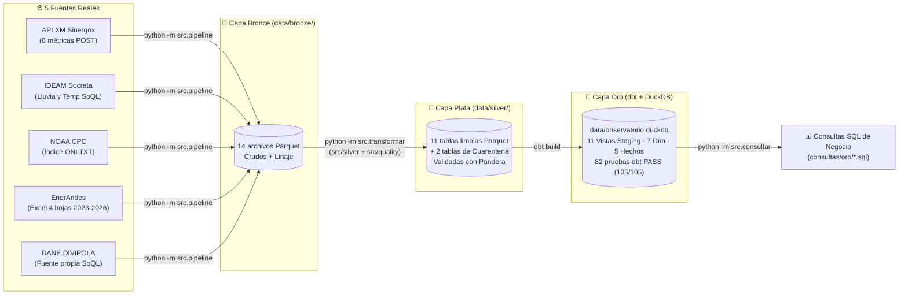

# Observatorio Energía y Clima Colombia – Capas Bronce, Plata y Oro (EA2)

> **Proyecto Integrado IV – Integración de Información (ISD-44)** · IU Digital de Antioquia · 2026-2

---

## 👥 Integrante y Video de Sustentación

| Nombre | Usuario GitHub | Rol (EA1 – EA2) | Bitácora | Video de Sustentación (EA2) |
|---|---|---|---|---|
| **César Puentes** | [`CesarPuentes`](https://github.com/CesarPuentes) | Data Engineer · Data Quality Analyst · Analytics Engineer · BI Analyst | [`docs/bitacoras/puentes_cesar.md`](docs/bitacoras/puentes_cesar.md) | *(Enlace al video en comentarios de entrega / repositorio)* |

---

## 🏗️ Arquitectura Medallion (Bronce → Plata → Oro)



---

## ⚙️ Cómo Ejecutar el Proyecto desde Cero

### 1. Crear entorno virtual e instalar dependencias

```bash
uv venv --python python3 .venv
source .venv/bin/activate          # En Windows: .\.venv\Scripts\Activate.ps1
uv pip install -r requirements.txt
```

### 2. Ejecutar el pipeline y construir las capas Plata y Oro con un solo comando

```bash
# 1. Extraer capa bronce (o usar la ya descargada en data/bronze/)
python -m src.pipeline

# 2. Construir Capa Plata (Pandera + Reporte de Calidad) y Capa Oro (dbt build en data/observatorio.duckdb)
python -m src.transformar

# 3. Ejecutar las 5 consultas SQL de negocio sobre el esquema estrella (Capa Oro)
python -m src.consultar --solo-oro

# 4. Ejecutar también una consulta directa con dbt show (como se vio en clase)
dbt show --project-dir dbt --profiles-dir dbt --inline "
select s.segmento, round(sum(f.energia_kwh) / 1000000, 1) as gwh
from {{ ref('fact_ventas_mensual') }} f
join {{ ref('dim_segmento') }} s using (segmento_id)
group by s.segmento order by gwh desc
"

# 5. Ejecutar las 25 pruebas unitarias automáticas (8 de extracción + 17 de limpieza y calidad)
python -m pytest -v
```

---

## ✅ Resumen del Reporte de Calidad (`docs/reporte_calidad.md`)

El pipeline evalúa automáticamente **23 reglas de calidad** antes y después de la limpieza y valida las tablas con los esquemas de **Pandera** ([`src/quality/esquemas.py`](src/quality/esquemas.py)). El detalle completo por fuente se encuentra en [`docs/reporte_calidad.md`](docs/reporte_calidad.md):

| Fuente | Problema principal resuelto | Métrica Antes (Bronce) | Métrica Después (Plata) | Filas en Cuarentena |
|---|---|---|---|---:|
| **EnerAndes** (`enerandes_ventas`) | Encabezados distintos en 4 hojas, filas `TOTAL`/títulos, 4 formatos de fecha (`2024-03`, `mar-24`, `03/2024`, `01/03/2026`), mezcla `kWh`/`MWh`, 32 variantes de municipio, duplicados, `segmento` vacío, `valor_cop` vacío y `energia_kwh` vacía/negativa | 4,184 filas brutas (14 parásitas, 120 duplicadas, 347 en `MWh`, 32 nombres de mpio, 28 sin segmento, 28 sin `valor_cop`, 43 con energía vacía o `< 0`) | **4,007 filas limpias** en 1 sola tabla (`kWh`, `periodo = YYYY-MM`, `divipola` DANE, `segmento = 'No informado'` cuando falta, `valor_cop` nullable, 0 duplicados) | **43** (`enerandes_cuarentena.parquet`: 25 sin energía + 18 con energía `< 0`) |
| **XM** (6 tablas) | 24 columnas horarias (`Hour01`..`Hour24`) como texto, 2.47M de celdas horarias vacías en generación, embalses en fracción `0..1`, 2 duplicados y 10 recursos históricos en `ListadoRecursos` | 352,369 filas anchas + 2,472,918 celdas nulas + 2 duplicados en catálogo | **5,988,144 filas tipadas** (`xm_precio_bolsa`: 24,096; `xm_demanda`: 24,096; `xm_generacion_recurso`: 5,935,449; `xm_embalses`: 1,004; `xm_aportes`: 1,004; `xm_listado_recursos`: 2,501) | **0** |
| **IDEAM** (2 tablas) | Fechas y métricas en texto, municipios sin código DANE (`SAN VICENTE`) y 7 lecturas extremas (`> 500 mm/día`, hasta `3,081.8 mm`) por volcado acumulado del sensor | 47,153 filas en texto + 7 extremos físicamente imposibles | **47,146 filas limpias** (`ideam_precipitacion`: 29,797 en `[0, 500] mm`; `ideam_temperatura`: 17,349) con `cod_mpio` DANE | **7** (`ideam_cuarentena.parquet`) |
| **NOAA** (`noaa_oni`) | Trimestres móviles (`DJF`..`NDJ`) en texto sin fecha mensual ni clasificación ENSO | 920 trimestres en texto | **920 meses** con `fecha` (`YYYY-MM-01`), `oni` (`float64`) y `fase_enso` (`El Niño`: 272, `La Niña`: 248, `Neutral`: 400) | **0** |
| **DANE DIVIPOLA** (`dane_divipola`) | Coordenadas `latitud` y `longitud` como texto con coma decimal (`6,246631`) | 1,122 filas con coma decimal en `str` | **1,122 municipios únicos** con coordenadas `float64` validadas | **0** |

---

## ⭐ Esquema Estrella en `dbt` + DuckDB (Capa Oro)

El proyecto [`dbt/`](dbt/) organiza los modelos en dos capas (`staging` como `view` y `marts` como `table` dentro de `data/observatorio.duckdb`):
- **Modelo Dimensional y Grano:** [`docs/modelo_dimensional.md`](docs/modelo_dimensional.md)
- **Diccionario de Datos:** [`docs/diccionario_datos.md`](docs/diccionario_datos.md)

| Modelo en `dbt/models/marts/` | Tipo | Grano Declarado | Filas en Oro |
|---|---|---|---:|
| `dim_mes` | Dimensión | 1 fila por `periodo` mensual (`YYYY-MM`) observado en EnerAndes (2023–2026) con `anio`, `mes`, `trimestre`, `oni` y `fase_enso` | 45 |
| `dim_fecha` | Dimensión | 1 fila por día calendario (`2023-01-01` a `2026-12-31`) con mes, trimestre, día de la semana, `oni` y `fase_enso` | 1,461 |
| `dim_hora` | Dimensión | 1 fila por hora del día (`1` a `24`) con franja horaria y tipo de demanda (`Pico`, `Valle`, `Intermedia`) | 24 |
| `dim_municipio` | Dimensión | 1 fila por municipio oficial de Colombia en DANE DIVIPOLA (`divipola` / `cod_mpio`) | 1,122 |
| `dim_segmento` | Dimensión | 1 fila por combinación de `segmento` (`Residencial`, `Comercial`, `Industrial`, `No informado`) y `tipo_compra` (`Contrato`, `Bolsa`) | 8 |
| `dim_recurso` | Dimensión | 1 fila por planta o recurso generador del SIN (`codigo_recurso` de `ListadoRecursos`) | 2,501 |
| `dim_estacion` | Dimensión | 1 fila por estación hidrometeorológica del IDEAM en Antioquia (`codigo_estacion`) | 73 |
| `fact_ventas_mensual` | Hecho | 1 fila por mes (`periodo`), municipio (`divipola`) y segmento/modalidad (`segmento_id`) en 2023–2026 | 4,007 |
| `fact_mercado_horario` | Hecho | 1 fila por `fecha` y `hora` (`1..24`) con precio de bolsa, demanda real y generación total | 24,096 |
| `fact_generacion_recurso` | Hecho | 1 fila por `fecha`, `hora` (`1..24`) y planta generadora (`codigo_recurso`) | 5,935,449 |
| `fact_hidrologia_diaria` | Hecho | 1 fila por `fecha` diaria con volumen útil de embalses (%) y aportes hídricos (kWh / GWh) | 1,004 |
| `fact_clima_diario` | Hecho | 1 fila por `fecha` y estación del IDEAM (`codigo_estacion`) con lluvia y temperaturas diarias | 30,271 |

---

## 📊 Resultados de las Consultas SQL sobre la Capa Oro (`consultas/oro/`)

Al ejecutar `python -m src.consultar --solo-oro`, se obtienen los siguientes resultados directamente desde `data/observatorio.duckdb`:

### Consulta 1: Riesgo Hídrico y Clima (ENSO) → Precio de Bolsa ([`01_enso_hidrologia_y_precio.sql`](consultas/oro/01_enso_hidrologia_y_precio.sql))

| `fase_enso` | `dias_operacion` | `oni_promedio_c` | `embalses_volumen_util_pct` | `aportes_hidricos_gwh_dia` | `precio_bolsa_promedio_cop_kwh` | `precio_bolsa_max_dia_cop_kwh` | `demanda_promedio_gwh_dia` |
|---|---:|---:|---:|---:|---:|---:|---:|
| **El Niño** | 274 | 1.53 | 61.91 % | 143.29 | **663.0** | 1,234.7 | 235.72 |
| **Neutral** | 638 | -0.10 | 64.07 % | 228.26 | **413.8** | 2,498.8 | 227.42 |
| **La Niña** | 92 | -0.59 | 83.45 % | 215.53 | **222.8** | 438.3 | 231.61 |

> **Hallazgo:** Durante **El Niño**, los aportes hídricos caen a **143.29 GWh/día** (-37 % frente a Neutral), el volumen útil de los embalses baja en promedio a **61.91 %** (vs. **83.45 %** en La Niña) y el precio promedio de bolsa casi se triplica (**663.0 COP/kWh** vs. **222.8 COP/kWh** en La Niña).

### Consulta 2: Matriz de Generación por Fase ENSO ([`02_matriz_generacion_por_fase_enso.sql`](consultas/oro/02_matriz_generacion_por_fase_enso.sql))

| `fase_enso` | `tipo_generacion` | `generacion_gwh` | `participacion_pct` |
|---|---|---:|---:|
| **El Niño** | `HIDRAULICA` | 40,916.0 | **62.50 %** |
| **El Niño** | `TERMICA` | 19,674.5 | **30.05 %** |
| **El Niño** | `SOLAR` | 4,056.4 | **6.20 %** |
| **Neutral** | `HIDRAULICA` | 111,576.2 | **75.89 %** |
| **Neutral** | `TERMICA` | 26,049.3 | **17.72 %** |
| **Neutral** | `SOLAR` | 7,682.7 | **5.23 %** |
| **La Niña** | `HIDRAULICA` | 17,629.8 | **81.56 %** |
| **La Niña** | `TERMICA` | 2,467.4 | **11.41 %** |
| **La Niña** | `SOLAR` | 1,261.3 | **5.84 %** |

> **Hallazgo:** La generación térmica pasa de representar el **11.41 %** en La Niña al **30.05 %** en El Niño, mientras que la generación hidráulica cae del **81.56 %** al **62.50 %**, explicando el encarecimiento marginal del precio en bolsa.

### Consulta 3: Patrón Horario de Demanda y Precio Pico ([`03_patron_horario_demanda_y_precio.sql`](consultas/oro/03_patron_horario_demanda_y_precio.sql))

| `hora` | `franja_horaria` | `periodo_dia` | `tipo_franja_demanda` | `demanda_media_mwh` | `demanda_max_mwh` | `precio_bolsa_medio_cop_kwh` |
|---:|---|---|---|---:|---:|---:|
| **20** | `19:00 - 20:00` | Noche | **Pico** | **10,909.2** | 12,644.2 | **658.9** |
| **19** | `18:00 - 19:00` | Noche | **Pico** | **10,752.3** | 12,463.3 | **611.3** |
| **21** | `20:00 - 21:00` | Noche | **Pico** | **10,690.8** | 12,414.4 | **584.6** |
| **16** | `15:00 - 16:00` | Tarde | Intermedia | 10,446.3 | 12,330.1 | 490.5 |
| **15** | `14:00 - 15:00` | Tarde | Intermedia | 10,439.3 | 12,287.9 | 470.6 |

> **Hallazgo:** La hora pico del sistema eléctrico colombiano es la **Hora 20 (`19:00 - 20:00`)**, con una demanda media de **10,909.2 MWh** y el precio medio más alto del día (**658.9 COP/kWh**), coincidiendo con la salida de la generación solar y el pico residencial nocturno.

### Consulta 4: Exposición a Bolsa por Municipio en EnerAndes ([`04_impacto_exposicion_bolsa_enerandes.sql`](consultas/oro/04_impacto_exposicion_bolsa_enerandes.sql))

| `cod_mpio` | `municipio` | `energia_total_gwh` | `energia_bolsa_gwh` | `pct_exposicion_bolsa` | `tarifa_media_bolsa_cop_kwh` | `tarifa_media_contrato_cop_kwh` |
|---|---|---:|---:|---:|---:|---:|
| `05001` | **MEDELLÍN** | 1,244.69 | **275.34** | 22.1 % | 1,005.2 | 1,003.7 |
| `05088` | **BELLO** | 320.21 | **71.37** | 22.3 % | 1,001.3 | 1,005.0 |
| `05360` | **ITAGÜÍ** | 241.00 | **53.75** | 22.3 % | 1,001.5 | 1,002.6 |
| `05266` | **ENVIGADO** | 213.85 | **48.87** | 22.9 % | 1,002.3 | 1,001.7 |
| `05615` | **RIONEGRO** | 150.76 | **33.16** | 22.0 % | 1,002.1 | 1,002.4 |

### Consulta 5: Cruce Clima Local (IDEAM) + DIVIPOLA + Ventas EnerAndes ([`05_clima_antioquia_vs_ventas_municipios.sql`](consultas/oro/05_clima_antioquia_vs_ventas_municipios.sql))

| `cod_mpio` | `municipio` | `meses_con_cruce` | `lluvia_promedio_mes_mm` | `temp_media_c` | `energia_vendida_gwh` | `facturacion_total_mm_cop` |
|---|---|---:|---:|---:|---:|---:|
| `05001` | **MEDELLÍN** | 19 | 505.2 | 17.88 °C | 547.23 | 592,302.2 |
| `05088` | **BELLO** | 19 | 0.1 | 22.57 °C | 140.48 | 150,415.7 |
| `05615` | **RIONEGRO** | 19 | 784.6 | 17.88 °C | 64.64 | 69,957.0 |
| `05129` | **CALDAS** | 19 | 229.6 | 18.06 °C | 26.86 | 28,998.5 |
| `05154` | **CAUCASIA** | 19 | 542.9 | — | 26.32 | 28,192.1 |
| `05837` | **TURBO** | 8 | 252.3 | 27.50 °C | 14.07 | 15,380.4 |
| `05042` | **SANTA FÉ DE ANTIOQUIA** | 18 | 138.4 | 26.15 °C | 10.17 | 11,015.5 |

---

## 📚 Documentación Completa del Proyecto

- **Perfilamiento Capa Bronce (EA1):** [`docs/perfilamiento.md`](docs/perfilamiento.md)
- **Reporte de Calidad Capa Plata (EA2):** [`docs/reporte_calidad.md`](docs/reporte_calidad.md)
- **Modelo Dimensional Estrella (EA2):** [`docs/modelo_dimensional.md`](docs/modelo_dimensional.md)
- **Diccionario de Datos Capa Oro (EA2):** [`docs/diccionario_datos.md`](docs/diccionario_datos.md)
- **Bitácora Individual:** [`docs/bitacoras/puentes_cesar.md`](docs/bitacoras/puentes_cesar.md)
- **Declaración de Uso de IA:** Se empleó asistente de IA en el IDE como apoyo en la estructuración de esquemas Pandera, modelos SQL de `dbt` y documentación técnica; todas las reglas, transformaciones y resultados fueron verificados contra los datos reales del proyecto.
